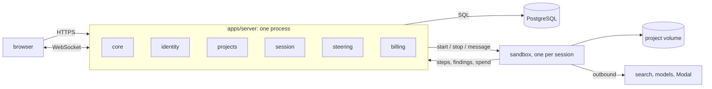

<div align="center">
  <picture>
    <source media="(prefers-color-scheme: dark)" srcset="apps/web/public/logo-dark.png">
    
  </picture>

  <br>

[](https://github.com/ziyangliu-666/lumen-next/actions/workflows/ci.yml)
[](package.json)
[](tsconfig.base.json)

</div>

# Lumen

> Automated research you can watch, steer and redirect while it works.

Give Lumen a research question. A team of AI agents divides the work, searching
sources and running computations, and the whole run appears live as a call tree.
Open any node to read its steps, send a message to a running task, or change the
direction of the investigation.

Lumen is the SWE5006 practice-module project of Team 1.

## Features

- **Live call tree.** Tasks, delegations and steps stream to the browser over
  WebSocket. Cost rolls up from every child task to its parent.
- **Steering.** Send a message to any running task and choose when it lands: at the
  next step or at the end of the turn.
- **Findings.** Agents record what they discover, linked to the task that produced it.
- **Spend control.** A monthly cap per account, owner approval for work that would
  exceed it, a wallet ledger, and Stripe top-ups.
- **Your own model key.** Store an OpenAI key, encrypted at rest, and your runs use it.
- **Accounts.** Sign in with GitHub, Google, or email and password. Staff manage roles
  and suspensions from the admin console.

## Quick start

Prerequisites: [Node.js](https://nodejs.org) 22 or later.

```bash
git clone https://github.com/ziyangliu-666/lumen-next.git
cd lumen-next
npm install
npm run build
node apps/server/dist/main.js
```

Open <http://localhost:4000>. With no database configured, Lumen keeps everything in
memory, which is all you need to explore the interface.

## Development

Prerequisites: Node.js 22 or later and [Docker](https://www.docker.com) for the local
PostgreSQL.

```bash
cp .env.example .env
docker compose up -d db                          # PostgreSQL 17 on :5432
npm run build                                    # builds the contracts, server and web app
node --env-file=.env apps/server/dist/main.js    # API and WebSocket on :4000
npm run dev --workspace @lumen/web               # web app on :4173, proxies /api and /ws
```

Open <http://localhost:4173>. The server applies database migrations on startup.
After changing server code, rebuild it with `npm run build --workspace @lumen/server`.

One command runs every check:

```bash
npm run verify    # format, lint, strict typecheck, tests, coverage
```

Database tests run whenever `DATABASE_URL` is set.

## Configuration

Copy `.env.example` to `.env`. Every variable is documented there. The ones you will
reach for first:

| Variable                                           | Purpose                                                             |
| -------------------------------------------------- | ------------------------------------------------------------------- |
| `DATABASE_URL`                                     | PostgreSQL connection string. Unset, Lumen runs in memory.          |
| `LUMEN_PORT`                                       | Server port. Defaults to `4000`.                                    |
| `LUMEN_ORIGIN`                                     | The exact origin the browser uses. Requests that change data must send it. |
| `LUMEN_MODEL_PROVIDER`, `LUMEN_MODEL`              | The language model behind the agents: `openai`, `deepseek` or `none`. |
| `OPENAI_API_KEY`, `DEEPSEEK_API_KEY`               | Provider credentials.                                               |
| `GITHUB_OAUTH_CLIENT_ID`, `GOOGLE_OAUTH_CLIENT_ID` | Enable GitHub and Google sign-in (each with its `_SECRET`).         |
| `BILLING_SECRET_KEYRING`, `BILLING_SECRET_ACTIVE_KEY_ID` | Enable stored personal API keys. The keyring is a JSON object mapping key ids to base64-encoded 32-byte keys. |
| `STRIPE_SECRET_KEY`, `STRIPE_WEBHOOK_SECRET`       | Enable Stripe test-mode top-ups.                                    |
| `LUMEN_LOG_LEVEL`                                  | `trace` to `fatal`, or `silent`. See [docs/LOGGING.md](docs/LOGGING.md). |

## Architecture

Lumen is a monolith: one Node.js process, one PostgreSQL database, and modules that
call each other in-process. The React single-page app is served by the same process.



- A **task** is one agent context window. A session's own run is the root task, and a
  delegation opens a child task.
- Cost rolls up from child tasks to their parent.
- The worker reaches the database only through the server.

The code is cut into vertical slices. A slice owns its pages, its server module and its
tables, from the screen to the database. A slice imports `core` and the public index of
other slices (`modules/<name>`), and `core` imports no slice.

| Slice    | Owner                                   | Server module | Pages                  |
| -------- | --------------------------------------- | ------------- | ---------------------- |
| identity | LU YI ([@youayouly])                    | `identity`    | Sign in, Account       |
| projects | PENG XUJIAN ([@kita80387694])           | `projects`    | Landing, Home          |
| session  | LIU ZIYANG ([@ziyangliu-666])           | `session`     | Session                |
| steering | LI ZHUOYANG ([@AyinLee987])             | `steering`    | Session (composer, files) |
| billing  | HE RONG ([@Darrenus])                   | `billing`     | Wallet, Keys, Admin    |

[@youayouly]: https://github.com/youayouly
[@kita80387694]: https://github.com/kita80387694
[@ziyangliu-666]: https://github.com/ziyangliu-666
[@AyinLee987]: https://github.com/AyinLee987
[@Darrenus]: https://github.com/Darrenus

## Repository layout

```
.
├── apps
│   ├── server                 Node.js backend (Fastify, PostgreSQL)
│   │   └── src
│   │       ├── core           Domain model, event broker, database, HTTP, auth guard
│   │       └── modules        One directory per slice: identity, projects,
│   │                          session, steering, billing
│   └── web                    React 19 frontend (Vite, Tailwind CSS, shadcn/ui)
│       └── src
│           ├── core           App shell, router, API client
│           ├── ui             Shared components
│           ├── styles         Theme tokens
│           └── pages          One directory per page
├── packages
│   └── contracts              Event protocol and data types shared by server and web
├── docs                       Architecture, standards and design documents
├── deploy                     Fly.io deployment configuration
├── reports                    Review workstream records
└── .github/workflows          CI, security scans and deployment
```

## Documentation

| Document                                          | Contents                                                |
| ------------------------------------------------- | ------------------------------------------------------- |
| [docs/ARCHITECTURE.md](docs/ARCHITECTURE.md)      | System design, data model, shared types and interfaces  |
| [docs/SLICES.md](docs/SLICES.md)                  | The scope and boundaries of every slice                 |
| [docs/CODING_STANDARDS.md](docs/CODING_STANDARDS.md) | Code conventions                                     |
| [docs/UI.md](docs/UI.md)                          | The web app's design system                             |
| [docs/DOD.md](docs/DOD.md)                        | Definition of done                                      |
| [docs/LOGGING.md](docs/LOGGING.md)                | Logging conventions and levels                          |
| [CODEOWNERS](CODEOWNERS)                          | Which directory belongs to whom                         |

Each server module also carries its own `README.md` in `apps/server/src/modules/<slice>/`.

## Deployment

Staging runs at <https://lumen-next-staging.fly.dev>. Every merge to `main` runs the
Deploy workflow, which scans the build with DAST and ships the same image to Fly.io.
The configuration lives in [`fly.toml`](fly.toml), [`deploy/fly/`](deploy/fly) and the
[`Dockerfile`](Dockerfile).

## Contributing

1. Branch from `main` as `<slice>/<topic>`.
2. Commit with [Conventional Commits](https://www.conventionalcommits.org), for example
   `feat(session): stream step content`.
3. Make `npm run verify` pass.
4. Open a pull request. CI, CodeQL and the dependency audit run automatically, and the
   owner of every touched slice reviews it ([CODEOWNERS](CODEOWNERS)).

Read [docs/CODING_STANDARDS.md](docs/CODING_STANDARDS.md) and
[docs/DOD.md](docs/DOD.md) before your first pull request. Code, comments, commit
messages and documentation are written in English.
