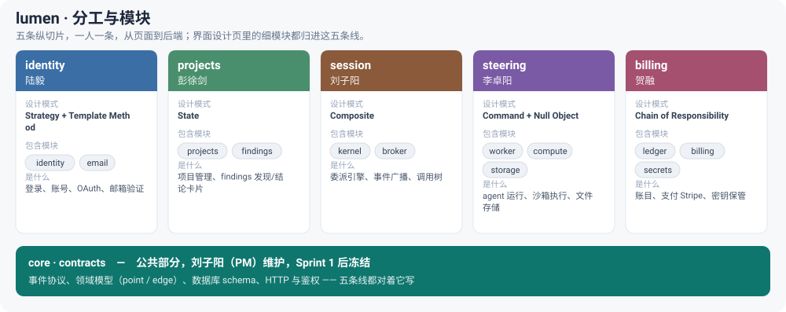

# lumen

一个网页应用：多个 AI agent 互相委派任务，它们之间的调用关系实时画成一张图。
你可以点进任意一个节点看它在干什么，也能中途插话、改它的方向。这是我们 SWE5006
实践模块的项目，Team 1。

一个核心概念：一个 point，就是一个 agent 上下文窗口的完整生命周期。每开一个新
窗口（新会话、一次委派、窗口写满被压缩……），图上就多一个 point，其它情况都不会
新增节点。

## 架构

后端是一个单体：一个进程、一个 Postgres 数据库，模块之间在进程内直接调用，不走
网络、不拆微服务。前端是一个 React 单页应用。

代码按功能垂直切分，一人负责一条完整的功能线——从页面一直写到后端，而不是分成
前端组和后端组。

```
packages/contracts   前后端共用的事件协议和数据类型（第一个 sprint 之后锁定）
apps/server          后端单体
  src/core           领域模型、事件广播、数据库、HTTP —— 公共部分，PM 维护
  src/modules        每条功能线一个目录，各有一个负责人
apps/web             React 前端，每个页面一个目录
```

## 谁负责什么



界面设计（每个屏幕标了归属）：线上 [ziy.bio/lumen-specs](https://ziy.bio/lumen-specs/)，源文件在 [docs/spec/index.html](docs/spec/index.html)。

新人先看 [docs/ONBOARDING.md](docs/ONBOARDING.md)，讲的是怎么配合 agent 干活。
每条功能线的具体边界看 [docs/SLICES.md](docs/SLICES.md)，怎样算做完看
[docs/DOD.md](docs/DOD.md)，代码规范看
[docs/CODING_STANDARDS.md](docs/CODING_STANDARDS.md)，哪个目录归谁看
[CODEOWNERS](CODEOWNERS)。

## 本地跑起来

```bash
npm install
docker compose up -d db          # 起一个本地 Postgres
npm run verify                   # 一条命令跑完：格式化、lint、类型检查、测试、覆盖率
npm run dev --workspace @lumen/server
npm run dev --workspace @lumen/web
```

需要 Node 22 以上。把 `.env.example` 复制成 `.env`，填上你这条线要用的密钥。

## 怎么协作

两周一个 sprint，每个 sprint 结束交一份进度报告。从第一个 sprint 起，每个 PR 都会
自动跑 CI、CD 和安全扫描。代码想合进主干，得先过对应负责人的 review，而且 CI 全绿。
