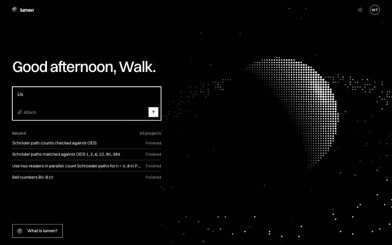
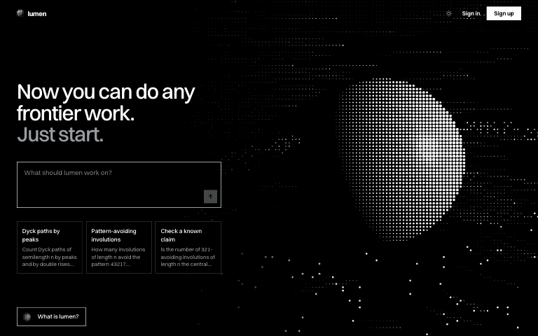

<div align="center">
  <picture>
    <source media="(prefers-color-scheme: dark)" srcset="apps/web/public/logo-dark.png">
    
  </picture>
</div>

# lumen

An AI that does research in mathematics on its own, and lets you watch and
steer it while it works.

<p align="center">
  
</p>

## How it works

<table>
  <tr>
    <td width="50%"></td>
    <td width="50%"></td>
  </tr>
</table>

## Features

- **Parallel agents.** A lead splits the work among readers; every step and its
  cost streams to the browser live.
- **Literature search.** arXiv, OpenAlex and the OEIS, with links to every source.
- **Real computation.** Python (NumPy, SymPy, NetworkX, Matplotlib) in a Docker
  sandbox with no network; files the agents keep stay with the project.
- **Steer, stop, edit.** Message a running task, stop it, or edit your last
  message and run it again.
- **Your models.** Any OpenAI-compatible API (OpenAI, DeepSeek and others); pick
  the model per turn, or bring your own key.
- **Accounts and spend.** GitHub, Google or email sign-in; a spend cap with
  approvals; Stripe top-ups.

<p align="center">
  
</p>

## Quick start

Requires Node.js 22 or later.

```bash
npm install
npm run build
node apps/server/dist/main.js
```

Open <http://localhost:4000>. Without a database or a model key, lumen runs in
memory with a demo agent. For the real agents:

```bash
OPENAI_API_KEY=sk-... LUMEN_MODEL_PROVIDER=openai LUMEN_WORKER=steering \
LUMEN_COMPUTE_PROVIDER=docker node apps/server/dist/main.js
```

## Development

Requires Node.js 22 or later and Docker.

```bash
cp .env.example .env
docker compose up -d db                  # PostgreSQL on :5432
npm run dev --workspace @lumen/server    # API and WebSocket on :4000
npm run dev --workspace @lumen/web       # web app on :4173
npm run verify                           # format, lint, typecheck, tests
```

Settings: [`.env.example`](.env.example). GitHub and Google sign-in:
[docs/oauth.md](docs/oauth.md). Email: [docs/mail.md](docs/mail.md).

## Architecture

One Node.js process (Fastify) serves the API, a WebSocket event stream and the
React app, with PostgreSQL behind it.

```
apps/server     core (events, database, HTTP) and one module per slice:
                identity, projects, session, steering, billing
apps/web        React 19, Vite, Tailwind CSS, shadcn/ui
packages/contracts   types and events shared by server and web
deploy          the container entrypoint and the sandbox's Python packages
```

## Contributing

Make `npm run verify` pass and use
[Conventional Commits](https://www.conventionalcommits.org). Security issues:
[SECURITY.md](SECURITY.md).

## License

[AGPL-3.0](LICENSE)
