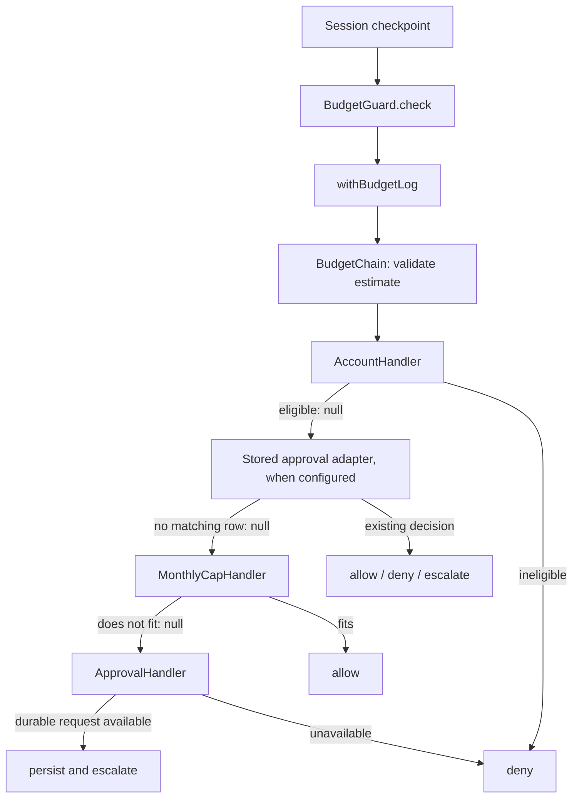

# Budget policy: Chain of Responsibility

Owner: HE RONG. Sprint 4 report evidence, started 11 October 2026.
This documents the existing implementation; it does not claim a new runtime
refactor or completion of Sprint 4. Core closed Billing Sprint 3 acceptance by
[waiving the dashboard replay on 12 October](https://github.com/ziyangliu-666/lumen-next/pull/66#issuecomment-6116352309);
no dashboard replay was performed or is claimed.

## Design problem

Session checks permission before a turn, fan-out and task opening. Eligibility,
existing approval decisions and the spending cap all affect the answer. Copying
those rules into each checkpoint makes policy changes require several edits and
risks different answers for the same operation.

The caller needs one `BudgetGuard.check(Charge)` returning allow, deny or escalate.
It should not know Identity's account storage, Billing's SQL or approval delivery.

## Before: illustrative conditional implementation

This is a comparison model, not a claim that this code was once shipped. Each
checkpoint could repeat the following logic. The SQL-backed `fits` operation
still owns money addition and comparison; even the comparison model must not
move that arithmetic into JavaScript.

```text
validate estimate
if account cannot spend: deny
if a stored approval decides this attempt: return that decision
if SQL says the estimate fits: allow
if durable approvals are available: persist request and escalate
deny
```

A shared conditional function would remove duplication, but adding a policy
would still edit that function's decision tree. The responsibility chain makes
the ordered policies independently testable and replaceable at composition.

## After: the implementation on main



Without durable approval configuration the stored-approval adapter is omitted.
`MonthlyCapHandler` retains a historical name: it checks all-time spend against
a flat account cap, without a monthly reset.

| Pattern role | Actual implementation |
| --- | --- |
| Client-facing contract | `BudgetGuard` and `Charge` in core/domain/budget.ts |
| Ordered dispatcher | `BudgetChain` in [budgetChain.ts](budgetChain.ts) |
| Handler contract | `BudgetHandler.handle(): Promise<Decision \| null>` |
| Concrete policies | `AccountHandler`, `MonthlyCapHandler`, `ApprovalHandler` |
| Stored decision adapter | Object implementing `handle`, assembled in [index.ts](index.ts), delegates to `Approvals.check` |
| Composition | `createBillingSlice` assembles the policies; app.ts supplies the guard to Session |
| Observation | [budgetLog.ts](budgetLog.ts) wraps the guard without changing decisions |

The chain owns traversal through an array rather than each handler holding a
`next` pointer. Both represent ordered responsibility passing. `null` means
continue; **any** decision stops traversal, including allow. An exhausted or
empty chain denies, and thrown storage errors propagate rather than allowing.

## Why the order matters

1. Validate the estimate before any policy can allow it.
2. Check eligibility before consulting an approval: approval cannot authorize
   a suspended or deleted account.
3. Check stored decisions before the cap: a rejected operation stays rejected
   even if its owner raises the cap. A valid consumed approval authorizes only
   its bound attempt, including the defined fan-out child checks.
4. Ask SQL whether the unapproved charge fits. Positive estimates use exact
   numeric addition/comparison; zero means unknown cost and requires room.
5. Persist an approval when no earlier policy accepts. Missing durable approval
   dependencies produce a denial rather than an invented approval identifier.

New mandatory restrictions belong before any policy that can allow. The pattern
permits extension, but does not make arbitrary reordering safe. A new checkpoint
also needs a core contract/caller change; the chain does not add callers itself.

## Alternatives and tradeoffs

| Option | Fit for this problem |
| --- | --- |
| Shared conditional function | Simple for a fixed small policy; additions change its decision tree. Valid baseline, not inherently incorrect. |
| Strategy | Suits choosing one alternative algorithm. Here multiple ordered policies cooperate to answer one request. |
| Chain of Responsibility | Models pass-on versus final decision directly; adds indirection and requires explicit ordering tests. |

SQL persistence, Identity locks and session resumption solve separate problems.
The chain alone guarantees neither transaction atomicity nor exactly-once work.
It does not reserve budget: concurrent checks and already-running steps can
overshoot. An approval does not raise the cap or create ledger spend.

## Test evidence and demonstration

| Claim | Existing executable evidence |
| --- | --- |
| Ordered dispatch, first decision wins, empty/exhausted denial | [budgetChain.test.ts](budgetChain.test.ts) |
| A fourth policy changes behavior without changing the guard caller | The extension case in `budgetChain.test.ts` |
| Eligibility first; invalid estimates and storage failures never become allow | `budgetChain.test.ts` |
| Decimal boundaries are evaluated in PostgreSQL | [ledger.test.ts](ledger.test.ts) |
| Real composition gates work at checkpoints | [app.test.ts](../../app.test.ts) |
| Waiting survives restart; grant resumes once; rejection wins despite cap increase | [approvalFlow.test.ts](../../approvalFlow.test.ts) |
| Decisions are logged without leaking charge text or changing error behavior | [budgetLog.test.ts](budgetLog.test.ts) |

For the report demonstration, run the extension test first, then the composed
approval flow with PostgreSQL. Explain the unchanged caller and changed chain,
then show why durable storage and the session resume port are still necessary.
The full submission gate remains `npm run verify` with DATABASE_URL set, plus
owner review and CI. This document introduces no new runtime behavior.

## Remaining Sprint 4 work

- Audit integration and hardening gaps against the agreed public ports; record
  concrete findings before choosing changes rather than rewriting working code.
- Incorporate reviewed test results and this comparison into HE RONG's final
  report and presentation, using the team's agreed deliverable format.
- Preserve the explicit Stripe replay waiver and track live Keys/provider
  acceptance separately; synthetic tests are not hosted observations.

This is an initial evidence contribution, not a claim that the team's report,
presentation or all integration acceptance is finished.
