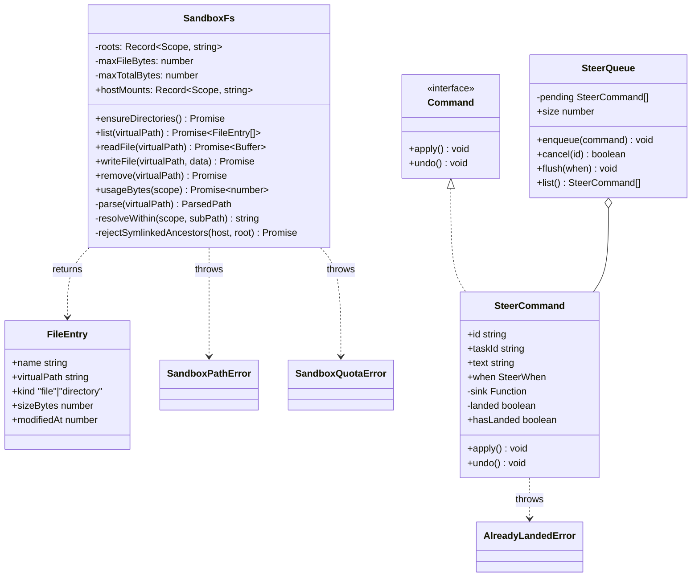
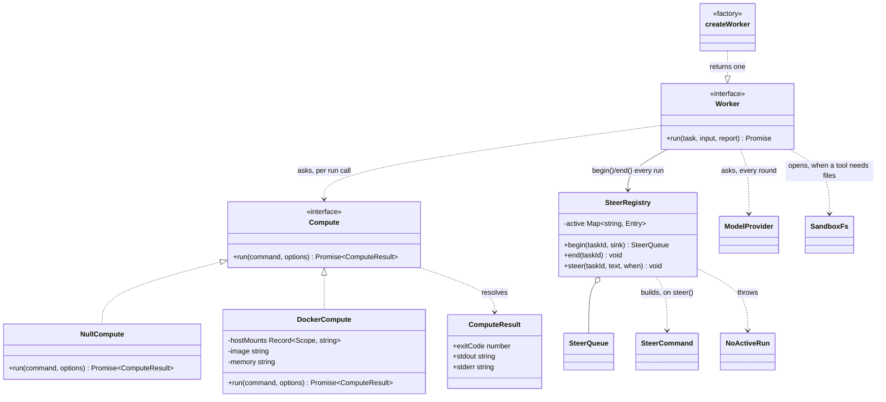

# steering — design doc: the sandbox, the steer queue, and the agent loop

**Slice:** `steering` (owner: LI ZHUOYANG) · **Use case:** UC4 — steer a running session, run a command
**Status:** All of UC4 has a first, real (not demo) implementation and is wired end to end · branch `steering/sandbox-foundations`, rebased on main 22 Sep
**Source:** `sandboxFs.ts`, `steerCommand.ts`, `steerRegistry.ts`, `compute.ts`, `worker.ts`, `routes.ts`, `commands.ts`, `index.ts` (each with a `.test.ts`)

Built in the order each piece needed the last: `SandboxFs` before `DockerCompute`
(compute binds `SandboxFs.hostMounts`); `SteerCommand`/`SteerQueue` before
`SteerRegistry` (the registry is what lets a `task.steer` arriving on the
broker find the right queue); both before `worker.ts`, which is the first
thing in the slice that uses all of it at once.

## 1. Scope

| Piece | File | What it owns |
|---|---|---|
| `SandboxFs` | `sandboxFs.ts` | Translates the agent's flat `/mnt/{upload,workspace,output}` view into real host paths, and refuses anything that would escape them. |
| `SteerCommand` / `SteerQueue` | `steerCommand.ts` | Queues a user's mid-turn message and applies it at a chosen moment; cancellable before it lands. |
| `Compute` / `NullCompute` / `DockerCompute` | `compute.ts` | Runs one command somewhere — nowhere, or a locked-down container — behind one interface. |
| `SteerRegistry` | `steerRegistry.ts` | The seam between a `task.steer` arriving at any moment and the one running turn it must land in. |
| The worker | `worker.ts` | The `Worker` implementation: a tool-calling loop over `core/model`'s `ModelProvider`. A lead delegates to readers; a reader runs commands and reads and writes files in its sandbox. |
| The files routes | `routes.ts` | `GET /api/projects/:id/files`, `GET /api/projects/:id/files/*`. |
| `task.steer` | `commands.ts` | The broker command a landed steer arrives as. |

Not in this piece of work: `steer.cancel` (not in the frozen contract), the
composer's attach button, a model.

## 2. Use case flow

**Sandbox file access (UC4, file part).** An agent inside a session's
container addresses files only through `/mnt/upload`, `/mnt/workspace`,
`/mnt/output` — it never sees a host path.

1. Agent (or, until wiring lands, a caller acting on its behalf) requests a
   file operation with a virtual path, e.g. `readFile('/mnt/workspace/notes.md')`.
2. `SandboxFs.parse` splits the path into `{scope, subPath}` and resolves it
   against the scope's host root (`resolveWithin`).
3. Every path segment is validated: no `.`/`..`, no illegal or reserved
   characters, no trailing dot/space, and the final resolved path must still
   sit under the scope root.
4. `rejectSymlinkedAncestors` walks the real filesystem from the scope root
   down to the target, failing closed on the first symlink found.
5. `writeFile` additionally rejects `upload` (agent-read-only) and checks the
   per-file and per-project quota before touching disk.
6. Only then does the real `fs/promises` call run.

**Steering a running turn (UC4, steer part), now end to end.**

1. The browser sends `task.steer { taskId, text, when }` on the socket.
   `commands.ts` resolves the task's session (`session.projects.taskSession`)
   and the session's owner (`session.projects.context`) and refuses — same
   404 whether the task is unknown or somebody else's — unless the caller
   owns it or is staff. wsBridge.ts's own comment is explicit that this check
   is steering's to make: a `taskId` travels under the session-level check
   every other command gets.
2. `SteerRegistry.steer` looks up the queue for that task's *current run* —
   `worker.ts` registers one at the top of `Worker.run` and drops it at the
   end — and enqueues a `SteerCommand` there. No active run for that task id
   (it isn't running right now) throws `NoActiveRun`, caught and swallowed:
   there is no `steer.queued`/`steer.landed` event in the contract yet to
   explain that to the browser, and the composer only offers this control
   while the task is shown as running.
3. Before every model call the worker flushes `'next-step'`. Every queued
   command whose `when` matches is applied — its `sink` hands the words to
   the run's own inbox — and removed from the queue in the same pass. The
   worker then writes each one, awaited and in order, as a `'you'` step (the
   same kind a fresh turn's words get) and adds it to the conversation as the
   user's next message, so the model reads it on that very call.
   When the model answers without calling a tool, the worker flushes both
   moments before accepting that as the end: if anything landed, what the
   model wrote becomes a thinking step, the steer follows, and the loop goes
   on. `'end-of-turn'` means exactly that — heard when the model would
   otherwise stop. After the run, `end()` is called first (so nothing new can
   arrive) and whatever the queue still holds is written to the trace, not
   dropped.
4. The user may cancel a steer any time before it lands — `SteerQueue.cancel(id)`
   removes it and calls `undo()`. Once landed, `undo()` throws
   `AlreadyLandedError` instead of pretending the delivery can be taken back.
   (Nothing calls `cancel` yet: `steer.cancel` isn't in the frozen contract.)

**Running a command (UC4, the third piece, now real).**

1. `session`'s kernel calls `Worker.run(task, input, report)`. The task is
   one conversation with the model (`ModelProvider.complete`, at most 12
   calls a turn): ask, run the tools it called, hand back what they returned,
   ask again, until it answers in plain text — that answer is the `reply`
   step, carrying the call's cost as its receipt.
2. A `lead` gets `delegate`, `list_files` and `read_file`. `delegate` goes
   through `report.delegate` (the kernel's own machinery — this worker opens
   no tasks itself) and hands the lead back each reader's final answer.
3. A `reader` gets `run`, `list_files`, `read_file`, `write_file` and
   `record_finding`. Its session is resolved to a project (`context`) the
   first time a tool needs files, and every path goes through `SandboxFs`,
   so it passes every check §4 documents. `run` asks
   `compute(provider, sandbox.hostMounts)`; `NullCompute` answers with a
   readable failure, which the model reads like any other result.
4. A tool call the model got wrong (a bad path, a quota, a missing argument,
   a tool it does not have) is said back to it as `error: …` and the turn
   goes on. A model that cannot be reached ends the turn: the reason is
   written as a `reply` step and the task fails.

## 3. Analysis class diagram

**Compute, SteerRegistry, and the worker that uses both:**

## 4. Design problem and pattern

### SteerCommand / SteerQueue — Command

The design problem (proposal §6.4): a user message must be queued and applied
at a chosen moment inside a running turn, and must be cancellable before it
lands.

**Candidates weighed:**

- **Strategy** answers "which algorithm accomplishes this." It would fit if
  *how* a landed steer reaches the worker varied. The actual problem here is
  *when*, not *how* — Strategy has no vocabulary for a moment in time.
- **Null Object** answers "how do we avoid a null the caller must guard."
  Nothing here needs that: a cancelled steer is removed from the queue, not
  replaced with an inert stand-in, and there's no "do nothing" steer. (Null
  Object does earn its place one layer down — a compute provider that does
  nothing, `NullCompute` — just not in this file.)
- **Command** fits because the three things asked for — queue it, apply it
  later, undo it before it lands — are exactly the three things Command gives
  an object: hold state, `apply()`, `undo()`.

**Invariant kept:** a command in `SteerQueue.pending` has never landed.
`flush()` removes a command the instant it applies it, so `cancel()` never
needs a landed-check of its own — finding the command still in the queue *is*
the proof it's still cancellable.

### Compute / NullCompute / DockerCompute — Null Object

The design problem (proposal, and `steerCommand.ts`'s own header, which named
this the day it was written): a worker must run a command somewhere, and a
host with no Docker — most contributors' machines, and this environment —
must not be a special case the worker branches on.

**Candidate considered and set aside:** a `provider: Compute | null` field,
checked with `if (this.provider)` at every call site. Every one of those
checks is a place a worker author can forget the check, and the failure mode
of forgetting is a crash, not a graceful "nothing ran." Two call sites exist
today (`worker.ts`); a model wiring in later adds more, each a fresh chance to
forget.

**Null Object fits** because the interface has exactly one thing a caller
does with it — `run()` — and "no compute available" is answerable *as* a
`Compute`, not as an absence of one: `NullCompute.run()` resolves with the
same `ComputeResult` shape a real run would, `exitCode` nonzero and `stderr`
saying why. `worker.ts` never learns which it got; `compute(provider,
hostMounts)` is the only place that knows, and it is a factory, not a branch
the worker carries.

**Test that proves the reason for it:** `compute.test.ts`'s `NullCompute`
suite asserts it never throws and always answers a `ComputeResult` — the
worker's own tests (`worker.test.ts`) then exercise a full reader run with no
Docker in this environment and no special-case code for it, which is the
point being tested as much as the message.

### SandboxFs — not a GoF pattern; a threat model

This piece isn't structured around a design pattern — it's path arithmetic
plus a filesystem, deliberately kept ignorant of Docker or the agent, so the
interesting cases (traversal, a planted symlink, a reserved Windows name) are
unit-testable without a container. The design work is the threat model:

| Threat | Guard |
|---|---|
| `projectId`/`sessionId` used as path segments | Rejected at construction unless each is a valid UUID |
| `../../etc` traversal | Segments containing `.` or `..` rejected; resolved path must stay under the scope root (`resolveWithin`) |
| Symlink planted inside the agent's own workspace (`ln -s /etc leak`) | `rejectSymlinkedAncestors` walks the real filesystem component by component — a string-only prefix check can't see it, because the string never mentions `/etc` |
| Windows device names / illegal chars / trailing dot-space | `WINDOWS_RESERVED`, `ILLEGAL_SEGMENT_CHARS`, explicit trailing-dot/space check — the team develops on Windows |
| Backslash inside a segment (`evil\..\..\..\x`) | Rejected explicitly, *and* independently caught by the final prefix check on Windows — kept as defense-in-depth, documented as a second layer rather than overclaimed as the sole guard |
| Unbounded file / project size | Per-file (`maxFileBytes`) and per-project (`maxTotalBytes`) checks in `writeFile`, backed by a tree walk in `usageBytes` |
| Agent writing to `upload` | `writeFile`/`remove` reject scope `'upload'` outright — read-only by design |

**Known limitation, stated rather than hidden:** the symlink check is
TOCTOU-imperfect — the link could be swapped between the check and the real
read/write that follows. Closing that fully needs `O_NOFOLLOW` opens, deferred
until this runs against content an attacker controls concurrently rather than
a single agent's own script.

## 5. Testing

- 69 tests in the slice, 62 passing / 7 skipped, 86.8% line coverage
  (`npm run verify` gate is 60%, repo-wide). Full repo: 554 passing / 106
  skipped (the rest need a real Postgres, same as everywhere else in the repo).
- Every check that isn't a plain string/format assertion was verified by
  temporarily removing it and watching the corresponding test fail — notably
  the UUID guard and the backslash-segment guard. The backslash guard turned
  out to be defense-in-depth rather than the sole barrier (the final prefix
  check also catches the Windows escape it produces); the comment in the
  source says so rather than overclaiming.
- Two independent things are skipped, not faked, on a machine that can't do
  them, each probed once and synchronously before Vitest collects the suite:
  a symlink test needs Administrator or Developer Mode on Windows
  (`sandboxFs.test.ts`); a `DockerCompute` test needs a reachable Docker
  daemon (`compute.test.ts`) — true in this environment (`docker info`
  fails: Docker Desktop is installed but not running), so those four cases
  are unverified here and need a machine with Docker running before they
  can be trusted.
- The worker (`worker.test.ts`) is tested against a fake `WorkerReport`, and
  separately, live: built and ran the compiled server, created a real
  project and session, and watched the real `Kernel` accept every step the
  worker wrote (nothing here invents its own validation to satisfy) — lead
  delegates one reader, reader runs, writes its log to the real volume,
  records a finding, both tasks end clean. Also sent `task.steer` over a
  live socket for a finished task (silently ignored, logged, no crash) and
  for another account's task with no session opened on that socket at all
  (refused with `no such task`, logged server-side, nothing sent to the
  caller) — the exact gap wsBridge.ts's own comment says is steering's to
  close.
- Symlink tests are skipped, not faked, when the host can't create a symlink
  (Windows without Administrator or Developer Mode) — probed once,
  synchronously, before Vitest collects the suite.

## 6. Boundary and follow-ups

`index.ts` now exports `createSteeringSlice({ volumeRoot, requireProject })`,
which gives `app.ts` a `registerRoutes` for the two files routes (§7 of
`docs/ARCHITECTURE.md`). (Slice wiring moved from `main.ts` to `app.ts` in
the walking-skeleton rewrite; `main.ts` now only reads the environment and
calls `composeApp`.)

- `GET /api/projects/:id/files?scope=upload|output&path=/sub` — one
  directory's listing (`SandboxFs.list`, non-recursive; the caller pages
  deeper by requesting a subdirectory's `path`).
- `GET /api/projects/:id/files/*` — one file's bytes, wildcard captures
  `<scope>/<subpath>`.

Both are project-scoped and only ever address `upload`/`output` — see the
`SandboxFs` change below.

`createSteeringSlice` also returns `worker` (a `Worker`) and `registerCommands`
(claims `task.steer`), both wired into `app.ts` now too — see below for how
each reaches what it needs from `session` and `projects`, declared as
closures before either exists, the same trick `app.ts` already used for
`session` and `projects` needing each other.

**`SandboxFs`'s `sessionId` is now optional.** The files routes have a
project id but no session id (there is no running sandbox behind a project's
top-level file browser), and the original constructor required both. With no
`sessionId`, `workspace` is simply unreachable — `parse()` refuses it before
it can build a path from a project id alone, and `ensureDirectories()` never
creates the placeholder. This is additive: every existing call site that
passes a `sessionId` is unaffected, and the refusal path has its own test
(`sandboxFs.test.ts`, "SandboxFs: no session").

**A path refusal and a genuinely missing file answer the same way: 404.**
`routes.ts`'s `asHttpError` folds `SandboxPathError` and a plain `ENOENT`
into one `notFound()` — a caller should not be able to tell "that file does
not exist" apart from "that path was rejected as unsafe" by the status code
alone.

**`LUMEN_VOLUME_ROOT` is a new env var** (`.env.example`, read in `main.ts`,
passed through `app.ts`), defaulting to `.data` next to the running server if
unset. `apps/server/.data/` is gitignored.

**The ownership check is closed, not a placeholder.** `projects` landed
`requireProject(principal, projectId)` (throws `notFound` unless `principal`
owns the project) while this slice was on its own branch; `app.ts` wires it
into steering the same way it wires `requireProject` into session's own
routes — `createSteeringSlice({ volumeRoot, requireProject: (p, id) =>
projects.requireProject(p, id) })`. `routes.ts` calls it before touching
`SandboxFs`, same order as session: validate, authorise, then touch disk.
Verified against a real, running server: created a project as one stub
account, confirmed a second account gets 404 on that project's files, not
its contents.

**The worker is built, wired, and off by default.** `app.ts`'s
`createSessionSlice({ worker })` still defaults to `session.demoWorker()`
when neither `worker` nor `useSteeringWorker` is given — deliberately, not
because this worker is unready: `e2e.test.ts` (the test that exists to catch
two slices that no longer fit together) asserts the demo worker's exact
three-reader fan-out and finding count, and that is also what the rest of
the team's staging and local runs have shown since Sprint 1. Flipping that
shared default is a call for the team, not a side effect of this branch.
`LUMEN_WORKER=steering` (or `useSteeringWorker: true` to `composeApp`)
opts in; `worker`, if given, still wins over either default. `steering.
registerCommands(broker)` runs unconditionally either way — claiming
`task.steer` costs nothing when the active worker never calls
`SteerRegistry.begin()`, since `steer()` then always finds no active run.

**`task.steer`'s ownership check is closed the way `commands.ts` describes
above** — through `session.projects.taskSession`/`context`, not through
`projects.requireProject` (that answers "whose *project*", not "whose
*task*"; a `task.steer` never carries a project id). Verified live, twice:
a steer for a task with nobody watching its session, sent by the account
that does not own it, refused with `no such task`, nothing sent back,
logged server-side — the same shape as a HTTP 404 that will not say which
half of "not found or not yours" it means.

**The composer sends `task.steer`.** `parts.tsx`'s `Composer` gained a
`steerable` prop (is the task currently shown itself running?) and an
`onSteer` handler; while the root is busy, the same field that starts a
fresh turn instead steers whichever task the stream is showing, always at
`when: 'next-step'` — a `when` picker (`'next-step'` vs `'end-of-turn'`) is
cut from this pass, not designed away: the underlying command already
carries either.

**Deliberately out of scope for this piece:**

- **Memory across turns.** Each turn starts a fresh conversation from its
  input; a follow-up `session.say` does not see the turns before it. The
  history is in the trace, but `WorkerReport` has no way to read it back yet.
- **`steer.cancel`.** Not in the frozen `ClientCommand` union
  (`packages/contracts/src/events.ts`); `SteerQueue.cancel` exists and is
  tested, nothing calls it from a command yet.
- **The composer's attach button.** Still `disabled` in the markup. Wiring
  it needs a way to write into `upload` that isn't `SandboxFs.writeFile` —
  that method refuses the scope outright, for the agent, and an attach flow
  is the user, not the agent, writing there. Needs its own method, not a
  bypass of the existing one.
- **Durable quota counter.** `usageBytes` walks the tree on every call,
  which is fine for sprint 1. A running counter belongs in the database once
  tasks and spend are persisted there too.
- **`DockerCompute`, unverified here.** Built to the same care as everything
  else in this file, but this environment has Docker Desktop installed and
  not running (`docker info` fails to reach the daemon) — its four tests
  skip, they do not fake, and nobody has watched it run a real container yet.
