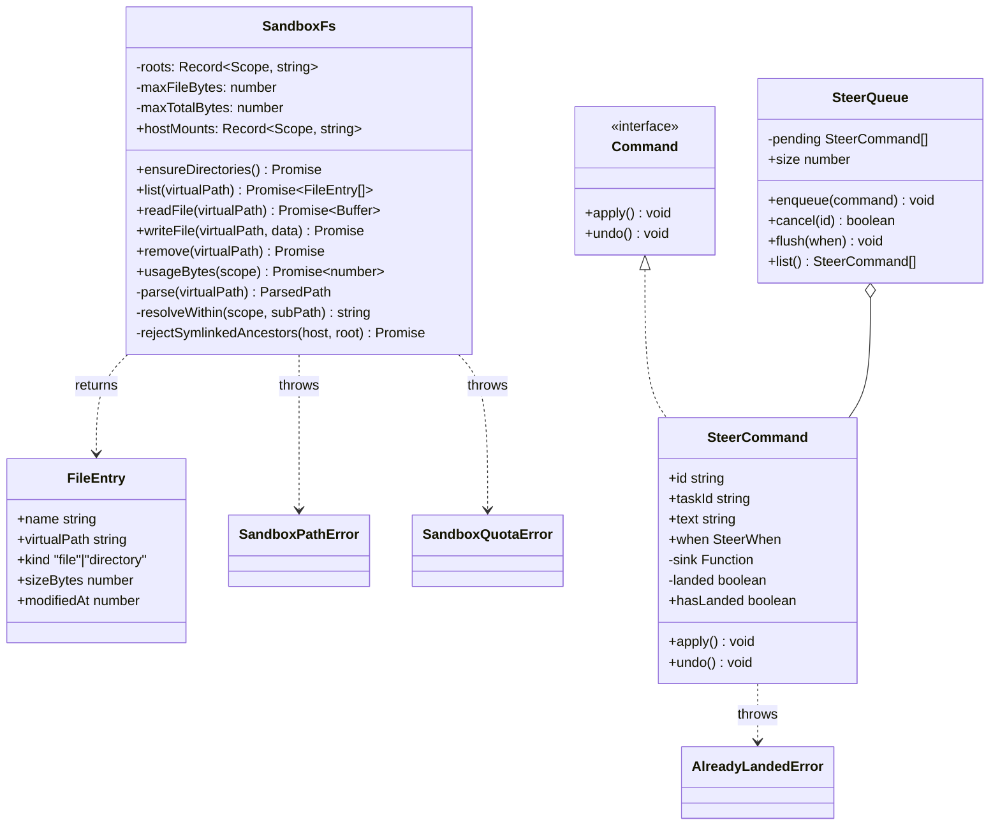

# steering — design doc: sandbox path virtualization & the steer queue

**Slice:** `steering` (owner: LI ZHUOYANG) · **Use case:** UC4 — steer a running session, run a command
**Status:** `SandboxFs`/`SteerCommand` implemented; the files routes are now wired into `main.ts` · branch `steering/sandbox-foundations`
**Source:** `sandboxFs.ts` / `sandboxFs.test.ts`, `steerCommand.ts` / `steerCommand.test.ts`, `routes.ts` / `routes.test.ts`, `index.ts`

This covers the first two of UC4's three pieces. Both are deliberately
Docker-free: `SandboxFs` is built before `DockerCompute` because the compute
piece consumes `SandboxFs.hostMounts` as its bind-mount source, so the mount
paths have to exist and be trustworthy first.

## 1. Scope

| Piece | File | What it owns |
|---|---|---|
| `SandboxFs` | `sandboxFs.ts` | Translates the agent's flat `/mnt/{upload,workspace,output}` view into real host paths, and refuses anything that would escape them. |
| `SteerCommand` / `SteerQueue` | `steerCommand.ts` | Queues a user's mid-turn message and applies it at a chosen moment; cancellable before it lands. |

Not in this piece of work: `DockerCompute`, and the route/command wiring that
would expose either class to an HTTP handler (see §6).

## 2. Use case flow

**Sandbox file access (UC4, file part).** An agent inside a session's
container addresses files only through `/mnt/upload`, `/mnt/workspace`,
`/mnt/output` — it never sees a host path.

1. Agent (or, until wiring lands, a caller acting on its behalf) requests a
   file operation with a virtual path, e.g. `readFile('/mnt/workspace/notes.md')`.
2. `SandboxFs.parse` splits the path into `{scope, subPath}` and resolves it
   against the scope's host root (`resolveWithin`).
3. Every path segment is validated: no `.`/`..`, no illegal or reserved
   characters, no trailing dot/space, and the final resolved path must still
   sit under the scope root.
4. `rejectSymlinkedAncestors` walks the real filesystem from the scope root
   down to the target, failing closed on the first symlink found.
5. `writeFile` additionally rejects `upload` (agent-read-only) and checks the
   per-file and per-project quota before touching disk.
6. Only then does the real `fs/promises` call run.

**Steering a running turn (UC4, steer part).**

1. A user sends a message mid-turn. The caller (not yet wired) builds a
   `SteerCommand` with a `when` ("between turns" / "between steps", per the
   contract's `ClientCommand` union) and enqueues it on the session's
   `SteerQueue`.
2. The user may cancel it any time before it lands — `SteerQueue.cancel(id)`
   removes it and calls `undo()`.
3. At each of the two moments the worker loop names, it calls
   `flush(when)`. Every queued command whose `when` matches is applied (its
   `sink` delivers `{taskId, text}` to the worker) and removed from the
   queue in the same pass.
4. Once a command has landed, `undo()` throws `AlreadyLandedError` instead of
   pretending the delivery can be taken back.

## 3. Analysis class diagram

## 4. Design problem and pattern

### SteerCommand / SteerQueue — Command

The design problem (proposal §6.4): a user message must be queued and applied
at a chosen moment inside a running turn, and must be cancellable before it
lands.

**Candidates weighed:**

- **Strategy** answers "which algorithm accomplishes this." It would fit if
  *how* a landed steer reaches the worker varied. The actual problem here is
  *when*, not *how* — Strategy has no vocabulary for a moment in time.
- **Null Object** answers "how do we avoid a null the caller must guard."
  Nothing here needs that: a cancelled steer is removed from the queue, not
  replaced with an inert stand-in, and there's no "do nothing" steer. (Null
  Object does earn its place one layer down — a compute provider that does
  nothing, `NullCompute` — just not in this file.)
- **Command** fits because the three things asked for — queue it, apply it
  later, undo it before it lands — are exactly the three things Command gives
  an object: hold state, `apply()`, `undo()`.

**Invariant kept:** a command in `SteerQueue.pending` has never landed.
`flush()` removes a command the instant it applies it, so `cancel()` never
needs a landed-check of its own — finding the command still in the queue *is*
the proof it's still cancellable.

### SandboxFs — not a GoF pattern; a threat model

This piece isn't structured around a design pattern — it's path arithmetic
plus a filesystem, deliberately kept ignorant of Docker or the agent, so the
interesting cases (traversal, a planted symlink, a reserved Windows name) are
unit-testable without a container. The design work is the threat model:

| Threat | Guard |
|---|---|
| `projectId`/`sessionId` used as path segments | Rejected at construction unless each is a valid UUID |
| `../../etc` traversal | Segments containing `.` or `..` rejected; resolved path must stay under the scope root (`resolveWithin`) |
| Symlink planted inside the agent's own workspace (`ln -s /etc leak`) | `rejectSymlinkedAncestors` walks the real filesystem component by component — a string-only prefix check can't see it, because the string never mentions `/etc` |
| Windows device names / illegal chars / trailing dot-space | `WINDOWS_RESERVED`, `ILLEGAL_SEGMENT_CHARS`, explicit trailing-dot/space check — the team develops on Windows |
| Backslash inside a segment (`evil\..\..\..\x`) | Rejected explicitly, *and* independently caught by the final prefix check on Windows — kept as defense-in-depth, documented as a second layer rather than overclaimed as the sole guard |
| Unbounded file / project size | Per-file (`maxFileBytes`) and per-project (`maxTotalBytes`) checks in `writeFile`, backed by a tree walk in `usageBytes` |
| Agent writing to `upload` | `writeFile`/`remove` reject scope `'upload'` outright — read-only by design |

**Known limitation, stated rather than hidden:** the symlink check is
TOCTOU-imperfect — the link could be swapped between the check and the real
read/write that follows. Closing that fully needs `O_NOFOLLOW` opens, deferred
until this runs against content an attacker controls concurrently rather than
a single agent's own script.

## 5. Testing

- 78 tests, 85.12% line coverage (`npm run verify` gate).
- Every check that isn't a plain string/format assertion was verified by
  temporarily removing it and watching the corresponding test fail — notably
  the UUID guard and the backslash-segment guard. The backslash guard turned
  out to be defense-in-depth rather than the sole barrier (the final prefix
  check also catches the Windows escape it produces); the comment in the
  source says so rather than overclaiming.
- Symlink tests are skipped, not faked, when the host can't create a symlink
  (Windows without Administrator or Developer Mode) — probed once,
  synchronously, before Vitest collects the suite.

## 6. Boundary and follow-ups

`index.ts` now exports `createSteeringSlice({ volumeRoot })`, which gives
`main.ts` a `registerRoutes` for the two files routes (§7 of
`docs/ARCHITECTURE.md`):

- `GET /api/projects/:id/files?scope=upload|output&path=/sub` — one
  directory's listing (`SandboxFs.list`, non-recursive; the caller pages
  deeper by requesting a subdirectory's `path`).
- `GET /api/projects/:id/files/*` — one file's bytes, wildcard captures
  `<scope>/<subpath>`.

Both are project-scoped and only ever address `upload`/`output` — see the
`SandboxFs` change below. `SteerCommand`/`SteerQueue` and `worker`/`compute`
are still internal; only the files routes are wired.

**`SandboxFs`'s `sessionId` is now optional.** The files routes have a
project id but no session id (there is no running sandbox behind a project's
top-level file browser), and the original constructor required both. With no
`sessionId`, `workspace` is simply unreachable — `parse()` refuses it before
it can build a path from a project id alone, and `ensureDirectories()` never
creates the placeholder. This is additive: every existing call site that
passes a `sessionId` is unaffected, and the refusal path has its own test
(`sandboxFs.test.ts`, "SandboxFs: no session").

**A path refusal and a genuinely missing file answer the same way: 404.**
`routes.ts`'s `asHttpError` folds `SandboxPathError` and a plain `ENOENT`
into one `notFound()` — a caller should not be able to tell "that file does
not exist" apart from "that path was rejected as unsafe" by the status code
alone.

**`LUMEN_VOLUME_ROOT` is a new env var** (`.env.example`, read in `main.ts`),
defaulting to `.data` next to the running server if unset. `apps/server/.data/`
is gitignored.

**Deliberately out of scope for this piece:**

- **The ownership check is a placeholder, not closed.** The routes trust
  `:id` the same way session's `routes.ts` trusts its own `:id` — no
  `projects.projectOf` exists yet to ask. Unlike session's `SessionAccess`
  (which now answers from session's own record of who opened it), steering
  has no equivalent record for "who owns this project"; that is `projects`'
  domain alone. This is a real hole reachable over HTTP now that the routes
  are live, not just a gap in a class nobody could call yet — close it before
  this reaches anything but local dev.
- **`DockerCompute`** — needs `SandboxFs.hostMounts` as its bind-mount source,
  which is why `SandboxFs` had to land first.
- **`task.steer` / `steer.cancel` and `worker: Worker`** — `core/domain/worker.ts`
  landed with session's walking skeleton (`session.echoWorker` is the Sprint 1
  stand-in); steering's own `Worker` implementation and command wiring are
  still to come.
- **Durable quota counter** — `usageBytes` walks the tree on every call,
  which is fine for sprint 1. A running counter belongs in the database once
  tasks and spend are persisted there too.
