# Architecture and the shared contract

Owner: LIU ZIYANG. What every slice builds against, and the design of the
session slice.

---

## 1. The system

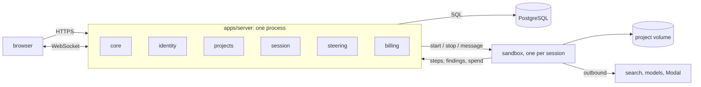

Three rules from the proposal.

1. A **task** is one agent context window. The session's own run is the root
   task; a delegation opens a child task. Nothing else opens one.
2. Cost rolls up from child tasks to their parent.
3. The worker never touches the database. Everything durable goes through the
   server.

---

## 2. Slices and the dependency rule

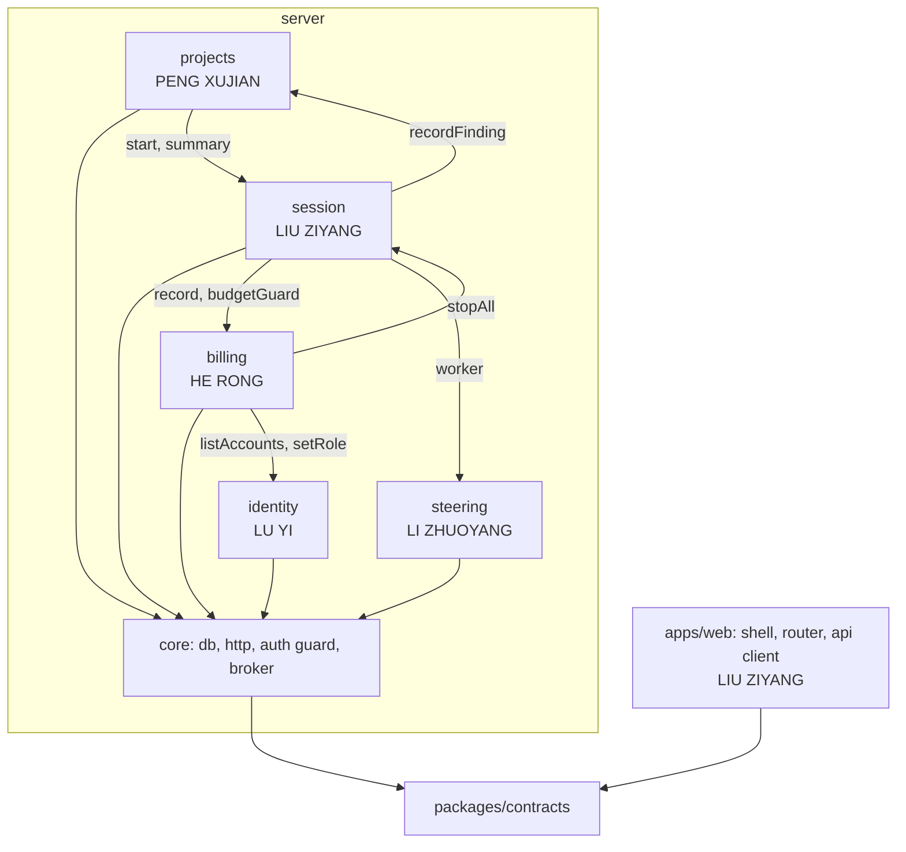

- A slice imports `core` and other slices' **public indexes** (`modules/<name>`),
  never their files. ESLint blocks the rest.
- `core` imports no slice.
- A slice owns its tables. Others read them through its public index.

| Slice | Pages | Modules inside |
|---|---|---|
| identity | 02 Sign in, 05 Account | identity, email |
| projects | 01 Landing, 03 Home | projects, findings |
| session | 04 Session: call tree, steps | kernel, trace |
| steering | 04 Session: composer, files | worker, compute, storage |
| billing | 05 Wallet, 05 Keys, 06 Admin | ledger, billing, secrets, admin |

---

## 3. Data model

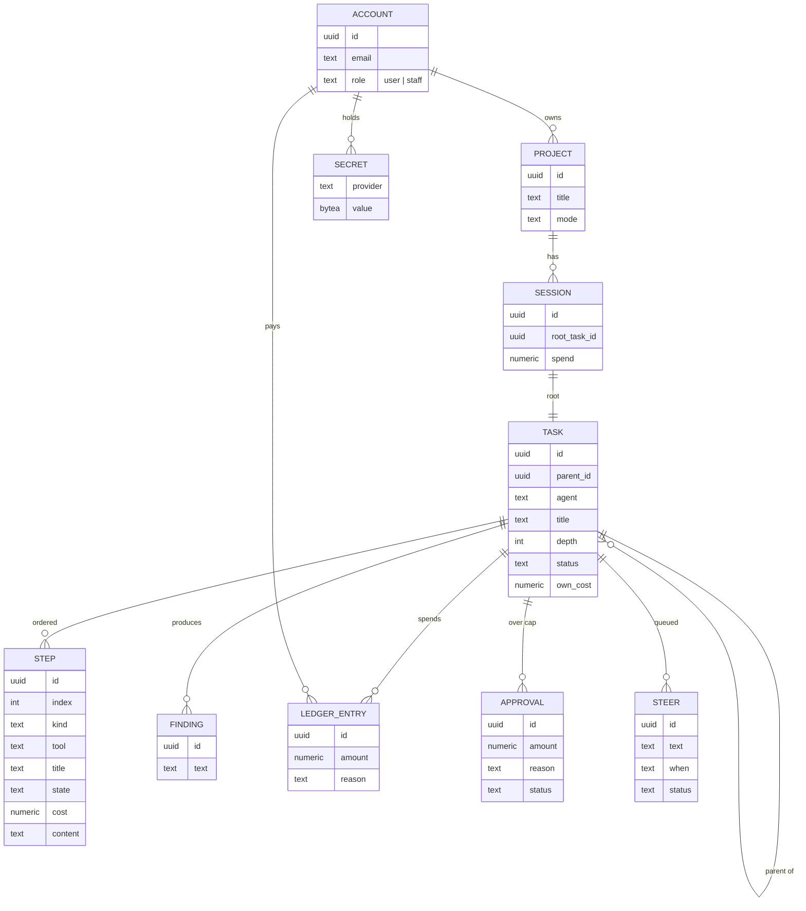

Base tables `accounts`, `projects`, `sessions`, `tasks`, `steps`, `findings`,
`ledger_entries` ship in `001_core_base.sql`. A slice adds its own as
`NNN_<slice>_<what>.sql`.

### Task status

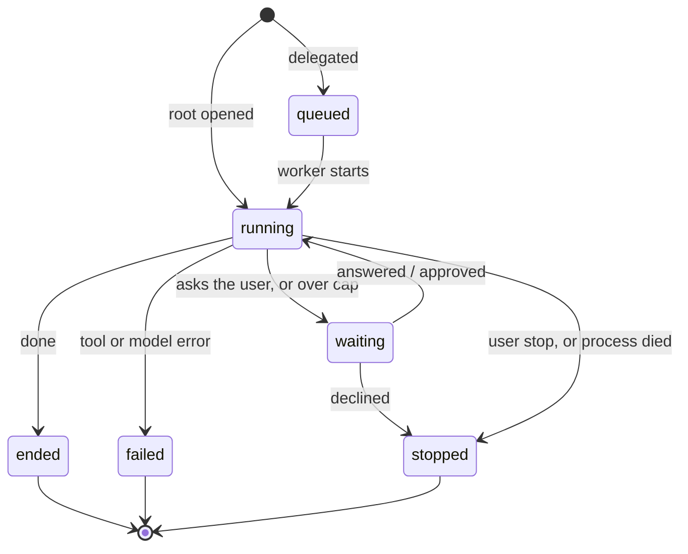


---

## 4. The contract (`packages/contracts`)

Frozen 12 Sep. Changes after that are reviewed pull requests.

```ts
export interface Money { readonly dollars: number }  // see the rule below

export type TaskStatus = 'queued' | 'running' | 'waiting' | 'ended' | 'stopped' | 'failed';

export interface Task {
  readonly id: string;
  readonly sessionId: string;
  readonly parentId: string | null;
  readonly agent: string;          // 'lead' | 'reader' | 'compute-perm' …
  readonly title: string;          // one line
  readonly depth: number;          // 0 for the root
  readonly status: TaskStatus;
  readonly ownCost: Money;         // excluding children
  readonly startedAt: number;
  readonly endedAt: number | null;
}

export type StepKind = 'you' | 'thinking' | 'tool' | 'delegate' | 'reply';

export interface Step {
  readonly taskId: string;
  readonly index: number;          // the order is the reasoning
  readonly kind: StepKind;
  readonly text: string;           // what the step says when it carries nothing else
  readonly detail?: StepDetail;    // what it did; absent on a step that only says something
}

export interface StepDetail {
  readonly tool?: string;          // 'search' | 'run' | 'save' | 'record' …
  readonly durationMs?: number;
  readonly cost?: Money;           // charged to the task in the same write as the step
  readonly rows?: readonly StepRow[];         // a search: source, query, result
  readonly output?: string;        // a run: what the terminal printed, bounded by the kernel
  readonly childTaskIds?: readonly string[];  // a delegate step: written by delegate() only
}

export interface StepRow {
  readonly source: string;
  readonly text: string;
  readonly result: string;
  readonly empty?: boolean;        // the row that found nothing, which often matters most
}

export type SessionMode = 'explore' | 'seed';
export interface Session {
  readonly id: string;
  readonly mode: SessionMode;
  readonly projectId: string;
  readonly accountId: string;      // the owner; billing charges this account
  readonly startedAt: number;
}

// What a page is given to draw a session. Status and end time are the root
// task's. Every total is summed by the server: the browser never adds.
export interface SessionSnapshot {
  readonly session: Session;
  readonly tasks: readonly Task[];
  readonly steps: readonly Step[];
  readonly totals: Readonly<Record<string, Money>>;  // each task with its descendants
  readonly spend: Money;                              // the root's total
}

export interface Finding  { readonly id: string; readonly sessionId: string; readonly taskId: string; readonly text: string; readonly createdAt: number }

// Designed, and added by their owners when their slices need them on the wire:
export interface Approval { readonly id: string; readonly taskId: string; readonly amount: Money; readonly reason: string; readonly status: 'pending' | 'approved' | 'declined'; readonly createdAt: number }
export type SteerWhen = 'end-of-turn' | 'next-step';
export interface Steer    { readonly id: string; readonly taskId: string; readonly text: string; readonly when: SteerWhen; readonly status: 'queued' | 'landed' | 'cancelled' }
```

**Money is dollars.** Decided 7 Sep. The column is `numeric(12,6)`; every
sum is done in SQL; the browser formats to four decimals and never adds. A JS
number carries the value, it does not compute with it.

---

## 5. The wire

One WebSocket per tab at `/ws`, cookie checked before upgrade, JSON frames.
A socket watches nothing until it says `session.open`; each open is checked
against the principal. The slice answers by publishing `session.snapshot`.
`?session=<id>` at the upgrade still works for one sprint.

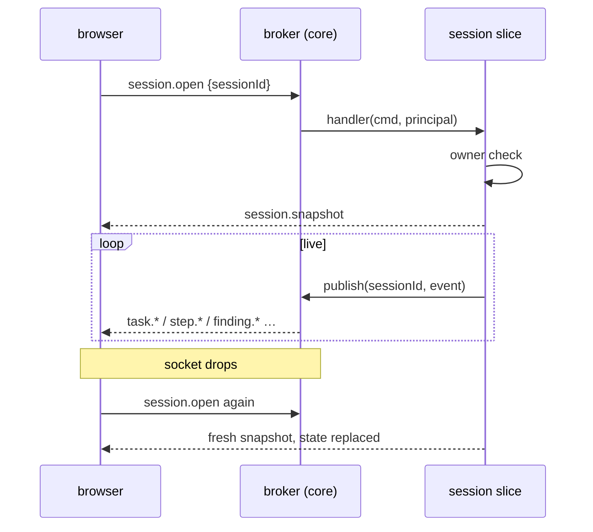

No sequence numbers in v1. The snapshot is the durable record read back.

```ts
// On main today.
export type ServerEvent =
  | { type: 'session.snapshot'; snapshot: SessionSnapshot }     // answer to session.open
  | { type: 'task.opened'; task: Task }
  | { type: 'task.status'; taskId: string; status: TaskStatus }
  | { type: 'task.cost'; taskId: string; ownCost: Money }
  | { type: 'task.total'; taskId: string; total: Money }        // rolled up; the browser never adds
  // One event per step, written whole. A step is appended when it is done, so
  // there is no open/update/close. Streaming a reply as it is typed is the
  // steering slice's to add, as a new event, when a model is wired in.
  | { type: 'step.appended'; taskId: string; index: number; kind: StepKind; text: string; detail?: StepDetail }
  | { type: 'finding.recorded'; taskId: string; findingId: string; text: string }
  | { type: 'error'; message: string };

export type ClientCommand =
  | { type: 'session.open'; sessionId: string }                 // session
  | { type: 'session.close'; sessionId: string }
  | { type: 'session.say'; sessionId: string; text: string }    // new turn on the root
  | { type: 'session.stop'; sessionId: string }
  | { type: 'task.steer'; taskId: string; text: string; when: SteerWhen };   // steering

// Designed, not on the wire yet. Each is added by its owner, as a new member:
//   billing:   approval.requested, approval.resolved; command approval.answer
//   steering:  steer.queued, steer.landed, steer.cancelled; command steer.cancel
//   storage:   files.changed
```

One handler per command type, registered by the owning slice at startup.

---

## 6. What `core` gives every slice

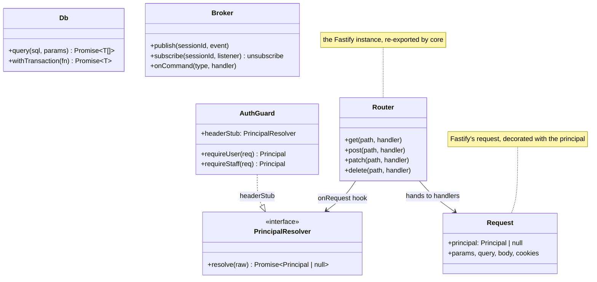

- **db**: one `pg` pool. `node-pg-migrate` runs the migrations at startup: it
  owns the applied-migrations table, the lock that stops two processes racing,
  and the transaction around each file. We do not write a migration runner.
- **http**: Fastify. `@fastify/cookie` for the session cookie, `@fastify/static`
  for the built SPA, `@fastify/websocket` for the event stream, and
  `@fastify/multipart` for the upload behind the composer's "+". Each public
  index exports `registerRoutes(router)`, where `Router` is the Fastify instance
  that core re-exports; `main.ts` calls the five. Tests use `app.inject()`, so a
  route is tested without opening a port.
- **auth**: an `onRequest` hook resolves the principal before any handler runs,
  so no handler parses a credential and none forgets to. Sprint 1 uses
  `headerStub` (`Authorization: stub <id>:<role>`); identity supplies the real
  resolver and `main.ts` swaps it.
- **broker**: fans events out to sockets that opened the session; routes
  commands to the one registered handler.

### Two answers core owes identity

LU YI raised both on 10 Sep and has been stopped by them since. The projects
document raises the first one independently.

**1. The error body gains a machine-readable code.**

Decided: `{ error: { code, message, field? } }`.

| Field | Is |
|---|---|
| `code` | A stable lowercase token a page branches on: `invalid_credentials`, `email_taken`, `invalid_body`. |
| `message` | For a person. It may be reworded at any time. |
| `field` | The offending input, when there is exactly one. |

Core answers `{ error: string }` today, where the string is the message. That is
not enough: identity's sign-in page is written against a closed set of codes,
and the projects document specified the same nested shape on its own. Two of
five slices need the code, and the alternative is branching on an English
sentence, which breaks the first time somebody rewords one.

The cost is one file, one error handler and four test assertions. It is cheap
while core is the only thing on `main`, and it is a five-way conflict later.

**2. The principal resolver exists. It cannot see the cookie.**

There is no new registration point to add. `PrincipalResolver` is the port,
`ServerDeps.resolver` injects it, and `main.ts` swaps it — §7 already has
identity exporting `principalResolver`.

What stops identity is the argument. `core/http/server.ts` calls:

```ts
request.principal = await deps.resolver.resolve(request.headers.authorization);
```

One header, nothing else. A cookie session cannot be read from there.

Decided: widen the argument to everything a credential can arrive in.

```ts
export interface PrincipalResolver {
  resolve(from: {
    readonly authorization: string | undefined;
    readonly cookies: Readonly<Record<string, string | undefined>>;
  }): Promise<Principal | null>;
}
```

`@fastify/cookie` is already registered, so `request.cookies` is there to pass.
`headerStub` reads `from.authorization` and ignores the rest.

**3. While we are here: `anySignedInMayWatch`.**

Core ships a `SessionAccess.canWatch` that lets any signed-in principal watch
any session. It cannot be closed in sprint 1: `headerStub` already lets anyone
claim any account, and `projectOf(sessionId)` does not exist. Replacing it is
the job of whichever of identity and projects lands second. It is not core's.

### Interfaces shared by two slices (`core/domain`)

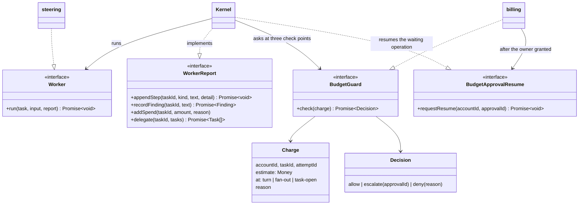

The report interface is the only door out of the sandbox. Everything durable passes through
it, so a dead worker loses nothing.

An `escalate` decision puts the task in `waiting` with the blocked operation kept on its row
(`pending`: attempt id, approval id, check point, input, the fan-out). A restart leaves it
waiting. When the owner grants the approval, billing calls `requestResume`; the kernel asks
the guard again with the same attempt id and runs exactly that operation. One fan-out is one
operation: the children it opens carry the fan-out's attempt id.

---

## 7. What each slice exposes

### identity (LU YI)

| Route | Does |
|---|---|
| `POST /api/auth/signup`, `POST /api/auth/password` | email + password → cookie |
| `GET /api/auth/github`, `…/github/callback`, same for `google` | OAuth |
| `POST /api/auth/signout`, `POST /api/auth/signout-all` | |
| `GET /api/me`, `PATCH /api/me`, `POST /api/me/password`, `DELETE /api/me` | account tab |

```ts
export const principalResolver: PrincipalResolver;
export function registerRoutes(router: Router): void;
export function listAccounts(): Promise<AccountSummary[]>;     // admin page
export function getAccount(id: string): Promise<AccountSummary | null>;
export function setRole(id: string, role: 'user' | 'staff'): Promise<void>;
export function suspend(id: string, on: boolean): Promise<void>;
export function sendMail(to: string, template: MailTemplate): Promise<void>;
```

GitHub and Google go through `arctic`, which owns the state parameter, PKCE and
the token exchange. The Strategy sits above it, not instead of it.

Staff sign in on the same page and are routed to `/admin` by role.

### projects (PENG XUJIAN)

| Route | Does |
|---|---|
| `GET /api/projects` | the cards: title, status, spend, findings count, last activity |
| `POST /api/projects` | `{ question, mode }` → project + first session |
| `GET /api/projects/:id`, `POST /api/projects/:id/stop` | |
| `GET /api/projects/:id/findings` | |

```ts
export function registerRoutes(router: Router): void;
export function recordFinding(sessionId: string, taskId: string, text: string): Promise<Finding>;
export function listFindings(sessionId: string): Promise<Finding[]>;
export function projectOf(sessionId: string): Promise<{ id: string; accountId: string }>;
```

### session (LIU ZIYANG) — design in section 9

| Route | Does |
|---|---|
| `POST /api/projects/:id/sessions` | `{ text, mode }` → root task opened |
| `GET /api/sessions/:id` | snapshot as JSON |
| `GET /api/steps/:id/content` | full step output |
| `POST /api/sessions/:id/stop` | |

Commands: `session.open`, `session.close`, `session.say`, `session.stop`, `step.full`.

```ts
export function registerRoutes(router: Router): void;
export function registerCommands(broker: Broker): void;
export function start(projectId: string, accountId: string, text: string, mode: SessionMode): Promise<Session>;
export function summary(sessionId: string): Promise<Session>;
export function stopAll(accountId: string): Promise<number>;   // admin kill switch
```

### steering (LI ZHUOYANG)

| Route | Does |
|---|---|
| `GET /api/projects/:id/files`, `GET /api/projects/:id/files/*` | tree, one file |
| `POST /api/sessions/:id/attach` | the "+" in the composer |

Commands: `task.steer`, `steer.cancel`.

```ts
export function registerRoutes(router: Router): void;
export function registerCommands(broker: Broker): void;
export const worker: Worker;                                    // for main.ts → kernel
export function compute(provider: 'modal' | 'docker' | 'none'): Compute;
```

### billing (HE RONG)

| Route | Does |
|---|---|
| `GET /api/wallet` | month: spent, cap, compute vs models, reset date |
| `GET /api/wallet/ledger?project=`, `PATCH /api/wallet/cap` | |
| `POST /api/wallet/checkout`, `POST /api/webhooks/stripe`, `GET /api/wallet/invoices` | Stripe |
| `GET /api/approvals`, `POST /api/approvals/:id` | "Recently authorized" |
| `GET /api/keys`, `PUT /api/keys/:provider`, `DELETE /api/keys/:provider` | write-only |
| `GET /api/admin/accounts`, `GET /api/admin/accounts/:id`, `PATCH /api/admin/accounts/:id` | staff |
| `POST /api/admin/invites`, `POST /api/admin/accounts/:id/kill` | staff |

Command: `approval.answer`.

```ts
export function registerRoutes(router: Router): void;
export function registerCommands(broker: Broker): void;
export const budgetGuard: BudgetGuard;                          // for main.ts → kernel
export function record(e: { accountId: string; taskId: string; amount: Money; reason: string }): Promise<void>;
export function monthSpend(accountId: string): Promise<{ spent: Money; cap: Money }>;
export function secret(accountId: string, provider: string): Promise<string | null>;
```

---

## 8. Startup, and the main flow

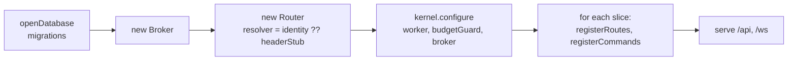

`main.ts` is that and nothing else. A slice never edits it.

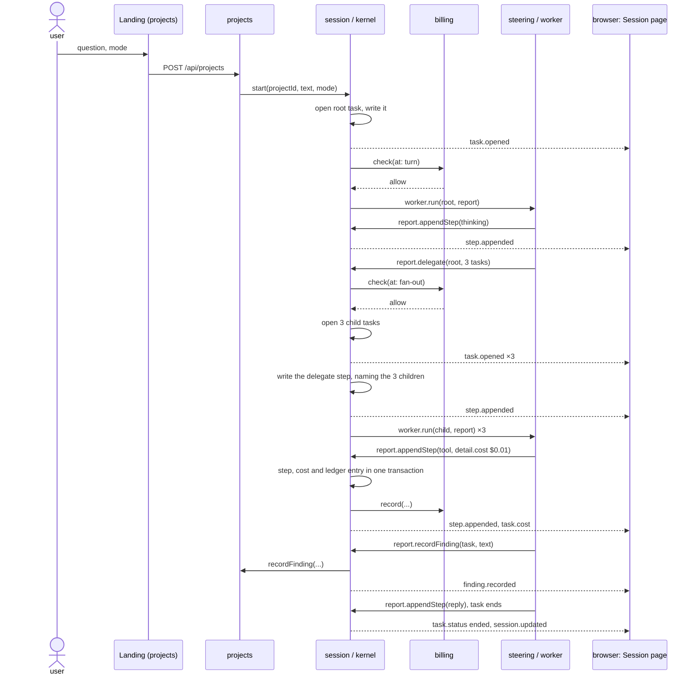

Over the cap: `check` returns `escalate`, the task goes `waiting`, the browser
gets `approval.requested`, the user answers, the kernel resumes or stops.

Sprint 1 walks this with a worker that emits one fixed step and ends.

---

## 9. The session slice

### Structure

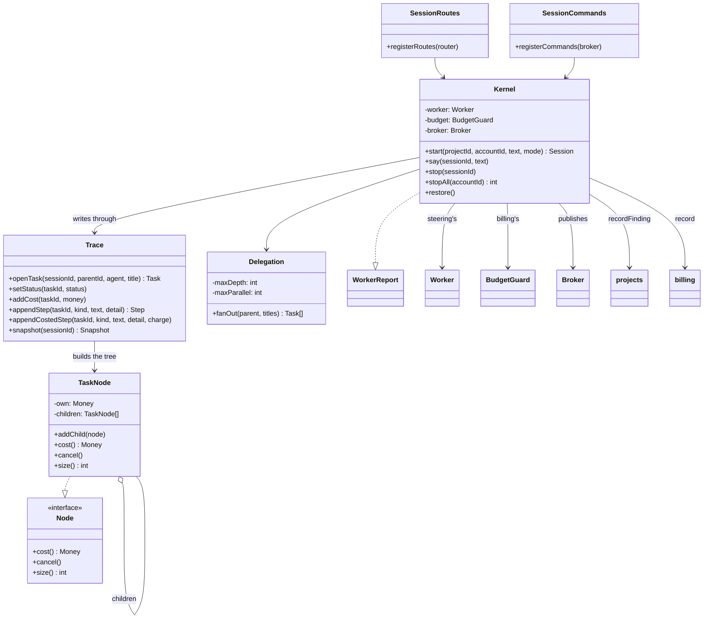

- **Trace** is the durable record: every task and step written to Postgres as
  it happens, and read back as the snapshot.
- **Kernel** is the engine. It implements `WorkerReport`, so the worker's every
  report lands in the trace and on the socket in one call.
- **Delegation** fans a `delegate` step out into child tasks, bounded by depth
  and parallelism.
- **TaskNode** is the Composite the design problem asks for.

### The design problem: Composite

A task and a subtree of tasks must answer cost, cancel and size the same way.

Brute force, before:

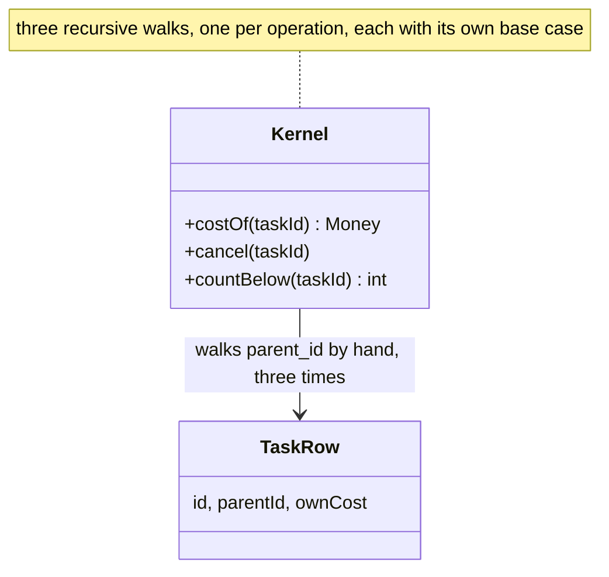

With the pattern, after:

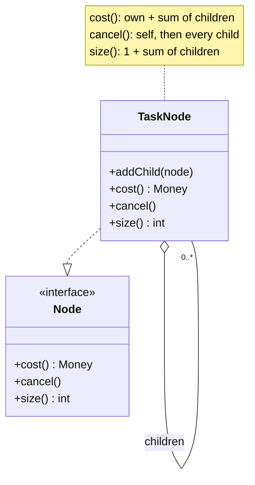

The caller holds one `Node` and does not know whether it is a leaf. The tree
walk lives in one place. Compared with Visitor (over-general for three
operations) and a flat table walk (the brute force). The test that proves it is
`session.test.ts`: a nested subtree's cost reaches the root.

### Delegation, cost and cancel

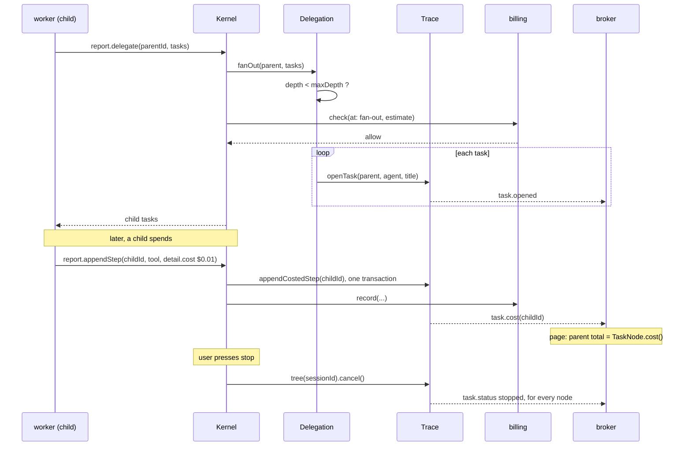

### Restore after a restart


Nobody pressed stop, but the reasoning is the same: the task was ended from
outside. `stopped`, not `failed`.

### The page

After the annotated spec, page 04. What the agent thought and did is the main
column. The call tree and the findings are the narrow column beside it.

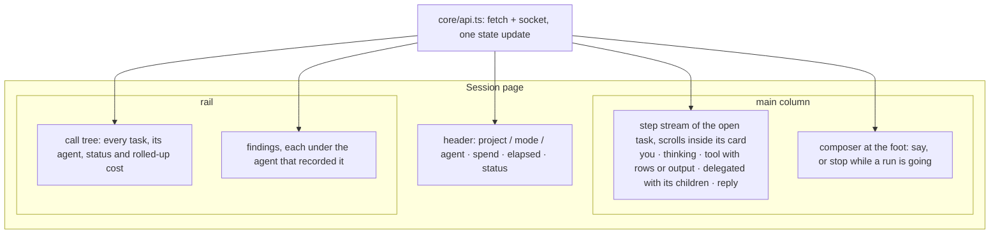

LIU ZIYANG owns the stream, the tree and the findings list. LI ZHUOYANG owns
the composer, and the files panel when it arrives.

One function in `apps/web/src/core/api.ts` applies every `ServerEvent` to one
state object. Every part of the page reads it; neither owner restyles the
other's part. `core/api.ts` keeps the socket, the backoff on reconnect and that
one reducer. The REST calls around it go through `request()` in the same file.
We do not write a cache.

Two limits are known. A worker gets no stop signal, so a step that is in
flight when the user stops a session still lands, and its cost is recorded: the
money was spent. `Kernel.say()` does not refuse a turn while the root runs; the
page does not send one. Both belong to the steering slice's agent loop.

---

## 10. Analysis → design: the rules every slice follows

| Analysis element | Becomes | Where |
|---|---|---|
| boundary class (a screen) | a page under `apps/web/src/pages/<page>/` and the routes it calls | the page's owner |
| control class (the use case's logic) | a service in the slice: `AuthFlow`, `ProjectCards`, `Kernel`, `SteerQueue`, `BudgetChain` | the slice |
| entity class (a persisted noun) | a type in `packages/contracts` and a table the slice owns | contract + slice |
| association across slices | a public index call, or an interface in `core/domain` | never a shared SQL write |
| anything the browser sees change live | a `ServerEvent` | contract |
| the proposal's design problem | the pattern on the control class; brute force kept for the before/after | the slice |

Entities are the same in every diagram: they are the contract. Control classes
are where the patterns live: that is where the conditionals gather.

---

## 11. Effort (LIU ZIYANG)

| # | Task | Sprint | Days |
|---|---|---|---|
| 1 | contract written, reviewed, frozen | 1 | 1.0 |
| 2 | core/db: pool, migrations, base schema | 1 | 0.5 |
| 3 | core/http: router, registerRoutes, resolver injection | 1 | 0.5 |
| 4 | core/protocol: broker over WebSocket, onCommand | 1 | 1.0 |
| 5 | web core: api client, router, shell | 1 | 0.5 |
| 6 | walking skeleton, first integration | 1 | 1.0 |
| 7 | backlog, sprint plan, report 1, burndown | 1 | 0.5 |
| 8 | UC3 analysis and design diagrams | 1–2 | 2.0 |
| 9 | Trace + TaskNode: persistence, roll-up, cancel, restore | 2 | 1.5 |
| 10 | Delegation over the Worker interface | 2 | 1.5 |
| 11 | Session page: step list, streaming, call tree | 2–3 | 1.5 |
| 12 | budget checks at three check points, waiting and resume | 3 | 1.0 |
| 13 | design problem write-up, before/after | 3–4 | 1.0 |
| 14 | pipeline jobs for core and session | 2 | 0.5 |
| 15 | integration, hardening, report, presentation | 4 | 1.0 |
|   | **total** |   | **15.0** |

Five over the proposal's ten: rows 1 to 4 and 7 are the shared contract and the
reporting, which the proposal spreads across the team. Rows 1 to 6 cannot move;
everyone waits on them. Rows 11 and 13 can drop to one day each.

---

## 12. Glossary

One word, one meaning.

| Word | Means | Not |
|---|---|---|
| slice | one person's vertical: pages, module, tables, pipeline jobs | a layer |
| module | a slice's server directory, `modules/<name>/` | a folder inside it like `kernel` |
| public index | a module's `index.ts`, the only importable file | |
| core | db, http, auth guard, broker; shared by all | a slice |
| contract | `packages/contracts`: types the browser and every slice share | the routes |
| principal | the signed-in account as a route sees it: id and role | the account record |
| session | one run on one question, under a project | a login |
| task | one agent context window: the session's root run, or a delegation under it | a message; the one-line `title` |
| step | one row in a task: you, thinking, tool, delegate, reply | |
| trace | all tasks and steps of a session, in order, in Postgres | a log file |
| kernel | the engine in the session slice | the worker |
| worker | the agent loop in the sandbox; steering's | the kernel |
| report | the interface the worker reports through; its only door out of the sandbox | |
| broker | carries events out and commands in | a message queue |
| event | server → browser, a fact | |
| command | browser → server, a request | |
| snapshot | everything about a session so far | |
| finding | a result the agent recorded; projects owns it | a reply |
| approval | a request over the cap; billing owns it | |
| steer | a message queued into a running turn; steering owns it | `session.say` |
| cap | the monthly spend limit | a per-session budget |
| owner | the person in CODEOWNERS for a path | |
