# Architecture and the shared contract

Owner: LIU ZIYANG. What every slice builds against, and the design of the
session slice. Diagrams are Mermaid; GitHub renders them in place.

| You are | Read |
|---|---|
| any slice owner, first day | 1, 2, 13 |
| writing your design doc | 3, 4, 10, your part of 7 |
| building a page or a module | 5, 6, 7, 8 |
| waiting on core | 11 |
| LIU ZIYANG | all, and 9, 12 |

---

## 1. The system

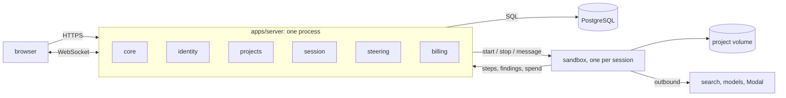

Three rules from the proposal.

1. A **point** is one agent context window. Opening a conversation, delegating,
   compacting, or handing over opens a point. Nothing else does.
2. Cost rolls up along **delegate** edges only.
3. The worker never touches the database. Everything durable goes through the
   server.

---

## 2. Slices and the dependency rule

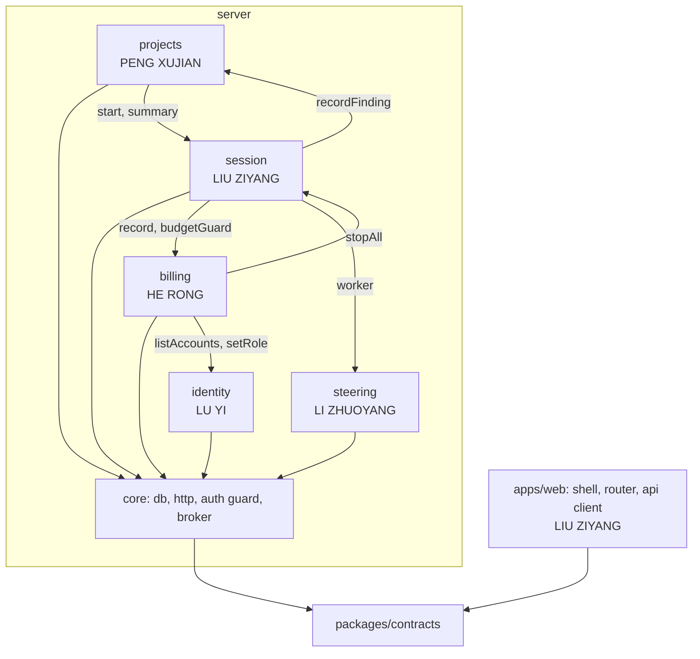

- A slice imports `core` and other slices' **public indexes** (`modules/<name>`),
  never their files. ESLint blocks the rest.
- `core` imports no slice.
- A slice owns its tables. Others read them through its public index.

| Slice | Pages | Modules inside |
|---|---|---|
| identity | 02 Sign in, 05 Account | identity, email |
| projects | 01 Landing, 03 Home | projects, findings |
| session | 04 Session: graph, call tree, steps | kernel, trace |
| steering | 04 Session: composer, files | worker, compute, storage |
| billing | 05 Wallet, 05 Keys, 06 Admin | ledger, billing, secrets, admin |

---

## 3. Data model

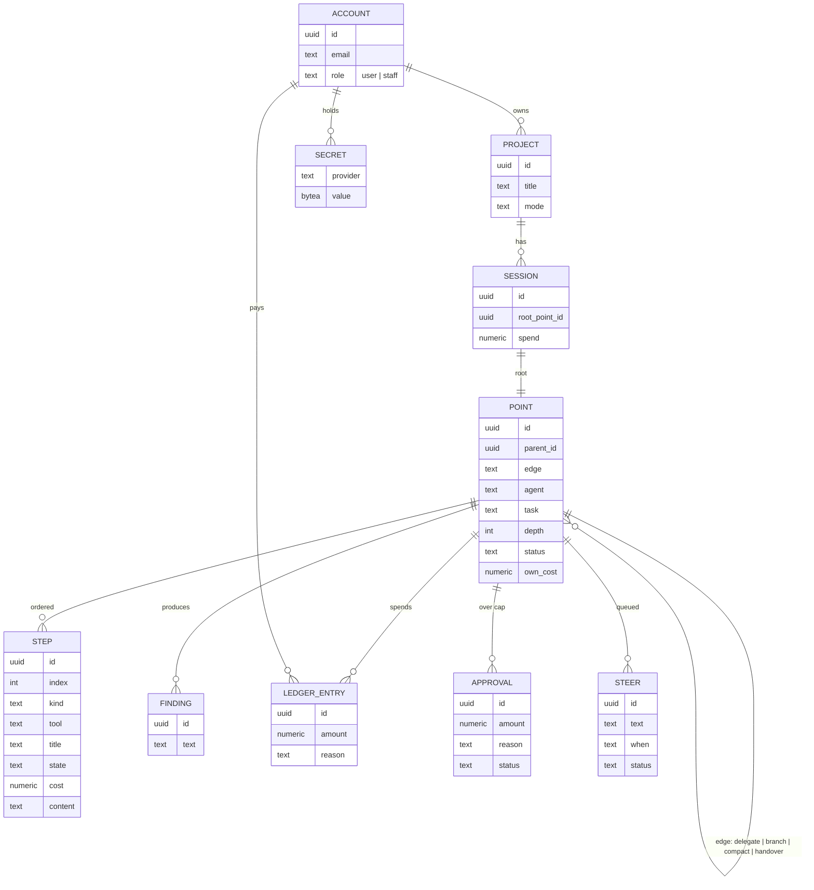

Base tables `accounts`, `projects`, `sessions`, `points`, `steps`, `findings`,
`ledger_entries` ship in `001_core_base.sql`. A slice adds its own as
`NNN_<slice>_<what>.sql`.

### Point status

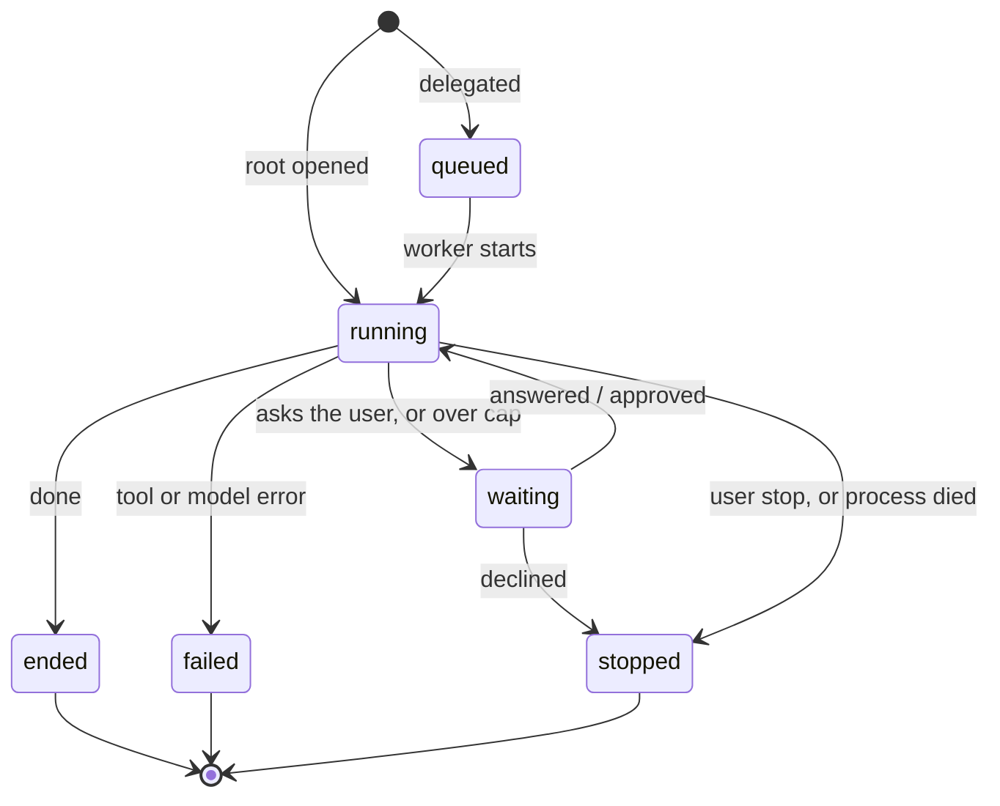

A compacted window is an `ended` point with a `compact` edge to its successor.

---

## 4. The contract (`packages/contracts`)

Frozen 12 Sep. Changes after that are reviewed pull requests.

```ts
export interface Money { readonly dollars: number }  // see the rule below

export type EdgeKind = 'delegate' | 'branch' | 'compact' | 'handover';
export type PointStatus = 'queued' | 'running' | 'waiting' | 'ended' | 'stopped' | 'failed';

export interface Point {
  readonly id: string;
  readonly sessionId: string;
  readonly parentId: string | null;
  readonly edgeFromParent: EdgeKind | null;
  readonly agent: string;          // 'lead' | 'reader' | 'compute-perm' …
  readonly task: string;           // one line, the point's title
  readonly depth: number;          // 0 for the root
  readonly status: PointStatus;
  readonly ownCost: Money;         // excluding children
  readonly startedAt: number;
  readonly endedAt: number | null;
}

export type StepKind = 'you' | 'thinking' | 'tool' | 'delegate' | 'reply';
export type StepState = 'running' | 'done' | 'failed' | 'stopped';

export interface Step {
  readonly id: string;
  readonly pointId: string;
  readonly index: number;          // the order is the reasoning
  readonly kind: StepKind;
  readonly tool: string | null;    // 'search' | 'run' | 'save' | 'record' …
  readonly title: string;          // "search", "run 8.9 s", "delegated 3 in parallel"
  readonly state: StepState;
  readonly startedAt: number;
  readonly endedAt: number | null;
  readonly cost: Money | null;
  readonly preview: string | null; // first lines; full text via step.full
  readonly childPointIds: readonly string[];
}

export type SessionMode = 'explore' | 'seed';
export interface Session {
  readonly id: string;
  readonly projectId: string;
  readonly mode: SessionMode;
  readonly rootPointId: string;
  readonly status: PointStatus;    // mirrors the root point
  readonly spend: Money;           // rolled up over delegate edges
  readonly startedAt: number;
  readonly endedAt: number | null;
}

export interface Finding  { readonly id: string; readonly sessionId: string; readonly pointId: string; readonly text: string; readonly createdAt: number }
export interface Approval { readonly id: string; readonly pointId: string; readonly amount: Money; readonly reason: string; readonly status: 'pending' | 'approved' | 'declined'; readonly createdAt: number }
export type SteerWhen = 'end-of-turn' | 'next-step';
export interface Steer    { readonly id: string; readonly pointId: string; readonly text: string; readonly when: SteerWhen; readonly status: 'queued' | 'landed' | 'cancelled' }
```

**Money is dollars.** Decided 7 Sep. The column is `numeric(12,6)`; every
sum is done in SQL; the browser formats to four decimals and never adds. A JS
number carries the value, it does not compute with it.

---

## 5. The wire

One WebSocket per tab at `/ws`, cookie checked before upgrade, JSON frames.

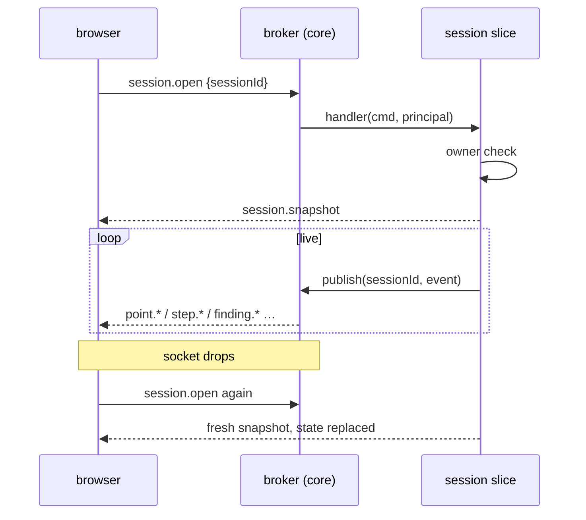

No sequence numbers in v1. The snapshot is the durable record read back.

```ts
export type ServerEvent =
  | { type: 'session.snapshot'; session: Session; points: Point[]; steps: Step[]; findings: Finding[]; approvals: Approval[]; steers: Steer[] }
  | { type: 'session.updated'; sessionId: string; patch: Partial<Session> }
  | { type: 'point.opened'; point: Point }
  | { type: 'point.status'; pointId: string; status: PointStatus }
  | { type: 'point.cost'; pointId: string; ownCost: Money }
  | { type: 'step.opened'; step: Step }
  | { type: 'step.updated'; stepId: string; patch: Partial<Step> }
  | { type: 'step.closed'; step: Step }
  | { type: 'step.text'; stepId: string; delta: string }        // streaming thinking / reply
  | { type: 'step.content'; stepId: string; text: string }      // answer to step.full
  | { type: 'finding.recorded'; finding: Finding }              // projects
  | { type: 'approval.requested'; approval: Approval }          // billing
  | { type: 'approval.resolved'; approvalId: string; status: 'approved' | 'declined' }
  | { type: 'steer.queued'; steer: Steer }                      // steering
  | { type: 'steer.landed'; steerId: string }
  | { type: 'steer.cancelled'; steerId: string }
  | { type: 'files.changed'; projectId: string }                // storage
  | { type: 'error'; message: string };

export type ClientCommand =
  | { type: 'session.open'; sessionId: string }                 // session
  | { type: 'session.close'; sessionId: string }
  | { type: 'session.say'; sessionId: string; text: string }    // new turn on the root
  | { type: 'session.stop'; sessionId: string }
  | { type: 'step.full'; stepId: string }
  | { type: 'point.steer'; pointId: string; text: string; when: SteerWhen }   // steering
  | { type: 'steer.cancel'; steerId: string }
  | { type: 'approval.answer'; approvalId: string; approve: boolean };        // billing
```

One handler per command type, registered by the owning slice at startup.

---

## 6. What `core` gives every slice

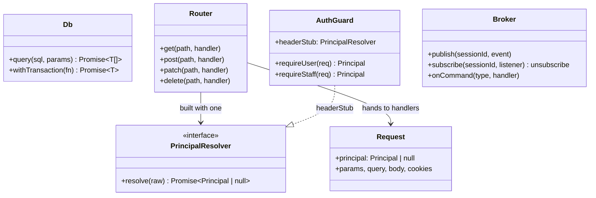

- **db**: one `pg` pool, migrations applied at startup in name order.
- **http**: `node:http`, no framework. Each public index exports
  `registerRoutes(router)`; `main.ts` calls the five.
- **auth**: the router resolves the principal before the handler. Sprint 1 uses
  `headerStub` (`Authorization: stub <id>:<role>`); identity supplies the real
  resolver and `main.ts` swaps it.
- **broker**: fans events out to sockets that opened the session; routes
  commands to the one registered handler.

### Interfaces shared by two slices (`core/domain`)

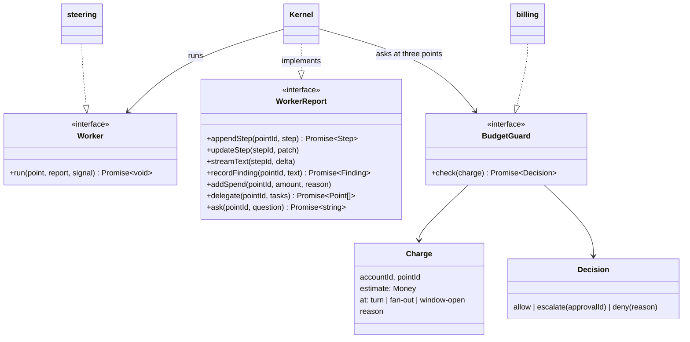

The report interface is the only door out of the sandbox. Everything durable passes through
it, so a dead worker loses nothing.

---

## 7. What each slice exposes

### identity (LU YI)

| Route | Does |
|---|---|
| `POST /api/auth/signup`, `POST /api/auth/password` | email + password → cookie |
| `GET /api/auth/github`, `…/github/callback`, same for `google` | OAuth |
| `POST /api/auth/signout`, `POST /api/auth/signout-all` | |
| `GET /api/me`, `PATCH /api/me`, `POST /api/me/password`, `DELETE /api/me` | account tab |

```ts
export const principalResolver: PrincipalResolver;
export function registerRoutes(router: Router): void;
export function listAccounts(): Promise<AccountSummary[]>;     // admin page
export function getAccount(id: string): Promise<AccountSummary | null>;
export function setRole(id: string, role: 'user' | 'staff'): Promise<void>;
export function suspend(id: string, on: boolean): Promise<void>;
export function sendMail(to: string, template: MailTemplate): Promise<void>;
```

Staff sign in on the same page and are routed to `/admin` by role.

### projects (PENG XUJIAN)

| Route | Does |
|---|---|
| `GET /api/projects` | the cards: title, status, spend, findings count, last activity |
| `POST /api/projects` | `{ question, mode }` → project + first session |
| `GET /api/projects/:id`, `POST /api/projects/:id/stop` | |
| `GET /api/projects/:id/findings` | |

```ts
export function registerRoutes(router: Router): void;
export function recordFinding(sessionId: string, pointId: string, text: string): Promise<Finding>;
export function listFindings(sessionId: string): Promise<Finding[]>;
export function projectOf(sessionId: string): Promise<{ id: string; accountId: string }>;
```

### session (LIU ZIYANG) — design in section 9

| Route | Does |
|---|---|
| `POST /api/projects/:id/sessions` | `{ text, mode }` → root point opened |
| `GET /api/sessions/:id` | snapshot as JSON |
| `GET /api/steps/:id/content` | full step output |
| `POST /api/sessions/:id/stop` | |

Commands: `session.open`, `session.close`, `session.say`, `session.stop`, `step.full`.

```ts
export function registerRoutes(router: Router): void;
export function registerCommands(broker: Broker): void;
export function start(projectId: string, accountId: string, text: string, mode: SessionMode): Promise<Session>;
export function summary(sessionId: string): Promise<Session>;
export function stopAll(accountId: string): Promise<number>;   // admin kill switch
```

### steering (LI ZHUOYANG)

| Route | Does |
|---|---|
| `GET /api/projects/:id/files`, `GET /api/projects/:id/files/*` | tree, one file |
| `POST /api/sessions/:id/attach` | the "+" in the composer |

Commands: `point.steer`, `steer.cancel`.

```ts
export function registerRoutes(router: Router): void;
export function registerCommands(broker: Broker): void;
export const worker: Worker;                                    // for main.ts → kernel
export function compute(provider: 'modal' | 'docker' | 'none'): Compute;
```

### billing (HE RONG)

| Route | Does |
|---|---|
| `GET /api/wallet` | month: spent, cap, compute vs models, reset date |
| `GET /api/wallet/ledger?project=`, `PATCH /api/wallet/cap` | |
| `POST /api/wallet/checkout`, `POST /api/webhooks/stripe`, `GET /api/wallet/invoices` | Stripe |
| `GET /api/approvals`, `POST /api/approvals/:id` | "Recently authorized" |
| `GET /api/keys`, `PUT /api/keys/:provider`, `DELETE /api/keys/:provider` | write-only |
| `GET /api/admin/accounts`, `GET /api/admin/accounts/:id`, `PATCH /api/admin/accounts/:id` | staff |
| `POST /api/admin/invites`, `POST /api/admin/accounts/:id/kill` | staff |

Command: `approval.answer`.

```ts
export function registerRoutes(router: Router): void;
export function registerCommands(broker: Broker): void;
export const budgetGuard: BudgetGuard;                          // for main.ts → kernel
export function record(e: { accountId: string; pointId: string; amount: Money; reason: string }): Promise<void>;
export function monthSpend(accountId: string): Promise<{ spent: Money; cap: Money }>;
export function secret(accountId: string, provider: string): Promise<string | null>;
```

---

## 8. Startup, and the main flow

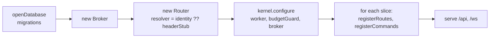

`main.ts` is that and nothing else. A slice never edits it.

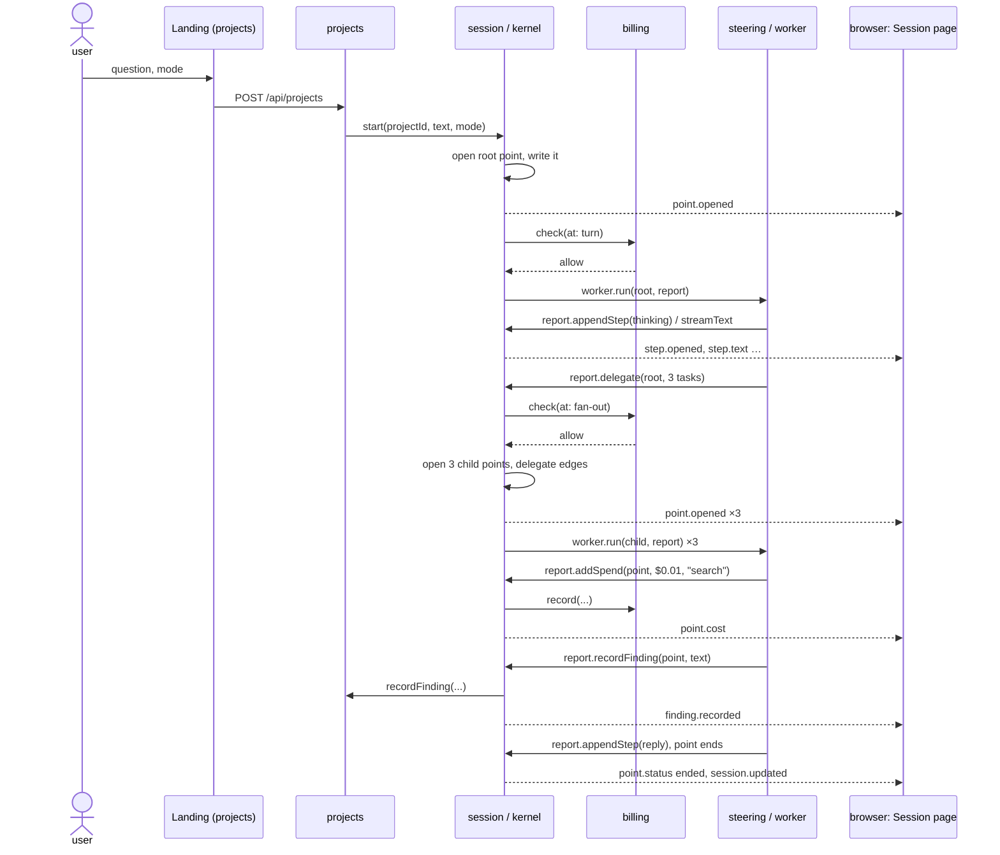

Over the cap: `check` returns `escalate`, the point goes `waiting`, the browser
gets `approval.requested`, the user answers, the kernel resumes or stops.

Sprint 1 walks this with a worker that emits one fixed step and ends.

---

## 9. The session slice

### Structure

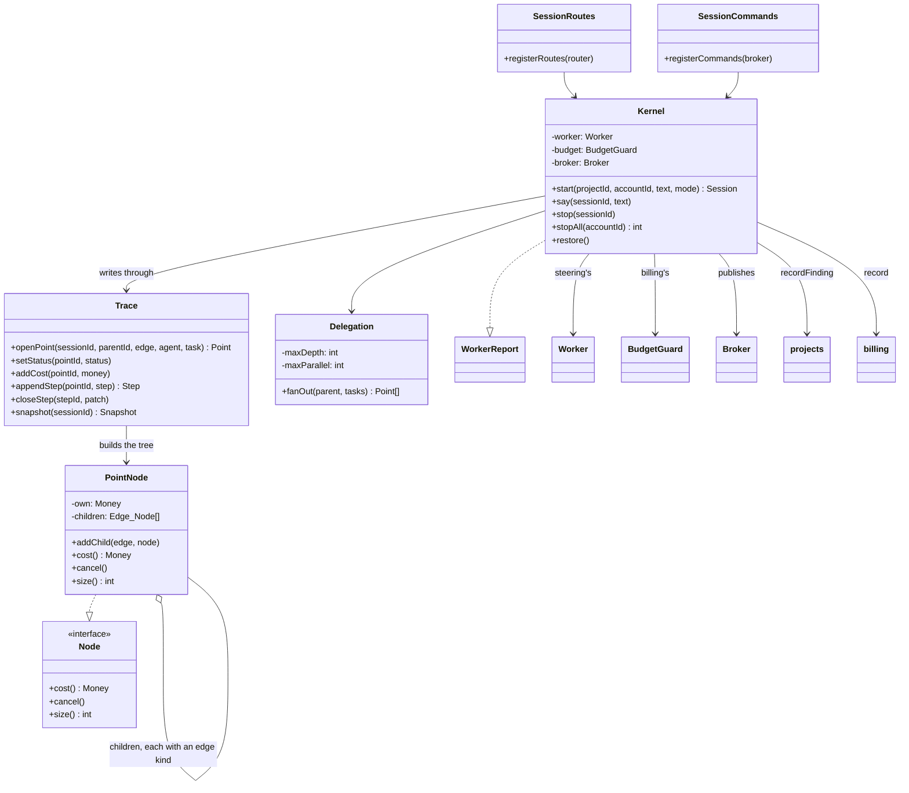

- **Trace** is the durable record: every point and step written to Postgres as
  it happens, and read back as the snapshot.
- **Kernel** is the engine. It implements `WorkerReport`, so the worker's every
  report lands in the trace and on the socket in one call.
- **Delegation** fans a `delegate` step out into child points, bounded by depth
  and parallelism.
- **PointNode** is the Composite the design problem asks for.

### The design problem: Composite

A point and a subtree must answer cost, cancel and size the same way. Cost rolls
up along `delegate` edges only.

Brute force, before:

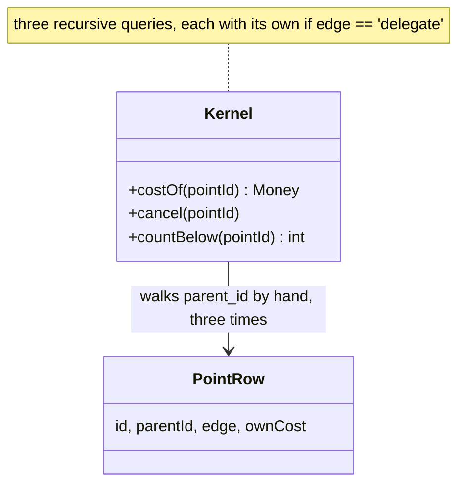

With the pattern, after:

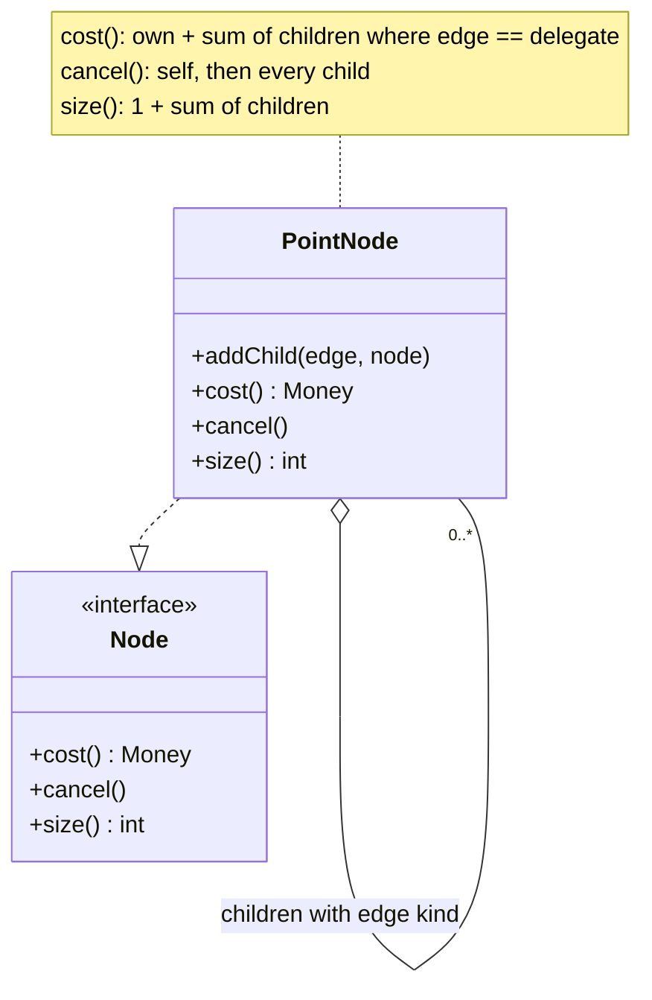

The caller holds one `Node` and does not know whether it is a leaf. The edge
rule lives in one place. Compared with Visitor (over-general for three
operations) and a flat table walk (the brute force). The test that proves it is
`session.test.ts`: delegate cost counted, branch and compact not.

### Delegation, cost and cancel

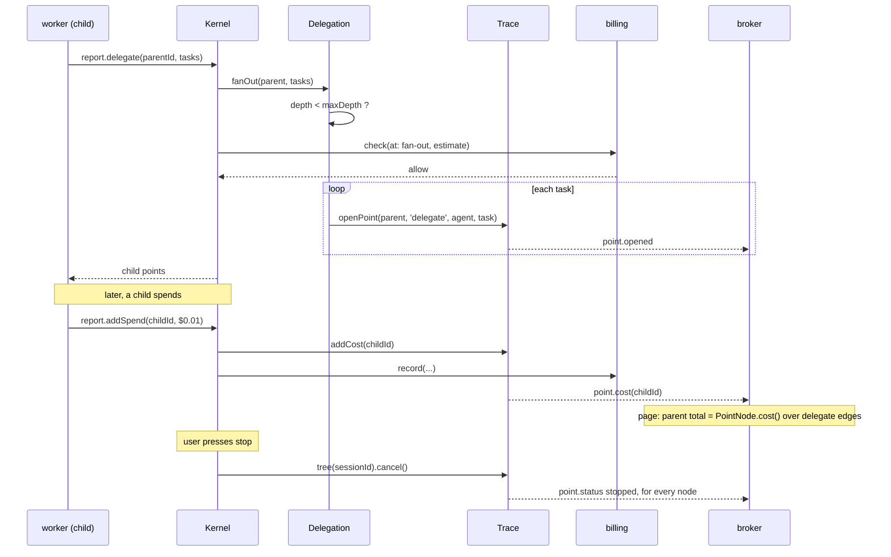

### Restore after a restart

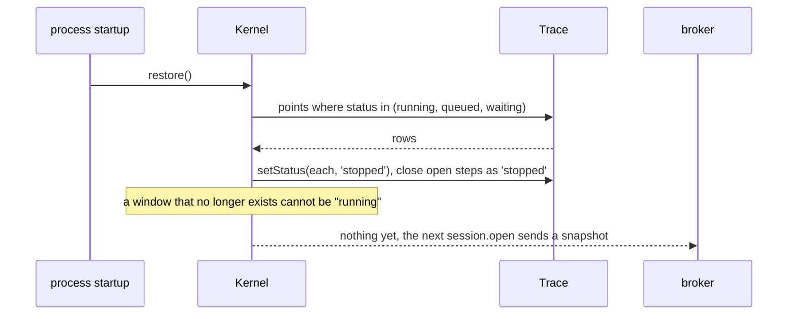

Nobody pressed stop, but the reasoning is the same: the window was ended from
outside. `stopped`, not `failed`.

### The page

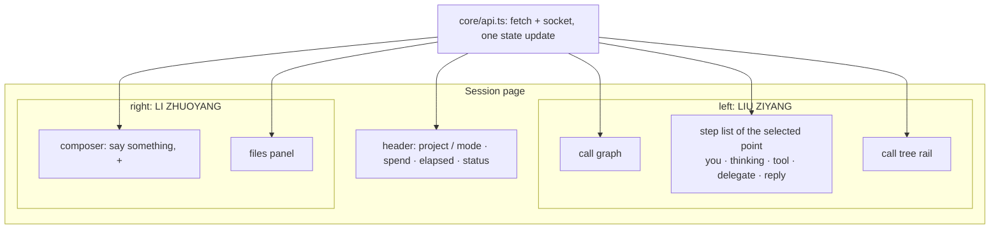

One function in `apps/web/src/core/api.ts` applies every `ServerEvent` to one
state object. Both halves read it; neither restyles the other.

---

## 10. Analysis → design: the rules every slice follows

| Analysis element | Becomes | Where |
|---|---|---|
| boundary class (a screen) | a page under `apps/web/src/pages/<page>/` and the routes it calls | the page's owner |
| control class (the use case's logic) | a service in the slice: `AuthFlow`, `ProjectCards`, `Kernel`, `SteerQueue`, `BudgetChain` | the slice |
| entity class (a persisted noun) | a type in `packages/contracts` and a table the slice owns | contract + slice |
| association across slices | a public index call, or an interface in `core/domain` | never a shared SQL write |
| anything the browser sees change live | a `ServerEvent` | contract |
| the proposal's design problem | the pattern on the control class; brute force kept for the before/after | the slice |

Entities are the same in every diagram: they are the contract. Control classes
are where the patterns live: that is where the conditionals gather.

---

## 11. What lands when

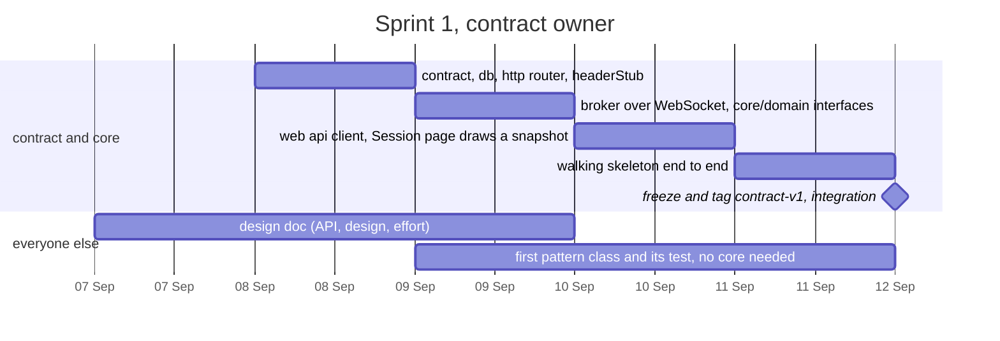

---

## 12. Effort (LIU ZIYANG)

| # | Task | Sprint | Days |
|---|---|---|---|
| 1 | contract written, reviewed, frozen | 1 | 1.0 |
| 2 | core/db: pool, migrations, base schema | 1 | 0.5 |
| 3 | core/http: router, registerRoutes, resolver injection | 1 | 0.5 |
| 4 | core/protocol: broker over WebSocket, onCommand | 1 | 1.0 |
| 5 | web core: api client, router, shell | 1 | 0.5 |
| 6 | walking skeleton, first integration | 1 | 1.0 |
| 7 | backlog, sprint plan, report 1, burndown | 1 | 0.5 |
| 8 | UC3 analysis and design diagrams | 1–2 | 2.0 |
| 9 | Trace + PointNode: persistence, roll-up, cancel, restore | 2 | 1.5 |
| 10 | Delegation over the Worker interface | 2 | 1.5 |
| 11 | Session page: step list, streaming, call tree | 2–3 | 1.5 |
| 12 | budget checks at three points, waiting and resume | 3 | 1.0 |
| 13 | design problem write-up, before/after | 3–4 | 1.0 |
| 14 | pipeline jobs for core and session | 2 | 0.5 |
| 15 | integration, hardening, report, presentation | 4 | 1.0 |
|   | **total** |   | **15.0** |

Five over the proposal's ten: rows 1 to 4 and 7 are the shared contract and the
reporting, which the proposal spreads across the team. Rows 1 to 6 cannot move;
everyone waits on them. Rows 11 and 13 can drop to one day each.

---

## 13. Glossary

One word, one meaning.

| Word | Means | Not |
|---|---|---|
| slice | one person's vertical: pages, module, tables, pipeline jobs | a layer |
| module | a slice's server directory, `modules/<name>/` | a folder inside it like `kernel` |
| public index | a module's `index.ts`, the only importable file | |
| core | db, http, auth guard, broker; shared by all | a slice |
| contract | `packages/contracts`: types the browser and every slice share | the routes |
| principal | the signed-in account as a route sees it: id and role | the account record |
| session | one run on one question, under a project | a login |
| point | one agent context window; a node of the graph | a message |
| edge | why a point exists: delegate, branch, compact, handover | |
| step | one row in a point: you, thinking, tool, delegate, reply | |
| trace | all points and steps of a session, in order, in Postgres | a log file |
| kernel | the engine in the session slice | the worker |
| worker | the agent loop in the sandbox; steering's | the kernel |
| report | the interface the worker reports through; its only door out of the sandbox | |
| broker | carries events out and commands in | a message queue |
| event | server → browser, a fact | |
| command | browser → server, a request | |
| snapshot | everything about a session so far | |
| finding | a result the agent recorded; projects owns it | a reply |
| approval | a request over the cap; billing owns it | |
| steer | a message queued into a running turn; steering owns it | `session.say` |
| cap | the monthly spend limit | a per-session budget |
| owner | the person in CODEOWNERS for a path | |
