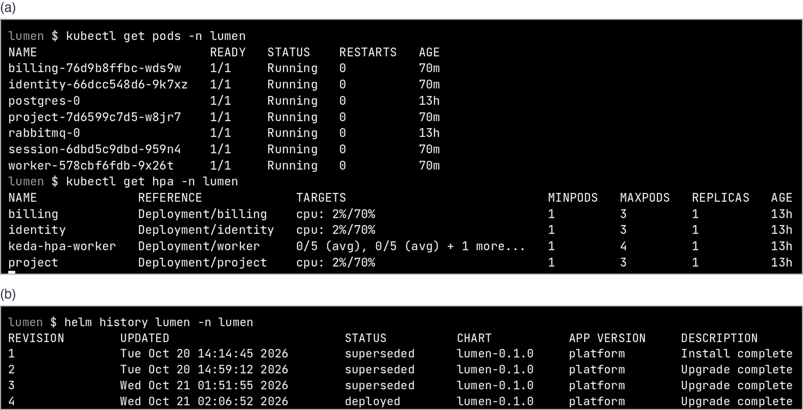
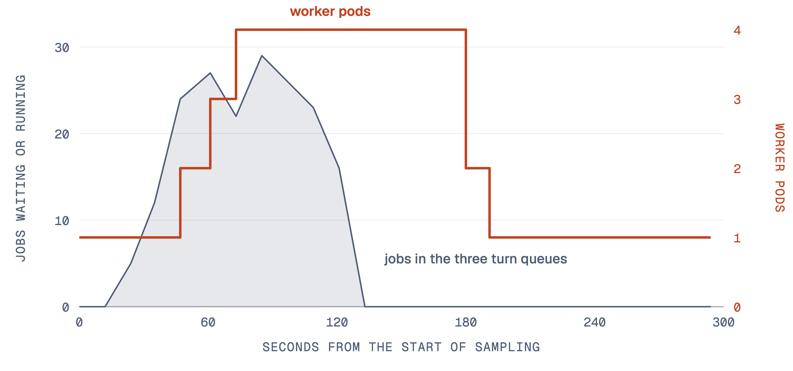
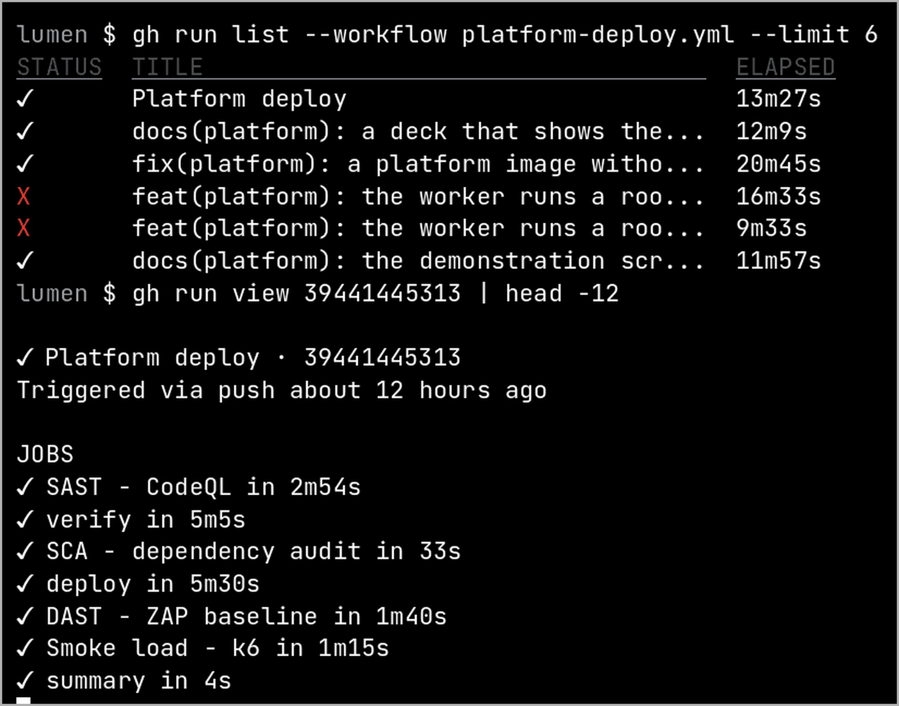

## Project Title

Lumen Platform. Lumen is an AI for research. You ask one question; several AI agents share
the work; you see every step and its cost. A lead agent splits the question into tasks and
gives parts to reader agents. Each step, finding and cost goes into a call tree, the record of
the run that the user can open. The budget cap is the most an account spends in a month;
spend above it waits for the owner's approval.

For this module, the team builds the Lumen Platform from the same code. Five services
(identity, project, session, worker, billing) run on Kubernetes behind one gateway. Other apps
use the platform through a public API.

## Date

20 October 2026. This report covers 7 to 20 October 2026: from the approved proposal (version
2, 6 October) to the end of project conduct.

## Summary of Work Done

All services, the pipeline and the public host were merged into the integration branch and
deployed on 20 October. Table 1 lists the tasks. Figure 1 shows the deployment as it stood at
the end of the period.

Table 1. Tasks done from 7 to 20 October 2026. Source: git history of the integration branch.

| Task | Owner | Result |
|---|---|---|
| Service boundaries, internal routes and the turn protocol between session and worker | LIU ZIYANG | Contract document; one prompt per member with the interfaces to build |
| Session service: runs the call tree, writes each step, streams the run to the browser | LIU ZIYANG | Session service and the shared turn protocol; read a question's answer, findings and cost through the API |
| Identity service; Traefik gateway with HTTPS and a sign-in rate limit | LU YI | Identity service; Let's Encrypt certificate on the public address |
| API keys with scopes and a per-key rate limit | LU YI | 21 requests pass, the next one gets HTTP 429 |
| Project service and agent registry; ask through the API; usage per key | PENG XUJIAN | Producers publish an agent; consumers ask with it and read usage |
| Literature watch: a second app built only on the public API | PENG XUJIAN | Published its agent, asked one topic, printed a digest in 5 s |
| Worker service: takes turns from RabbitMQ, one queue for each level of the call tree | LI ZHUOYANG | Worker service; a root turn runs with the agent the user chose |
| Worker deleted during a question, gracefully and by force | LI ZHUOYANG | The question ended both times |
| Billing service | HE RONG | Wallet, budget cap, approvals and top-ups as their own service |
| Helm chart with HPA and KEDA; deploy pipeline with SCA, SAST, image scan, DAST and a smoke load | HE RONG | Pipeline run 39441445313 passed every stage |
| k6 load test that makes the workers scale | PENG XUJIAN, HE RONG | 135 questions, 0 of 1,040 requests failed, workers 1 to 4 and back to 1 |

Terms used in Table 1. A turn is one job for a worker: one agent's work on one task. The
**HPA** (Horizontal Pod Autoscaler) adds service copies when CPU use rises. **KEDA**
(Kubernetes Event-Driven Autoscaling) adds workers when jobs wait in the queues.

Figure 1 shows where each part runs. All of the platform runs on one virtual machine; the
reason is budget (see Problems Encountered).

{width=12.5}

Figure 2 is the cluster as the team saw it through SSH: one pod for each service, the two
data stores, the three HPAs and the HPA that KEDA made for the worker. Each deploy is a Helm
release, so a bad release rolls back with one command.

{width=13}

Figure 3 shows one use case end to end, "ask a question through the public API". The app
posts the question with an API key, gets the session id at once, and reads the answer and
its cost later. No web request waits for the model.

{width=10}

Figure 4 shows the load test on the public host. The workers ran with a fixed delay in place
of each model call, so the test cost no model money. KEDA added workers while more than five
jobs waited for each worker, and removed them about a minute after the queues were empty.

{width=12}

## Effort Expended

Table 2. Hours per member from 7 to 20 October 2026.

| Member | Work in this period | Hours |
|---|---|---|
| LIU ZIYANG | Contracts; session service; demonstration script; first project report | 56 |
| LU YI | Identity service; gateway, HTTPS, rate limits; API keys | 70 |
| PENG XUJIAN | Project service; agent registry; literature watch; usage; k6 test | 70 |
| LI ZHUOYANG | Worker service; turn queues; agent on a root turn; worker deletion test | 70 |
| HE RONG | Billing service; Helm chart; public host; deploy pipeline | 66 |
| Total | | 332 |

How the hours were counted: the proposal plans ten person-days of 8 hours (80 hours) for each
member. Each member's 80 hours are split between the two report periods by the work that
member delivered in each period, from the git history and the owned service.

## Problems Encountered

Table 3. Problems from 7 to 20 October 2026 and what the team did.

| Problem | What the team did |
|---|---|
| Budget for the host. The first plan was one EC2 t3.xlarge (4 vCPU, 16 GB) at about USD 5 a day. | One t3.medium (2 vCPU, 4 GB, 2 GB swap) at about USD 1.3 a day. Every container requests 128 MiB; workers scale from 1 to 4. |
| Image distribution. A container registry is one more service to run and to pay for. | The pipeline builds the image, copies it to the host over SSH and imports it into k3s. The image tag is the commit. |
| The image scan stopped the deploy (run 39439752963): 5 critical CVEs, from the Docker engine that the web app's image carries. | A platform image without Docker, patched at build. The next run, 39441445313, passed every stage. |
| The public API was not on the host at first: `GET /api/v1/openapi.json` returned 404. | Merged and deployed; then keys, registry, asking, usage, the OpenAPI document and the 429 limit were checked on the host. |
| A worker killed by force: its unacknowledged turns ran again from their start. The question ended, but cost USD 0.08 with 8 findings instead of USD 0.03 with 3. | Recorded as a known limit. The fix is an idempotency key for each step; it goes into the project report. |

Figure 5 shows the pipeline runs. The two red runs are the image scan at work: the image
with 5 critical CVEs never reached the host. The run after the fix passed every stage.

{width=9}

Figure 6 shows the worker test as the presentation repeated it with the real model: the only
worker pod is deleted by force during a question, Kubernetes starts a new one, and the
question ends.

{width=11}

The team solved these problems itself. No help from the lecturers is needed.

## Plan for the Next 2 Weeks

Table 4. Tasks planned from 21 October to 3 November 2026.

| Task | Owner | Date |
|---|---|---|
| Run the load test with the real model on the public host | LIU ZIYANG | 21 Oct |
| Test that an approval resumes a waiting task across the billing and session services over HTTP | HE RONG | 21 Oct |
| Presentation deck, speaking script and recorded demonstrations | LIU ZIYANG | 21 to 24 Oct |
| Rehearse; each member presents the part that member built | All members | 23 to 25 Oct |
| Presentation and live demonstration | All members | 26 Oct, 11:25 |
| Prepare for the written exam | All members | 3 Nov |
