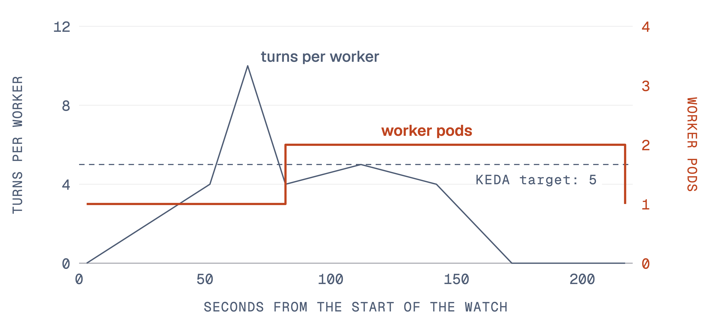

## Project Title

Lumen Platform. Lumen is an AI for research. You ask one question; several AI agents share
the work; you see every step and its cost. A lead agent splits the question into tasks and
gives parts to reader agents. The budget cap is the most an account spends in a month; spend
above it waits for the owner's approval.

The platform runs Lumen as five services (identity, project, session, worker, billing) on
Kubernetes. Other apps use it through a public API.

## Date

27 October 2026. This report covers 21 to 27 October 2026. In this period the team ran the
real model under load, made the presentation deck and presented on 26 October. The plan runs to
the project report on 16 November.

## Summary of Work Done

A **turn** is one unit of work for a worker: one agent's work on one task. A **producer** is
the author of an agent; other users ask questions with that agent. Table 1 lists the tasks.

Table 1. Tasks done from 21 to 27 October 2026. Source: git history of the integration branch,
the evidence files, the meeting minutes of 23 October, and deploy run 39542685448.

| Date | Task | Owner | Result |
|---|---|---|---|
| 21 Oct | An approval resumes a waiting task across the billing and session services over HTTP | HE RONG | 4 integration tests pass; the deploy run passed |
| 21 Oct | The deployed model is named in the pipeline, so the cost of the demonstration does not depend on a default | HE RONG | gpt-4.1-nano on the public host |
| 21 Oct | k6 load test with the real model on the public host | LIU ZIYANG | 131 questions, 0 % failed requests, median 4.1 s, p95 27.0 s to finish; workers 1 to 2 and back to 1 |
| 21 to 24 Oct | Presentation deck of 25 slides in the order of the course outline, with terminal recordings from the public host; speaking script and speaker guide | LIU ZIYANG | Each member presents the part that member built |
| 23 Oct | Planning meeting and rehearsal | All members | Slide numbers, handovers and the KEDA explanation agreed |
| 24 Oct | gpt-4.1-nano replaced by gpt-4.1-mini | LIU ZIYANG | The provider rejected gpt-4.1-nano with HTTP 404 |
| 25 Oct | Public host moved to a Vultr VM in Singapore with the same Helm chart; demonstration scripts and a narrated backup video | LIU ZIYANG | Backup video of 2 min 42 s; three extra recordings on the new host |
| 25 Oct | An agent registry page in the web app: a producer publishes an agent, a user asks with it | LIU ZIYANG | Uses only the public API routes |
| 26 Oct | Presentation and live demonstration, 11:25 to 12:05 | All members | Each member presented the part that member built |
| 26 Oct | A new account's budget cap comes from configuration: USD 0.05 on the public host | LIU ZIYANG | A new sign-up cannot run up the model bill |

On 21 October the workers called the real model, gpt-4.1-nano, under load for the first
time. Figure 1 shows how KEDA (Kubernetes Event-Driven Autoscaling) changed the number of
workers in that run. A worker spends most of a turn waiting for the model. Fewer turns waited
in the queues than in the run of 20 October. KEDA added one worker; on 20 October it added
three. Figure 2 is the same run in the terminal.

{width=15.9}

{width=15.9}

On 25 October the public host moved to a Vultr VM with the same Helm chart (Figure 3). The
platform still runs on one node.

{width=15.9}

Figure 4 repeats the KEDA test of the presentation on the new host with the real model. The
worker deletion test passed on the new host too, and the question ended with 3 findings.

{width=15.9}

The team recorded the narrated backup video of the demonstration on the new host. Figure 5
shows the producer side of the agent registry. Figure 6 shows a question asked with the
published agent.

{width=9.5}

{width=12}

The deck of 26 October is docs/platform/slides/out/Team15-Lumen-Platform.pptx in the repository.

## Effort Expended

Table 2. Hours per member from 21 to 27 October 2026, and from 7 October to date.

| Member | Work in this period | Hours this period | Hours to date |
|---|---|---|---|
| LIU ZIYANG | Real-model run; deck, script and speaker guide; host move; slides 1 to 8 | 24 | 80 |
| LU YI | Slides 9 to 12: public API and deployment; answers on keys and the gateway | 10 | 80 |
| PENG XUJIAN | Slide 24: the live demonstration, the agent registry and the literature watch | 10 | 80 |
| LI ZHUOYANG | Slides 13 to 16: the queue decision, the sequence, the worker deletion | 10 | 80 |
| HE RONG | Approval test across HTTP; model in the pipeline; slides 17 to 23 | 14 | 80 |
| Total | | 68 | 400 |

The proposal plans ten person-days of 8 hours (80 hours) for each member. The team split each
member's 80 hours between the two report periods by the work delivered in each period. The
git history, the service that each member owns and the slides that each member presented show
that work.

## Problems Encountered

Table 3. Problems from 21 to 27 October 2026 and what the team did.

| Problem | What the team did |
|---|---|
| The lecturer asked the team, at the presentation, to write down why the platform runs on one node. | The reason is budget. The team pays for the host. One node of 2 vCPU and 4 GB costs about USD 1.3 a day on EC2, or USD 20 a month on Vultr. One node is one failure domain and shows no node autoscaling. The same Helm chart installs on EKS with several nodes. The project report states this decision and its cost. |
| With the real model, one of 131 questions was still running when the load profile ended; p95 time to finish was 27.0 s. | The run of 20 October, with a fixed delay in place of each model call, remains the evidence for scaling to 4 workers. |
| The model provider rejected gpt-4.1-nano with HTTP 404 on 24 October. | The pipeline and the default model changed to gpt-4.1-mini. |
| The first Vultr VM (1 vCPU, 2 GB) ran out of memory during the first install. It swapped about 500 MB, the k3s API timed out and the Helm release stayed pending. | The host runs on 2 vCPU and 4 GB, the smallest size that works. |
| A public sign-up could spend model money. | The default budget cap of a new account is USD 0.05 on the public host. |

The team needs no help from the lecturers.

## Plan for the Next 2 Weeks

Table 4. Tasks planned from 28 October to 10 November 2026, and the project report on 16 November.

| Task | Owner | Date |
|---|---|---|
| Write the one-node decision into the project report: the budget, the single failure domain, and the same chart on EKS | LIU ZIYANG, HE RONG | 2 Nov |
| Bring the project report up to date: the Vultr host, gpt-4.1-mini, the default budget cap, the real-model run | LIU ZIYANG | 2 Nov |
| Record an approval that resumes a waiting task on the public host, through the gateway and the queues | HE RONG | 2 Nov |
| Each owner checks the report sections on that owner's service | All members | 2 Nov |
| Written exam | All members | 3 Nov, evening |
| Build the project report in the course template and check each page | LIU ZIYANG | 10 Nov |
| Submit the project report | LIU ZIYANG | 16 Nov |
