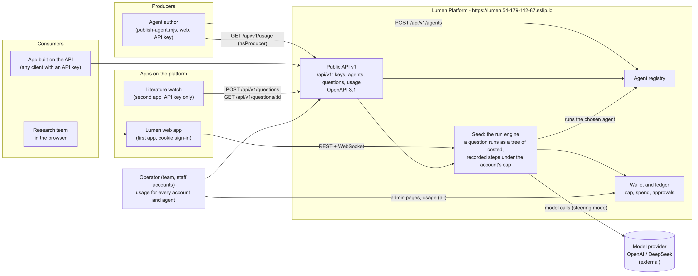
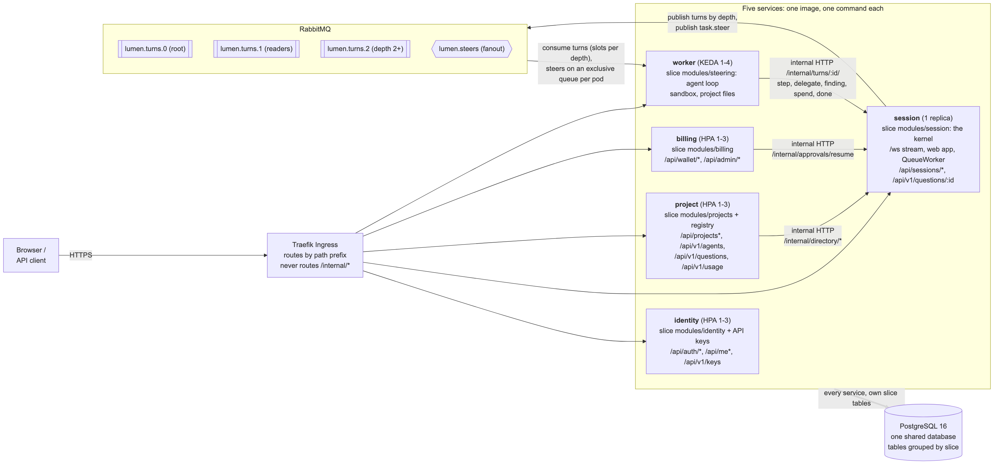
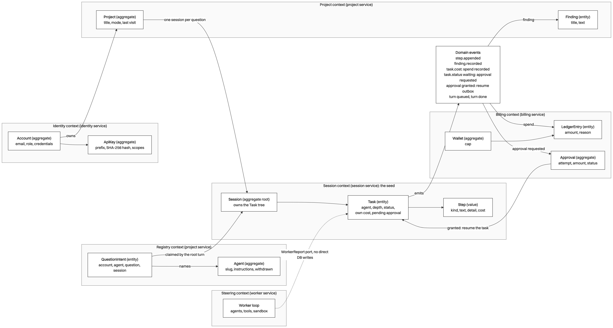
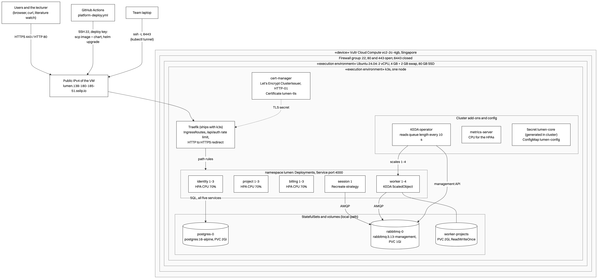
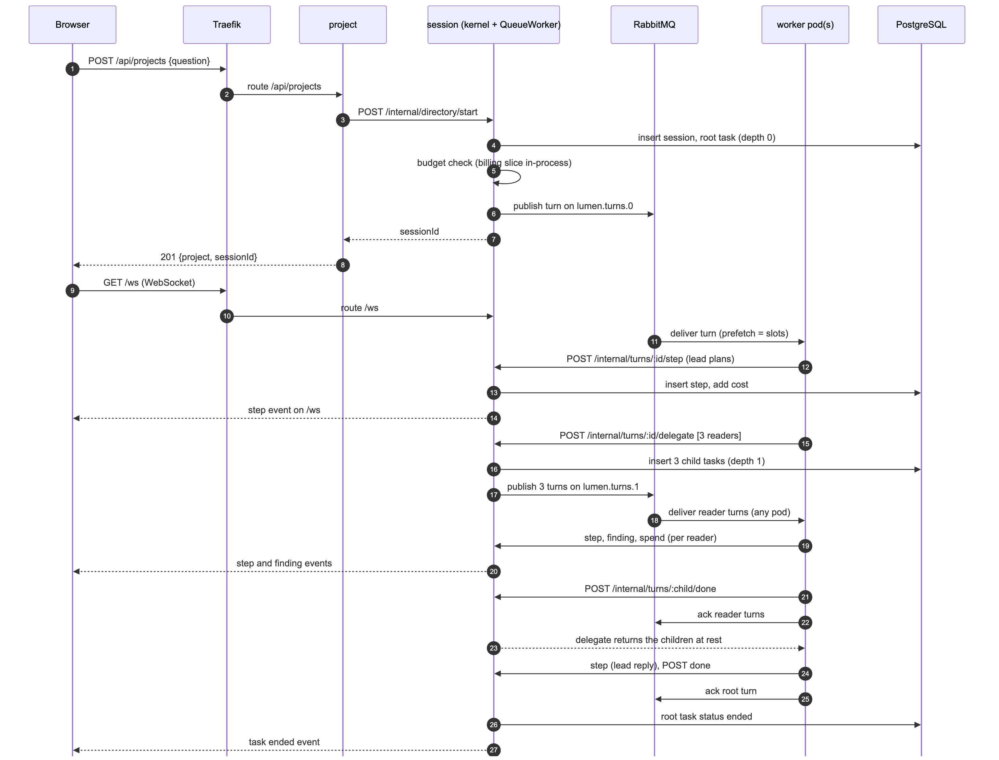
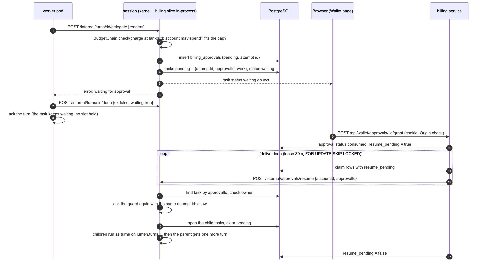
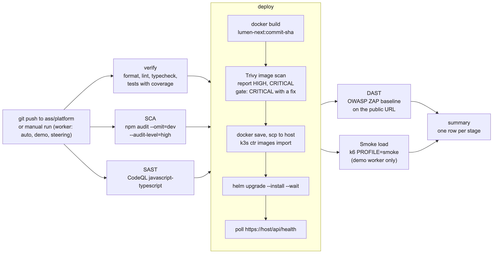

# Project Report for Lumen Platform

Practice Module for Graduate Certificate in Architecting Scalable Systems

Team 15

Members: HE RONG, LI ZHUOYANG, LIU ZIYANG, LU YI, PENG XUJIAN

Public address: https://lumen.54-179-112-87.sslip.io

---

## 1. Introduction

### 1.1 Background

Research teams now give work to language-model agents. An agent reads papers,
runs a calculation, or checks a claim. Each team that does this builds the same
parts again:

- a record of each step and its cost;
- a spending cap per account;
- a sandbox for commands;
- sign-in;
- a live view of the run.

Lumen is the team's research workspace. It started as one Node.js application
(the "monolith" on the `main` branch). The monolith is organised in vertical
slices: identity, projects, session, steering and billing. Each slice owns its
routes, its tables and its ports.

This project turns Lumen into **Lumen Platform**: the slices run as separate
services on Kubernetes in AWS, behind a public HTTPS address. Producers publish
agents. Consumers ask questions through the web app or a public API. The
platform runs each question, records every step with its cost, streams the run
live, and stops work that would pass the account's cap.

The team submitted the proposal (version 2) on 6 October 2026. The lecturer's
review on the same day asked for "a horizontally scalable cloud-native
microservice-oriented system". The team presents on 26 October 2026 at 11:25
and submits this report by 16 November 2026.

### 1.2 Business Needs

The briefing asks: what are the pain points, and what does a new use case gain
when it is built on the platform? For Lumen the answers are these:

- **Repeated work.** Every team that runs agents builds sign-in, cost control,
  a step record and a live view again. The platform builds them once.
- **No place to publish an agent.** An agent author has no way to offer a good
  agent to other teams. The platform has an agent registry.
- **No safe way to run another team's agent.** The platform runs a chosen
  agent under the consumer's own cap, and records every step and its cost.
- **Load that comes in bursts.** One question fans out to several reader
  agents. The platform must add workers when turns wait, and remove them
  after.
- **Spend with no limit.** A model call costs money. The platform checks each
  step against the account's cap and asks the owner before it passes the cap.

### 1.3 Stakeholders

| Stakeholder | Type | Interest |
|---|---|---|
| Research teams (consumers) | Business | Ask questions, watch the run, keep the findings, control the cost. |
| Agent authors (producers) | Business | Publish an agent once; see how much it is used. |
| App developers (consumers of the API) | Business and IT | Build an app on the API with a key, for example the literature watch. |
| Operator (the team, staff accounts) | IT | Run the cluster, read usage and spend for every account and agent. |
| Model providers (OpenAI, DeepSeek) | External | Supply the model calls. Not built by the team. |
| NUS-ISS lecturers | Assessor | Assess the architecture, the demonstration and this report. |
| Team 15 members | Delivery | Each member owns one service (section 2.1). |

### 1.4 Project Scope

The scope is the platform side of the system: the services, the messages
between them, the deployment, the pipeline, the public API, and two apps on the
platform. The architecture in this report is wider than the build in some
places. Section 3.4 lists each place where the build differs from the
proposal, with the reason and the resolution.

The work has two phases:

- **Phase 1 (8 to 26 October 2026): the demonstration.** Five services on
  k3s on one EC2 instance, the public HTTPS address, autoscaling, the pipeline,
  the public API v1, the agent registry, and the literature watch.
- **Phase 2 (after the presentation): the roadmap.** The items in section 3.4,
  for example a second session replica, one database per service, and EKS.

#### 1.4.1 Functionality in scope

The use cases come from the proposal (UC1 to UC6). The evidence for each status is in `docs/platform/evidence/`.

| ID | Use case | Actor | Status on 20 October 2026 |
|---|---|---|---|
| UC1 | Publish an agent in the registry; the platform lists it. | Producer | Built and verified on the public host, as instructions for the lead agent (AISS-09). |
| UC2 | Ask a question with a chosen agent through the public API; read the steps, the answer and the cost. | Consumer | Built and verified on the public host. |
| UC3 | Create, scope and revoke an API key; a request over the rate limit gets 429. | Consumer | Built and verified on the public host (429 after 21 requests). |
| UC4 | Approve or refuse a step that would pass the cap. | Consumer | Built and deployed (from the billing slice). |
| UC5 | Read usage: sessions and cost per account and per agent. | Operator, Producer | Built and verified on the public host as `GET /api/v1/usage`, plus the staff pages. Latency per agent is the median time to rest. |
| UC6 | Literature watch: a second app that asks saved questions on a schedule. | Consumer | Built and verified: it ran end to end on the public host (`apps/watch/`, CronJob in the chart). |

Other functions in scope:

- Sign-up, sign-in, and the auth cookie on every service.
- A question runs as a tree of tasks: a lead agent delegates to reader agents.
- The live stream of steps over a WebSocket (`/ws`).
- Autoscaling: HPA on CPU for identity, project and billing; KEDA on queue
  length for the worker.
- A k6 load test and an autoscaling demonstration on the public host.
- A CI/CD pipeline with SCA, SAST, an image scan, DAST and a smoke load.

#### 1.4.2 Functionality out of scope

From the proposal:

- Payments to producers. Billing measures usage; payout is not built.
- More than one region.
- Training or fine-tuning models.
- A mobile client.

Moved out of scope during the project (section 3.4 gives the reasons):

- A separate `stream` service and a separate `model-gateway` service.
- One database per service.
- A managed cluster (EKS) with node autoscaling.
- Agents as remote endpoints, tools or model adapters from producers.
- OpenTelemetry tracing, Prometheus metrics and network policies.
- A client library for the API. The OpenAPI document takes its place.

---

## 2. Project Conduct

### 2.1 Project Plan

The proposal estimated ten person-days per member, fifty in total. The table
below is the WBS from the proposal (in person-days), with the owner of each
service as built. The owners follow `docs/platform/contract.md`.

| WBS | Task | Owner | Estimate (days) |
|---|---|---|---|
| 1 | Architecture: service boundaries, API and event contracts | LIU ZIYANG | 3 |
| 2 | Session service (the stream is now inside session); shared adapters; demo script | LIU ZIYANG | 7 |
| 3 | Identity service; ingress, HTTPS, rate limits; API keys | LU YI | 7 |
| 4 | Public API v1, OpenAPI document | LU YI | 3 |
| 5 | Project service and agent registry | PENG XUJIAN | 4 |
| 6 | Second app (literature watch); usage analytics; k6 load test | PENG XUJIAN | 6 |
| 7 | Worker service and the job queue | LI ZHUOYANG | 5 |
| 8 | Model gateway (not built, see AISS-08); KEDA autoscaling for workers; agent instructions on a root turn | LI ZHUOYANG | 5 |
| 9 | Billing service | HE RONG | 4 |
| 10 | Kubernetes, Helm chart, AWS host, deploy pipeline, DevSecOps stages | HE RONG | 3 |
| 11 | Load tests and capacity results | HE RONG | 3 |
| | **Total** | | **50** |

### 2.2 Project Status

As of 21 October 2026 the status is as follows.

Done, deployed and verified on the public host:

- The five services, PostgreSQL and RabbitMQ on k3s on one EC2 instance.
- HTTPS with a Let's Encrypt certificate on `lumen.54-179-112-87.sslip.io`.
- One question end to end, through the queues, with the live stream.
- The HPAs and the KEDA ScaledObject. The k6 test made the workers scale from
  1 to 4 and back to 1 (section 4.1).
- The public API v1: API keys with scopes, the agent registry, asking with a
  chosen agent, the answer, usage, the OpenAPI document and the per-key rate
  limit (`docs/platform/evidence/2026-10-20-public-api-flow.md`).
- The literature watch: it published its agent, asked through the API with
  only the URL and a key, and printed a digest (same evidence file).
- A worker pod deleted during a question, gracefully and by force: the
  question ended both times (`docs/platform/evidence/2026-10-20-worker-kill.md`).
- The full pipeline: run 39441445313 passed every stage (SCA, SAST, verify,
  image scan, deploy, DAST, smoke load). The run before it stopped on purpose
  at the image scan (section 5.3).

Latest evidence and limits of the current demonstration:

- The 21 October real-model run used steering with gpt-4.1-nano. Of 131
  questions, 130 were at rest when the profile ended; one was still running.
  HTTP failures were 0%, median time to rest was 4.1 s and p95 was 27.0 s.
  KEDA scaled workers from 1 to 2 and back to 1. See
  `docs/platform/evidence/2026-10-21-load-real-model.md`.
- Deployment run 39542685448 passed verify, SCA, SAST, image scan/deploy and
  DAST. Its k6 smoke job was skipped as designed in steering mode; the green
  pipeline does not mean that a new smoke load ran.
- The recorded short profiles demonstrate observed scaling, not the full
  profile or the proposal's maximum capacity. A hosted cross-service approval
  scenario still needs its own evidence; local integration tests do not prove
  the live ingress and queue configuration.

Outstanding issues:

- The fortnightly progress report in Canvas. [TEAM TO FILL: the date the
  progress report was submitted, or a statement that it was late and why.]
- The open items in section 3.4.

### 2.3 Project Metrics

Milestones. The work followed the schedule in the proposal (its Figure 9).
Every milestone below is done.

| Date | Milestone | Evidence |
|---|---|---|
| 1 Oct 2026 | Proposal v1 | `01_Proposal-v1_2026-10-01.docx` |
| 4 Oct 2026 | Proposal v1.1 | `02_Proposal-v1.1_2026-10-04.docx` |
| 6 Oct 2026 | Proposal v2, and the lecturer's review | `03_Proposal-v2_2026-10-06.docx` |
| 8 to 12 Oct 2026 | Architecture: service boundaries, API and event contracts (WBS 1) | `docs/platform/contract.md` |
| 8 to 16 Oct 2026 | Identity, project, worker and billing services (WBS 3, 5, 7, 9) | `apps/server/src/services/` |
| 13 to 21 Oct 2026 | Session service and the shared turn protocol (WBS 2) | `apps/server/src/services/session.ts` |
| 14 to 16 Oct 2026 | Kubernetes: Helm chart with HPA and KEDA; the deploy pipeline (WBS 10) | `deploy/k8s/lumen/`, `.github/workflows/platform-deploy.yml` |
| 14 to 21 Oct 2026 | Public API v1, literature watch, KEDA autoscaling, load tests (WBS 4, 6, 8, 11) | `apps/watch/`, `deploy/k8s/load/`, `docs/platform/evidence/` |
| 20 Oct 2026 | Pipeline run 39441445313: every stage passed | GitHub Actions |
| 21 Oct 2026 | The real model on the public host | `docs/platform/evidence/2026-10-21-load-real-model.md` |
| 26 Oct 2026 | Presentation, 11:25 | Presentation schedule |
| 16 Nov 2026 | Report submission | Briefing |

Effort per member. Each member spent about ten person-days (80 hours), as the proposal's work
breakdown planned: 400 hours in total.

| Member | Main work | Effort (hours) |
|---|---|---|
| HE RONG | Billing service, Helm chart, KEDA, AWS host, deploy pipeline, DevSecOps stages | 80 |
| LI ZHUOYANG | Worker service, the turn queues, agent instructions on a root turn | 80 |
| LIU ZIYANG | Session service, shared adapters, integration, contracts, demo script | 80 |
| LU YI | Identity service, Traefik ingress, HTTPS, rate limit, API keys | 80 |
| PENG XUJIAN | Project service, agent registry, public API routes, k6 test, literature watch | 80 |
| **Total** | | **400** |

---

## 3. Solution Overview

Figure 1 shows the platform in its context: the seed, the producers, the
consumers, the operator and the two apps.

### 3.1 Logical Architecture & Design

The platform is five services. Each service is one existing slice of the
monolith, built by a new entry point (`apps/server/src/services/<name>.ts`).
Every service runs from the same container image with a different command.

Figure 2 shows the services, the internal calls, the queues and the database.

Two kinds of call cross a process boundary:

- **Messages on RabbitMQ.** The session service puts each agent turn on a
  durable queue. Any worker pod takes it. Steers (a person's message to a
  running agent) go on a fanout exchange to every worker pod.
- **Internal HTTP.** The worker reports each step back to the session
  service. The project and worker services reach the running kernel through
  the session directory. The billing service resumes an approved task.

All five services share one PostgreSQL database. A port that only reads or
writes the database stays in-process: a service builds the other slice over
the shared database. Section 3.4 (AISS-02) states this as a limitation.

#### 3.1.1 Key Architectural Decisions

The key architectural decisions taken are as follows:

| Identifier | Description |
|---|---|
| AD-01 | **Service boundaries follow the existing slices.** Decision: five services (identity, project, session, worker, billing), each one an existing slice with a new entry point. Alternative: the eight services of the proposal, written new. Trade-off: fewer services than the proposal, and two proposed services (stream, model gateway) are not separate. Rationale: the slices already have clear ports and tests. Reuse leaves the time for the parts that must change, which are the calls between processes. The `main` branch keeps its tests green, because the slice internals do not change. |
| AD-02 | **A turn crosses from session to worker on a durable RabbitMQ queue.** Decision: the kernel takes a `Worker` port. The session service gives it a `QueueWorker`, which publishes the turn and waits for `/internal/turns/:id/done`. Alternatives: a direct HTTP call from session to a worker; the worker loop inside session. Trade-off: one more moving part (the broker) and a second protocol. Rationale: a slow model call never holds a web request. Any worker pod can take any turn. A worker that dies before it acknowledges leaves the turn on the queue for another worker. KEDA can scale on the queue length. The kernel does not change. |
| AD-03 | **One queue per task depth.** Decision: `lumen.turns.0` (root), `lumen.turns.1` (readers), `lumen.turns.2` (depth 2 and deeper), each with its own slots per pod (`LUMEN_WORKER_SLOTS`, default 4). Alternative: one queue. Trade-off: three queues to watch and three KEDA triggers. Rationale: a parent turn keeps its worker slot while `delegate` waits for its children. With one queue, waiting parents can fill every slot and the children never start. With one queue per depth, the deepest level never waits, so the work always drains. |
| AD-04 | **The session service is the only writer of the trace.** Decision: the worker reports each step, delegation, finding and spend through the `WorkerReport` port. In the worker service this port is `RemoteReport`, which calls `/internal/turns/:turnId/<member>` on session. Alternative: the worker writes steps to the database. Trade-off: one HTTP call per step, and `delegate` holds a call open for up to 15 minutes. Rationale: a worker that dies loses nothing, because each step already landed in the trace. The kernel keeps the cost roll-up, the budget checks and the live stream in one place. |
| AD-05 | **Steers go on a fanout exchange.** Decision: `task.steer` from the browser arrives at session over `/ws`. Session publishes it on `lumen.steers`. Every worker pod has an exclusive, auto-delete queue bound to it, and the pod that runs the task applies it. Alternative: a table of which pod runs which task. Trade-off: every pod sees every steer. Rationale: steers are rare and small; no pod needs to know where a task runs. |
| AD-06 | **One shared database, with in-process slices for database-only ports.** Decision: every service connects to the same PostgreSQL database. A port that only touches the database (for example `requireProject`) is built in-process over it. Alternative: one database per service, with an API call for every cross-slice read. Trade-off: the services are coupled at the schema level; one database is a single point of failure. Rationale: time. The tables are already grouped by slice (migration prefixes), so a split later is mechanical. See AISS-02. |
| AD-07 | **The public API is a versioned path with API keys and scopes.** Decision: `/api/v1/*`; keys of the form `lmn_<prefix>_<secret>`, stored as a SHA-256 hash; five scopes; a token-bucket rate limit per key (60 a minute, burst 20) that answers 429; an OpenAPI 3.1 document. A key works only on `/api/v1/*`; the web app's routes stay cookie-only. Alternative: the cookie for apps too. Trade-off: two ways to sign in. Rationale: an app needs a credential that it can store, scope and revoke without a password. The guard refuses a v1 route that is not in its scope table, so a new route is closed until it is listed. |
| AD-08 | **An agent is a set of instructions for the lead agent, chosen per question.** Decision: a producer publishes a slug, a name, a description and instructions (at most 4000 characters). `POST /api/v1/questions` writes a question intent row first. The worker claims it on the root turn with `FOR UPDATE SKIP LOCKED` and puts the agent's instructions in front of the question. Alternative: the proposal's registered agent endpoint and manifest. Trade-off: a producer cannot bring its own code or model. Rationale: it shows the producer and consumer roles end to end, with no change to the kernel or the worker loop, and with no untrusted code. See AISS-09. |

#### 3.1.2 Tiers and Layers

The solution has four tiers. Each service has the same internal layers.

Tiers:

1. **Client tier.** The Lumen web app (React, served by the session service),
   the literature watch (Node.js, API key), and any HTTP client of the API.
2. **Edge tier.** Traefik, the Kubernetes Ingress controller that ships with
   k3s. It ends TLS, redirects HTTP to HTTPS, applies the rate limit on
   `/api/auth`, and routes by path prefix to the five services. It never
   routes `/internal/*`.
3. **Service tier.** The five services (Fastify on Node.js 22). They talk to
   each other through RabbitMQ and internal HTTP.
4. **Data tier.** PostgreSQL 16 (one shared database), RabbitMQ 3.13 (queues
   and the steer exchange), and a persistent volume for project files.

Layers inside each service (the slice structure of the monolith):

| Layer | Content | Example |
|---|---|---|
| Entry point | Reads the environment, builds the slices, registers routes, starts the server. | `services/session.ts` |
| HTTP adapter | Fastify routes, validation, the auth resolver, the key guard. | `modules/projects/routes.ts`, `services/platform/keyGuard.ts` |
| Application | The slice's service objects and use cases. | `modules/session/kernel.ts`, `modules/billing/approvals.ts` |
| Domain | Types and rules with no I/O. | `core/domain/task.ts`, `core/domain/budget.ts`, `core/domain/money.ts` |
| Ports and adapters | Interfaces between slices, and their local or remote adapters. | `Worker`, `WorkerReport`, `SessionDirectory`; `QueueWorker`, `RemoteReport`, `remoteSessionDirectory` |
| Data access | SQL stores over the shared database. | `modules/session/pgTrace.ts`, `services/platform/registry.ts` |

The ports and adapters layer made the split possible. The kernel depends on
the `Worker` interface, not on the worker. In the monolith the adapter is the
in-process worker. In the platform it is `QueueWorker`. The same is true for
`WorkerReport` (`RemoteReport`) and `SessionDirectory`
(`remoteSessionDirectory`).

#### 3.1.3 Nodes and Subsystems

| Subsystem | Built from | Public routes | Internal routes it serves | Scales on |
|---|---|---|---|---|
| identity | `modules/identity`; `services/platform/apiKeys.ts`, `keyRoutes.ts` | `/api/auth/*`, `/api/me*`, `/api/local/*`, `/api/v1/keys` | none | CPU (HPA, 1 to 3) |
| project | `modules/projects`; `services/platform/registry.ts`, `agentRoutes.ts`, `askRoutes.ts`, `openapi.ts` | `/api/projects*` (except two session and worker rows), `/api/v1/agents`, `POST /api/v1/questions`, `/api/v1/usage`, `/api/v1/openapi.json` | none | CPU (HPA, 1 to 3) |
| session | `modules/session` (the kernel), the `Broker`, `/ws`, the web app, `QueueWorker` | `/api/sessions/*`, `/api/projects/:id/sessions`, `/api/models`, `/ws`, `GET /api/v1/questions/:sessionId`, the web app | `/internal/turns/*`, `/internal/directory/*`, `/internal/approvals/resume`, `/internal/health` | none, 1 replica |
| worker | `modules/steering` (agent loop, sandbox), or the demo worker | `/api/projects/:id/files*`, `/api/projects/:id/upload/*` | none | queue length (KEDA, 1 to 4) |
| billing | `modules/billing` | `/api/wallet/*`, `/api/keys/*`, `/api/billing/*`, `/api/admin/*` | none | CPU (HPA, 1 to 3) |
| PostgreSQL | `postgres:16-alpine` StatefulSet | none | SQL on 5432 | 1 replica |
| RabbitMQ | `rabbitmq:3.13-management` StatefulSet | none | AMQP 5672, management API 15672 | 1 replica |
| literature watch | `apps/watch/watch.mjs`, CronJob `watch` | none (a client) | none | one run a day |

The internal calls (`docs/platform/contract.md`):

| From | To | Call | Purpose |
|---|---|---|---|
| session | worker | RabbitMQ `lumen.turns.<depth>` | Run one turn of one task. |
| session | worker | RabbitMQ fanout `lumen.steers` | Deliver a steer to the pod that runs the task. |
| worker | session | `POST /internal/turns/:turnId/{step, delegate, finding, spend, stopped, done}` | Report the turn. `delegate` waits up to 15 minutes; every other call 10 seconds. |
| project, worker | session | `POST /internal/directory/{start, list, stop, context, task-session}` | Reach the running kernel. |
| billing | session | `POST /internal/approvals/resume` | Resume a task after the owner approves. |

Every `/internal/*` route checks the header `x-lumen-internal` against the
secret `LUMEN_INTERNAL_KEY` with a constant-time comparison. A request without
it gets 401.

#### 3.1.4 Platform Design

**Platform roles.** The briefing asks for the seed, the producers and the
consumers.

| Role | Who | What they do on the platform |
|---|---|---|
| Seed | The run engine: session, worker, billing | A question runs as a tree of costed, recorded steps under the account's cap. |
| Producer | An agent author | Publishes an agent in the registry (`POST /api/v1/agents`). Reads its usage (`GET /api/v1/usage`, `asProducer`). |
| Consumer | A research team, or an app on the API | Asks a question with a chosen agent; reads the answer, the findings and the cost. |
| Operator | The team (staff accounts) | Reads usage for every account and agent (`all` in `/api/v1/usage`, and the admin pages). |

The web app is the first consumer. The literature watch is the second. It uses
only the public API and an API key.

**Domain-driven design.** Each slice is a bounded context, and each service
hosts one or two contexts. Figure 3 shows the contexts, the aggregates and the
domain events.

Bounded contexts:

| Bounded context | Service | Aggregates and entities | Terms |
|---|---|---|---|
| Identity | identity | **Account** (credentials, auth sessions), **ApiKey** | account, role, staff, key, scope |
| Registry | project | **Agent**, QuestionIntent | agent, slug, publish, withdraw, intent |
| Project | project | **Project**, Finding | project, question, mode, finding |
| Session (the seed) | session | **Session** with its Task tree, Step (value) | session, task, call tree, step, turn, delegate, at rest |
| Steering | worker | the worker loop (no aggregate; it keeps no state of its own) | reader, tool, sandbox, steer |
| Billing | billing | **Wallet**, LedgerEntry, **Approval** | cap, spend, ledger, approval, check point |

Rules that each aggregate keeps:

- **Session and its Task tree.** A task has one parent and a depth. The kernel
  limits the depth of the tree. A task's total cost is its own cost plus the
  cost of its children; the kernel does the roll-up. Only the kernel changes
  a task's status.
- **Wallet and LedgerEntry.** Money is `numeric(12,6)`. Every total is a SUM
  in SQL, never a sum of JavaScript numbers.
- **Approval.** One approval belongs to one attempt of one operation
  (`unique (account_id, attempt_id)`). A grant is consumed once. An old
  approval never authorises a different turn.
- **ApiKey.** The key itself is never stored. A revoked key never works again.
- **Agent.** An agent is withdrawn, never deleted, so its usage stays.

Domain events. The names are the event types in `packages/contracts`, or the
state change that carries the event:

| Event | Raised by | Consumed by |
|---|---|---|
| `step.appended` (step recorded) | Session kernel | The browser over `/ws`; the API answer |
| `finding.recorded` | Session kernel, through the project port | Project (findings table); the browser |
| `task.cost` (spend recorded) | Session kernel, through the billing port | Billing (ledger entry); the browser |
| `task.status` = `waiting` (approval requested) | Session kernel, after the budget guard escalates | Billing (approval row); the browser |
| approval granted | Billing (`resume_pending = true`, an outbox row) | Session (`/internal/approvals/resume`) |
| turn queued, turn done | Session (`lumen.turns.*`), worker (`/done`) | Worker; the kernel |
| agent published, agent withdrawn | Registry | Consumers (`GET /api/v1/agents`) |

The contexts talk through ports, not through each other's code. Two examples:

- The kernel asks a `BudgetGuard` before it spends. Billing implements it as a
  chain: the account may spend; the charge fits the cap; else ask for an
  approval. Neither slice imports the other.
- The worker loop knows only the `WorkerReport` port. It never writes the
  trace.

**How the platform interacts with producers and consumers.**

1. A producer creates an API key with the `agents:write` scope, or signs in.
2. The producer publishes an agent: `POST /api/v1/agents` with a slug, a
   name, a description and instructions. `apps/watch/publish-agent.mjs`
   publishes `literature-scout` this way.
3. A consumer lists the agents: `GET /api/v1/agents`.
4. The consumer asks: `POST /api/v1/questions {question, agent}`. The answer is
   `201 {sessionId, projectId, agent}`.
5. The platform runs the question. The lead agent gets the agent's
   instructions in front of the question.
6. The consumer reads the result: `GET /api/v1/questions/:sessionId` returns
   the status, the answer, the findings and the cost.
7. The producer and the operator read usage: `GET /api/v1/usage` returns
   sessions, cost and the median time to rest per agent.

**What a new app saves.** The literature watch is about 210 lines of code in
`watch.mjs` and 36 in `publish-agent.mjs`. It has no database, no model calls,
no sandbox and no billing of its own. The platform gives it sign-in and keys,
the agent runtime, the sandbox, the cost cap and approvals, and scaling. This
is the answer to the briefing's question 3 for this platform.

### 3.2 Physical Architecture & Design

Figure 4 shows the physical deployment.

The platform runs on one AWS EC2 instance in `ap-southeast-1` (Singapore):

- **Instance:** `t3.medium` (2 vCPU, 4 GB), plus a 2 GB swap file, Ubuntu
  24.04, 20 GB gp3 disk.
- **Address:** an Elastic IP. The host name is
  `lumen.54-179-112-87.sslip.io`. sslip.io resolves the name to the IP, so
  the team did not buy a domain.
- **Security group:** 80 and 443 open; 22 for the deploy key; 6443 (the
  Kubernetes API) closed. `kubectl` from a laptop goes through
  `ssh -L 6443:localhost:6443`.
- **Kubernetes:** k3s, one node. k3s ships Traefik, the local-path storage
  class and metrics-server. The same chart runs on k3d on a laptop.
- **HTTPS:** cert-manager with a Let's Encrypt `ClusterIssuer` (HTTP-01
  through Traefik) issues the certificate `lumen-tls`.
- **Workloads (namespace `lumen`):** five Deployments (Service port 4000);
  two StatefulSets (PostgreSQL with a 2Gi volume, RabbitMQ with a 1Gi volume);
  a 2Gi `ReadWriteOnce` volume for the worker's project files; the HPAs; the
  KEDA ScaledObject; an optional CronJob for the literature watch.
- **Resources per service:** request 50m CPU and 128 MiB, limit 256 MiB.
  Everything shares one 4 GB node.

#### 3.2.1 Key Architectural Decisions

The key architectural decisions taken are as follows:

| Identifier | Description |
|---|---|
| AD-09 | **k3s on one EC2 instance, not EKS.** Decision: one `t3.medium` with k3s. Alternatives: EKS (the proposal), or a managed container service. Trade-off: one node is one failure domain; node autoscaling is not possible; pods scale only inside 2 vCPU and 4 GB. Rationale: cost and time. The host costs about USD 1.3 a day while it runs, plus about USD 0.12 a day for the Elastic IP and USD 0.06 a day for the disk: about USD 10 for the project. k3s ships the same Traefik, storage and metrics-server as k3d, so the chart does not change between the laptop and AWS. The same chart can run on EKS later. See AISS-03. |
| AD-10 | **The gateway is a Traefik Ingress, not a gateway service.** Decision: Traefik IngressRoutes route by path prefix, end TLS, redirect HTTP, and rate-limit `/api/auth` (average 10, burst 20). Each service checks the cookie or the API key itself. Alternative: the API gateway service of the proposal. Trade-off: the auth check runs in every service, not once at the edge; the per-key rate limit is in each pod. Rationale: one less service to build and run; Traefik is already in k3s. |
| AD-11 | **Two autoscalers for two kinds of load.** Decision: HPA on CPU (70%, 1 to 3 replicas) for identity, project and billing. KEDA on the length of the three turn queues (`QueueLength` 5, 1 to 4 replicas, polling every 10 s, scale-down window 60 s) for the worker. Session has one replica with the `Recreate` strategy. Trade-off: session does not scale (AISS-01). Rationale: request load shows in CPU. Agent load shows in the queues before it shows in CPU, because a worker waits on the model most of the time. `Recreate` makes sure that two kernels never run at the same time during a rollout. |
| AD-12 | **No image registry.** Decision: the workflow builds `lumen-next:<commit sha>`, copies it to the host with `scp`, and imports it with `k3s ctr images import`. Alternative: GHCR or ECR. Trade-off: the copy is slower than a pull, and only one node can use the image. Rationale: no registry to pay for and no registry credential to keep. It fits one node. |
| AD-13 | **Secrets are generated inside the cluster.** Decision: the chart generates the database password, the RabbitMQ password and `LUMEN_INTERNAL_KEY` on the first install (`randAlphaNum`). It keeps them on upgrade (`lookup`) and on uninstall (`resource-policy: keep`). The only GitHub secrets are the SSH key, the host and the optional model key. Alternative: keep the secrets in GitHub. Trade-off: a lost cluster loses the secrets, and the data with them. Rationale: the core secrets never leave the cluster and never appear in a log. |
| AD-14 | **A public HTTPS address on sslip.io with Let's Encrypt.** Decision: the host name is built from the Elastic IP. Alternative: buy a domain and use Route 53. Trade-off: the name changes if the IP changes. Rationale: a real certificate and a stable name at no cost, so the lecturer can open the platform during and after the presentation. |

#### 3.2.2 Technology and Services

| Technology | Use | Trade-off and rationale |
|---|---|---|
| Node.js 22, TypeScript, Fastify | All five services | The monolith's stack. Reuse, not rewrite. |
| React | The web app, served by the session service | One origin, so no CORS. |
| PostgreSQL 16 | All persistent data | Transactions, `FOR UPDATE SKIP LOCKED` for queues of rows, `numeric` for money. One shared database (AD-06). |
| node-pg-migrate | Schema migrations at startup | Takes an advisory lock, so pods that start together migrate one after another. Platform tables start at 090, so they never collide with `main`. |
| RabbitMQ 3.13 | Turn queues and the steer fanout | Durable queues, acknowledgements, prefetch per channel, and a management API that KEDA reads. |
| k3s | Kubernetes on one node | Small footprint; ships Traefik, local-path storage and metrics-server. |
| Traefik | Ingress, TLS end, HTTP redirect, rate limit | Ships with k3s. |
| cert-manager, Let's Encrypt | TLS certificate | Free; renews on its own. |
| KEDA | Worker autoscaling on queue length | Scales on the cause of the load, not on CPU. |
| Helm | One chart for k3d and AWS | A values file for each environment (`values.yaml`, `values-aws.yaml`). |
| AWS EC2, Elastic IP, security group | The host | See AD-09. |
| GitHub Actions | CI/CD | Free for the repository; secrets for SSH. |
| k6 | Load test | Scripted in JavaScript; profiles `full`, `short` and `smoke`. |
| CodeQL, npm audit, Trivy, OWASP ZAP | SAST, SCA, image scan, DAST | Free; run in the pipeline. |
| OpenAI or DeepSeek | Model calls in steering mode | External. The demo worker needs no model, so load tests cost nothing. |

#### 3.2.3 Persistence Design

All persistent data is in one PostgreSQL 16 database on a 2Gi local-path
volume. Each slice owns its tables. The table name or the migration prefix
shows the owner (for example `012_billing_approvals.sql`). Every service runs
the migrations at startup under an advisory lock.

Transactions and concurrency:

- **Money** is `numeric(12,6)`. Every total is a SUM in SQL.
- **The approval decision** runs in one transaction with `SELECT ... FOR
  UPDATE`, so a grant is consumed once.
- **The approval delivery** is an outbox. A granted row gets
  `resume_pending = true`. The deliver loop claims rows with `FOR UPDATE SKIP
  LOCKED` and a 30-second lease. Two billing pods never deliver the same row,
  and a pod that crashes releases its rows after 30 seconds.
- **The question intent** is claimed by the worker with `FOR UPDATE SKIP
  LOCKED`, so two root turns never take the same intent.
- **A waiting task** keeps its blocked operation in `tasks.pending` (JSONB).
  A restart of the session pod does not lose an approval in flight.
- **Turns in flight** are in RabbitMQ, not in the database. A worker
  acknowledges a turn only after `/done` succeeds.

Logical data model (main tables):

| Table | Owner | Key columns | Kept for |
|---|---|---|---|
| `accounts` | identity | id, email, display_name, role | Life of the account |
| `credentials`, `auth_sessions`, `identity_oauth_attempts`, `identity_mail_*` | identity | account_id | Session lifetime (7 days by default), or until used |
| `platform_api_keys` | identity | account_id, prefix, key_hash, scopes, revoked_at | Until revoked; then kept for audit |
| `projects` | project | account_id, title, mode | Life of the account |
| `findings` | project | session_id, task_id, title, text | Life of the project |
| `platform_agents` | project (registry) | owner_account_id, slug, instructions, withdrawn_at | Withdrawn, never deleted |
| `platform_question_intents` | project (registry) | account_id, agent_id, question, session_id | Kept, for usage |
| `sessions` | session | project_id, account_id | Life of the project |
| `tasks` | session | session_id, parent_id, agent, depth, status, own_cost, pending | Life of the session |
| `steps` | session | task_id, index, kind, text, detail | Life of the session |
| `billing_wallets` | billing | account_id, cap | Life of the account |
| `ledger_entries` | billing | account_id, task_id, amount, reason | Kept, for the ledger |
| `billing_approvals` | billing | account_id, task_id, attempt_id, status, resume_pending | Kept, for audit |
| `billing_topups`, `billing_secrets` | billing | account_id | Top-up history; secrets until removed |

Data groups:

**Identity and access data**

- Data format: relational records. Password hashes are text in the format
  `scrypt$v1$<salt>$<digest>`. Auth sessions are rows keyed by a random token
  that the browser keeps in an HTTP-only cookie (`lumen_session`).
- Proposed storage technology: PostgreSQL. Sign-in needs transactions and
  unique constraints (one email per account).
- Security requirements and controls: passwords hashed with scrypt (N=2^15,
  r=8, p=3, 16-byte salt); a constant-time compare; a dummy hash when no
  account exists, so the response time does not show which emails exist; a
  Traefik rate limit on `/api/auth`; an Origin check on writes. Account
  deletion erases the account's secrets in the same transaction.
- Trade-off consideration: a managed identity provider (for example Amazon
  Cognito) would remove this code. The slice already existed and has tests,
  so the team kept it.

**API keys**

- Data format: relational records: prefix, SHA-256 hex hash of the whole key,
  scopes as `text[]`, timestamps.
- Proposed storage technology: PostgreSQL, in the identity context.
- Security requirements and controls: the key is shown once and never stored,
  so a leaked table does not hand out working keys. A key is 190 random bits,
  so a plain SHA-256 is enough and a slow hash is not necessary. Scopes per
  route; a key works only on `/api/v1/*`; 429 over the rate; 401 when revoked;
  `last_used_at` is written at most once a minute.
- Trade-off consideration: a JWT needs no lookup, but it cannot be revoked at
  once. A lookup per request is cheap at this scale.

**Agent registry and question intents**

- Data format: relational records. Instructions are text, at most 4000
  characters.
- Proposed storage technology: PostgreSQL. The slug is unique; the intent's
  `session_id` is unique.
- Security requirements and controls: only the owner sees the instructions
  and may withdraw the agent. A withdrawn agent cannot be chosen.
- Trade-off consideration: the intent row is written before the session
  exists, because the root turn can reach a worker before `POST
  /api/projects` returns. A matching rule (same account, same question text,
  last 60 seconds) covers that race. A change in the kernel would be simpler,
  but the kernel stays unchanged on this branch.

**Session trace (sessions, tasks, steps) and findings**

- Data format: relational records. A step's `detail` and a task's `pending`
  are JSONB. The live stream sends the same records as JSON events.
- Proposed storage technology: PostgreSQL. The call tree needs order
  (`tasks.seq`), parent links and SQL roll-ups.
- Security requirements and controls: only the owner or staff may read a
  session or open its stream. An unknown session and another person's session
  both answer 404, so an id tells an attacker nothing. Steps never hold a
  credential.
- Trade-off consideration: a document store would keep one session as one
  document. The roll-up of cost over the tree and the usage queries are SQL,
  so a relational store fits better.

**Billing data (wallets, ledger, approvals, top-ups, saved model keys)**

- Data format: relational records; money as `numeric(12,6)`.
- Proposed storage technology: PostgreSQL, for transactions and exact
  decimals.
- Security requirements and controls: the payer is always the account that
  opened the session, never a value from the browser. An approval decision
  needs the owner's cookie and the correct Origin. Saved model keys are
  encrypted with AES-256-GCM, with a key from the environment. Admin routes
  are for staff only.
- Trade-off consideration: the cap check does not reserve the money, so work
  that runs at the same time can pass the cap a little (AISS-10).

**Messages (turns and steers)**

- Data format: JSON messages `{turnId, task, input}` and
  `{command, principal}`.
- Proposed storage technology: RabbitMQ. Turns are on durable queues, as
  persistent messages with publisher confirms. Steers are on a per-pod queue
  that is deleted with the pod.
- Security requirements and controls: RabbitMQ has no route from outside the
  cluster. Its password is generated in the cluster. The management page is
  reached only through the SSH tunnel.
- Trade-off consideration: delivery is at least once. A redelivered turn runs
  again from its start (AISS-04).

**Project files**

- Data format: files that agents write (code, data, notes) under
  `/data/projects/<project>`.
- Proposed storage technology: a 2Gi `ReadWriteOnce` local-path volume that
  every worker pod mounts. This works because all pods are on one node.
- Security requirements and controls: the files routes check that the
  principal may touch the project. Agent commands run in a sandbox when a compute provider is set (none on the public host).
- Trade-off consideration: on more than one node this needs a shared file
  system (EFS) or object storage (S3). See AISS-03.

**Configuration and secrets**

- Data format: Kubernetes ConfigMap `lumen-config`; Secrets `lumen-core` and
  `lumen-extra`.
- Proposed storage technology: the Kubernetes API (the k3s datastore).
- Security requirements and controls: generated in the cluster (AD-13); never
  in the repository. The model key reaches the host on SSH stdin at deploy
  time.
- Trade-off consideration: no external secret manager (for example AWS
  Secrets Manager). This is acceptable for one node and one environment.

#### 3.2.4 Detailed Design

This section shows two use cases. Use case A shows the platform roles and the
message path. Use case B shows the cost control and a call that crosses three
services.

**Use case A: ask a question with a chosen agent (UC2, with UC1 before it)**

Precondition: a producer published the agent `literature-scout`. The consumer
has an API key with the scopes `questions:write` and `questions:read`.

Figure 5 shows the path of one question from the browser to the end. The API
path differs only at the start (steps 1 to 3 below).

Steps, with the classes and functions that do them:

1. The client sends `POST /api/v1/questions {question, agent:
   "literature-scout"}` with `Authorization: Bearer lmn_...`.
2. In the project service, `withApiKeys` (`apiKeys.ts`) resolves the key to a
   `Principal`. `registerKeyGuard` (`keyGuard.ts`) checks the path, the key,
   the rate (`RateLimiter.take`, a token bucket) and the scope
   (`ROUTE_SCOPES`).
3. `registerAskRoutes` (`askRoutes.ts`) validates the body
   (`questionRequestOf`), finds the agent (`AgentStore.bySlug`), and writes an
   intent row (`IntentStore.insert`). Then it creates the project with the
   same request as the web app: Fastify `inject` on `POST /api/projects`,
   with the caller's own key and the internal key. Last, it sets the intent's
   session id (`IntentStore.attach`) and answers
   `201 {sessionId, projectId, agent}`.
4. The projects slice calls `SessionDirectory.start`. In the project service
   this is `remoteSessionDirectory`, which calls
   `POST /internal/directory/start` on session.
5. In session, the kernel opens the session and the root task (depth 0). It
   asks the `BudgetGuard` at the check point `turn`. Billing's `BudgetChain`
   answers allow.
6. The kernel calls `Worker.run`. The worker is `QueueWorker`. It keeps the
   kernel's `WorkerReport` in a map under a new `turnId`, and publishes
   `{turnId, task, input}` on `lumen.turns.0`.
7. A worker pod takes the message (prefetch = `LUMEN_WORKER_SLOTS`).
   `rootTurnInput` (`rootTurn.ts`) sees depth 0. It gets the session's
   account (`sessions.context`) and claims the intent (`IntentStore.claim`,
   `FOR UPDATE SKIP LOCKED`). The input becomes the agent's instructions,
   then the question (`agentInput`).
8. The worker loop runs with a `RemoteReport`. Each `appendStep`, `delegate`,
   `recordFinding` and `addSpend` is a `POST /internal/turns/:turnId/<member>`
   to session (`turnRoutes.ts`), which calls the kernel's real report. The
   kernel writes the step, rolls up the cost, and publishes `step.appended`
   on the `Broker`. The `/ws` socket sends it to the browser.
9. `delegate` opens three child tasks (depth 1). Each child is a new turn on
   `lumen.turns.1`, and any worker pod can take it. This fan-out is what makes
   the worker scale.
10. When a child turn ends, its worker calls `/internal/turns/:id/done` and
    acknowledges the message. When all children are at rest, `delegate`
    returns to the parent. The lead writes its reply and calls `done`.
11. The client polls `GET /api/v1/questions/:sessionId` (session service,
    `answerRoutes.ts`). The answer holds the status, the answer text (the
    root task's last reply step), the findings, the agent and the cost.

Verified on the public host (`docs/platform/evidence/2026-10-20-public-api-flow.md`):
one API key published an agent, asked a question with it, and read the
answer. The question was `ended` after 4.9 s with a cost of USD 0.01. The
worker's input began with `Instructions from the agent "Literature Scout"`, so
the chosen agent reached the worker through the intent row. The same key got
403 on a web route (`GET /api/projects`).

Failure handling in this use case:

- A worker pod dies before it acknowledges: RabbitMQ gives the turn to another
  worker.
- `/done` answers 404 (session restarted and stopped the task): the worker
  acknowledges and drops the turn, so it does not loop.
- The agent lookup fails: the turn runs with the plain question. The agent is
  an addition to the question, never a condition for it.
- The client passes its rate: 429 with `Retry-After`. The literature watch
  waits and asks again.

**Use case B: a step over the cap waits for the owner's approval (UC4)**

Figure 6 shows the sequence.

Steps:

1. The lead's worker calls `delegate` (`POST /internal/turns/:id/delegate`).
2. The kernel asks the guard once for the whole fan-out, at the check point
   `fan-out`, with a new attempt id. The guard is billing's `BudgetChain`,
   built in-process in the session service:
   - `AccountHandler`: may the account spend?
   - `MonthlyCapHandler`: does the estimate fit the cap?
   - `ApprovalHandler`: if not, write a pending row in `billing_approvals` and
     answer `escalate`.
3. The kernel keeps the blocked operation in `tasks.pending` (attempt id,
   approval id, the work) and sets the task to `waiting`. The browser gets
   `task.status`.
4. `delegate` throws `WaitingForApproval`. The worker ends the turn with
   `/done {ok: false, waiting: true}` and acknowledges it. No worker slot is
   held while the person decides.
5. The owner opens the Wallet page and grants:
   `POST /api/wallet/approvals/:id/grant` in the billing service. The route
   checks the cookie, the Origin and that the account may spend.
   `Approvals.decide` sets the row to `consumed` and `resume_pending = true`
   in one transaction.
6. The billing deliver loop claims the row (30-second lease,
   `FOR UPDATE SKIP LOCKED`) and calls `POST /internal/approvals/resume` on
   session.
7. `Kernel.requestResume` finds the task by the approval id and checks the
   owner. It asks the guard again with the same attempt id. The consumed
   approval matches, so the guard answers allow.
8. The kernel opens the children, runs them as turns on `lumen.turns.1`, and
   gives the parent one more turn with the children's reports.
9. The deliver loop sets `resume_pending = false`. A 404 from session (for
   example on a second delivery) is final, so the loop also clears the row.

Design points:

- A guard that throws is not a "yes". The kernel treats it as "could not be
  checked" and does not run the work.
- The approval survives a restart of any pod. It is in `billing_approvals` and
  `tasks.pending`, not in memory.
- One approval covers exactly one operation. The attempt id ties them.

### 3.3 Other Architectural Decisions

The key architectural decisions taken are as follows:

| Identifier | Description |
|---|---|
| AD-15 | **One platform image, one command per service.** Decision: `deploy/k8s/Dockerfile` builds one image for all five services; each Deployment starts `node apps/server/dist/services/<name>.js`. The platform image differs from the monolith's image in two ways: it has no Docker engine and no sandbox packages (the workers run with `LUMEN_COMPUTE_PROVIDER=none`), and it installs the Debian security updates at build time. Both came from the image scan (section 5.3). Trade-off: every service carries all the code, and a change in one slice redeploys all five. Rationale: one build, one scan, one copy to the host. The services cannot drift to different versions of the shared code. |
| AD-16 | **A demo worker for load tests.** Decision: `LUMEN_WORKER=demo` runs `demoWorker`, which fans out to three readers and waits `LUMEN_DEMO_PACE_MS` (1500 ms) per step, with no model call. Trade-off: the load test does not measure the model's latency. Rationale: the test costs no money and is repeatable, and the queue grows enough to make KEDA scale. The pipeline's smoke load runs only when the effective worker mode is `demo`. |
| AD-17 | **A lost RabbitMQ connection ends the process.** Decision: on `close`, the service exits and Kubernetes restarts the pod. Alternative: a reconnect loop. Rationale: a turn that was not acknowledged goes back on its queue. A reconnect loop could hold a half-open channel. The exit is simpler and safer. |
| AD-18 | **A worker shuts down gracefully.** Decision: on SIGTERM the worker stops taking turns, finishes the turns in hand, then closes the broker and the database. `terminationGracePeriodSeconds` is 120. Rationale: in the common case, a scale-in by KEDA does not cut a turn in the middle. |
| AD-19 | **Every service runs the migrations under an advisory lock.** Decision: node-pg-migrate in every service at startup; platform migrations numbered from 090 with `checkOrder: false`. Trade-off: startup waits for the lock. Rationale: no separate migration job; pods that start together migrate one after another. |
| AD-20 | **Rate limits at two levels.** Decision: Traefik limits `/api/auth` (average 10, burst 20) against password guessing. The key guard limits each API key (60 a minute, burst 20) in each pod. Trade-off: the per-key limit is per pod (AISS-07). Rationale: no shared store (for example Redis) to add. |

Section 4 gives the reasons for the decisions on quality attributes.

### 3.4 Architectural Limitation

The key outstanding architectural issues in the solution are as follows:

| Identifier | Issue and impact | Description | Resolution | Owner | Status |
|---|---|---|---|---|---|
| AISS-01 | `session` has one replica. It is a single point of failure for running questions, and it does not scale out. | The kernel keeps running tasks, the pending turns (`QueueWorker`) and the `/ws` sockets in memory. A second replica would not see them. A restart stops the open tasks (`kernel.restore`). | Move the live stream to its own `stream` service (as in the proposal) and the task state to the database. Then run several session replicas. Phase 2. | LIU ZIYANG | Open |
| AISS-02 | One shared database, not one per service (proposal). The services are coupled at the schema level, and the database is a single point of failure. | The slices still read across tables in-process (for example `requireProject`). | Step 1: one schema and one database user per service. Step 2: replace the in-process cross-slice reads with internal calls or events. Step 3: one database per service, on a managed service (Amazon RDS). Phase 2. | HE RONG | Open |
| AISS-03 | One EC2 node, not EKS (proposal). No node autoscaling; one node is one failure domain; scaling stops at 2 vCPU and 4 GB. | Chosen for cost and time (AD-09). The worker's volume is `ReadWriteOnce` on local-path, which works only on one node. | EKS with a managed node group and the cluster autoscaler; EFS or S3 for project files; the same chart. Phase 2. | HE RONG | Open |
| AISS-04 | A redelivered turn runs again from its start. Steps appear twice, and a model call can be paid twice. | Delivery is at least once. If a worker dies after some steps but before the acknowledgement, another worker runs the whole turn again. Seen on the public host: after a hard kill (`--grace-period=0 --force`) the question still ended, but cost USD 0.08 with 8 findings, against USD 0.03 and 3 findings for an undisturbed question (`docs/platform/evidence/2026-10-20-worker-kill.md`). | Make turns idempotent: an idempotency key per step, or resume from the recorded steps. | LI ZHUOYANG | Open |
| AISS-05 | No network policies (proposal); one shared internal key. A pod in the cluster that has the key can call any `/internal/*` route. | The Ingress never routes `/internal/*`, and the key is checked in constant time. | Network policies that allow only the calls in section 3.1.3; one key per caller, or mutual TLS through a service mesh. | LU YI | Open |
| AISS-06 | No tracing or metrics stack (proposal: OpenTelemetry, Prometheus). A slow question is hard to diagnose across services. | The services write structured logs with the session, task and turn ids. | OpenTelemetry with one trace id per question across the queue and the internal calls; Prometheus and Grafana for queue length, latency and errors. | LIU ZIYANG | Open |
| AISS-07 | The per-key rate limit is per pod. With N project pods, the true limit is up to N times higher. | The token buckets are in memory in each pod (AD-20). | A shared limiter in Redis, or a per-key limit at the Traefik edge. | LU YI | Open |
| AISS-08 | No separate `stream` and `model-gateway` services (proposal). | The stream is inside session (AISS-01). Model calls go from the worker to the provider through the existing model module, which prices each call. | Split them as in the proposal when session gets more than one replica. | LI ZHUOYANG | Open |
| AISS-09 | An agent is instructions only. A producer cannot publish an endpoint, a tool or a model adapter (proposal UC1). | Chosen to show the producer role with no untrusted code (AD-08). | A manifest with tools from an allow-list; then remote agent endpoints behind the same `Worker` port, with a sandbox and a timeout. | PENG XUJIAN | Open |
| AISS-10 | The cap check does not reserve the money. Work that runs at the same time can pass the cap a little. | `MonthlyCapHandler` checks the estimate against the cap but does not hold it. | Reserve the estimate in the ledger at the check point, and settle it when the step is recorded. | HE RONG | Open |
| AISS-11 | The public API, the API keys and the registry were not on the public host at first. | On 20 October 2026, before the API code was merged, `GET /api/v1/openapi.json` returned 404. | Merged and deployed by pipeline run 39441445313. Then verified on the public host: keys, registry, asking with an agent, usage, OpenAPI (200), 429 after 21 requests, and the literature watch end to end (`docs/platform/evidence/2026-10-20-public-api-flow.md`). | LU YI, PENG XUJIAN | Closed |
| AISS-12 | The load test is small. The proposal's targets (200 concurrent sessions, 1,000 open streams) were not tested. | The recorded test used 10 virtual users on one `t3.medium`. One node cannot hold the target load. | Run the `full` profile (30 virtual users), then a larger test on EKS with node autoscaling. | PENG XUJIAN | Open |
| AISS-13 | The Traefik rate limit can count every user as one client. | The k3s ServiceLB can replace the client IP, so all users could share the `/api/auth` limit. Not checked on the host. | `externalTrafficPolicy: Local` on the Traefik service, or a `sourceCriterion` on the middleware. | LU YI | Open |

---

## 4. Quality Attributes

### 4.1 Performance

Design choices for performance:

- **No web request waits for a model.** A question returns `201` as soon as
  the session exists. The work runs on the queues (AD-02).
- **The fan-out runs in parallel.** The three readers of one question are
  three turns on `lumen.turns.1`, so they run on different slots or pods at
  the same time.
- **Each pod has a bounded number of turns.** A pod takes at most
  `LUMEN_WORKER_SLOTS` (4) turns per depth (RabbitMQ prefetch per channel).
- **Static assets are cached.** `/assets/*` has
  `Cache-Control: public, max-age=31536000, immutable`.
- **Load balancing.** Kubernetes Services balance HTTP across replicas.
  RabbitMQ balances turns across worker pods.

Measured result. On 20 October 2026 the team ran k6 against the public HTTPS
address (one `t3.medium`, k3s). The workers were in demo mode
(`LUMEN_DEMO_PACE_MS=1500`, no model calls). Profile `short`: 1 to 10 virtual
users over 30 s, hold 1 min, down over 20 s. Each virtual user signs in, asks
a question, and polls until the root task is at rest. Sources:
`docs/platform/evidence/2026-10-20-load-and-scaling.md` and
`docs/platform/evidence/2026-10-20-k6-short-summary.json`.

| Measure | Result |
|---|---|
| Questions asked | 135 |
| Questions at rest | 135 |
| Waiting over the cap | 0 |
| Timed out | 0 |
| Time to rest, median | 6.1 s |
| Time to rest, p95 | 9.3 s |
| Time to rest, max | 10.9 s |
| HTTP requests | 1,040 |
| HTTP requests failed | 0.00 % (threshold: under 1 %) |
| HTTP request duration, median | 20.8 ms |
| HTTP request duration, p95 | 340.7 ms |
| HTTP request duration, max | 1,561 ms |

Autoscaling during the same run (samples about every 10 s; queue columns show
ready and unacknowledged messages):

| Time (UTC) | Worker pods (ready/desired) | `lumen.turns.0` | `lumen.turns.1` |
|---|---|---|---|
| 14:19:25 | 1/1 | 0:0 | 0:0 |
| 14:19:48 | 1/1 | 5:4 | 7:4 |
| 14:20:00 | 2/2 | 9:8 | 15:8 |
| 14:20:14 | 3/3 | 10:10 | 17:12 |
| 14:20:26 | 4/4 | 9:9 | 13:13 |
| 14:20:38 | 4/4 | 10:10 | 19:16 |
| 14:21:26 | 4/4 | 0:0 | 0:0 |
| 14:22:13 | 2/2 | 0:0 | 0:0 |
| 14:22:24 | 1/1 | 0:0 | 0:0 |

What the result shows:

- KEDA added the second worker about 12 s after the sample where the queues
  first held more than the target. It reached the maximum of 4 pods about
  38 s later.
- With one pod, the unacknowledged count stayed at 4 per queue: every slot was
  full. With four pods it rose to 16 on `lumen.turns.1`: every new pod took
  work.
- The queues were empty at 14:21:26. The workers went back to 1 by 14:22:24,
  after the 60-second scale-down window.
- `lumen.turns.2` stayed empty, because readers (depth 1) do not delegate.
- After the run the identity HPA showed 3 replicas. The node used 2.0 GiB of
  3.7 GiB memory. RabbitMQ used the most CPU (324m).
- The demo question has several steps at 1.5 s each, so 5 s is about the
  least it can take (the minimum was 5.1 s). The median of 6.1 s shows that
  the wait in the queue added about 1 s at 10 users.

Not measured: latency with real model calls, the `full` profile, and the
proposal's targets (AISS-12).

### 4.2 Availability

| Component | Replicas | What happens when it fails |
|---|---|---|
| identity, project, billing | 1 to 3 (HPA) | Kubernetes restarts the pod (liveness probe on `/api/health`). With more than one replica, the Service sends requests to the others. |
| worker | 1 to 4 (KEDA) | A turn that was not acknowledged goes back on its queue, and another worker takes it. On SIGTERM a worker finishes the turns in hand (grace period 120 s). Both paths were tested on the public host (see below). |
| session | 1 (`Recreate`) | Single point of failure (AISS-01). On restart, `kernel.restore` stops the tasks that the last process left open. Running questions end; new questions work when the pod is ready. A worker whose `/done` gets 404 drops the turn. |
| PostgreSQL | 1 (StatefulSet, volume) | Single point of failure (AISS-02). Data survives a pod restart on the volume. |
| RabbitMQ | 1 (StatefulSet, volume) | Durable queues and persistent messages survive a pod restart. Services that lose the connection exit and restart (AD-17). |
| The node | 1 EC2 instance | Single point of failure (AISS-03). |

Other measures for availability:

- **Probes.** Every service has startup, readiness and liveness probes on
  `/api/health`. An init container waits for PostgreSQL (and for RabbitMQ in
  session and worker), so a fresh install does not crash-loop.
- **Rolling updates.** `helm upgrade --install --wait` waits until every
  Deployment is ready. The workflow then polls the public `/api/health`.
- **Durable approval delivery.** The outbox row and the lease (section 3.2.4)
  make sure that a granted approval resumes its task, also when a pod
  restarts.

Worker failure, tested on the public host on 20 October 2026 with one worker
pod in demo mode (`docs/platform/evidence/2026-10-20-worker-kill.md`). Each
question was asked through `POST /api/v1/questions`, and the pod was deleted 1
to 2 seconds later:

| Test | What happened | Result |
|---|---|---|
| Graceful delete (`kubectl delete pod`), 15:05:08 UTC | Kubernetes sent SIGTERM. The pod stopped taking new turns and finished the turns in hand. A new pod started at once. | The question ended at 15:05:09: `ended`, USD 0.03, 3 findings. The same as an undisturbed question. |
| Hard kill (`--grace-period=0 --force`), 15:05:41 UTC | The turns in hand were not acknowledged. Two seconds later, one turn on depth 0 and two on depth 1 were held by the new pod. | The question ended at 15:05:51 (`ended`, 12.6 s after it started), with USD 0.08 and 8 findings. The redelivered turns ran again from their start (AISS-04). |

The test shows the availability design and its cost. No question was lost in
either case. A hard kill makes the redelivered turns run twice, which costs
more and records duplicate findings.

### 4.3 Security

Controls that are built:

| Area | Control |
|---|---|
| Transport | HTTPS with a Let's Encrypt certificate. HTTP redirects to HTTPS. `Strict-Transport-Security: max-age=31536000; includeSubDomains` (checked on the public host on 20 October 2026). |
| Network | Security group: 80 and 443 open, 22 for the deploy key, 6443 closed. The Kubernetes API and the RabbitMQ management page only through an SSH tunnel. PostgreSQL and RabbitMQ have no route from outside the cluster. |
| Edge | Traefik never routes `/internal/*`. Rate limit on `/api/auth` (average 10, burst 20). |
| Service to service | Every `/internal/*` route needs `x-lumen-internal`, compared in constant time; 401 without it. |
| Users | scrypt password hashes; HTTP-only session cookie; Origin check on writes; equal hash work when an account does not exist; OAuth sign-in with GitHub and Google when configured. |
| API keys | SHA-256 hash only; shown once; five scopes; a key works only on `/api/v1/*`; a route that is not in the scope table is refused; 429 per key; 401 when revoked. |
| Authorisation | Only the owner or staff may read a session or open its stream; another person's session answers 404. Admin routes need the staff role. |
| Data | Saved model keys encrypted with AES-256-GCM. Account deletion erases the account's secrets in the same transaction. |
| Spend | Every account has a cap (USD 1 on the public host). The model key on the host has a low spending limit at the provider. |
| Secrets | Core secrets generated in the cluster, never in GitHub or a log (AD-13). The model key goes to the host on SSH stdin. |
| Containers | A platform image with no Docker engine and with the Debian security updates installed at build. Pods run as user 1000, not root. The watch CronJob has a read-only root file system and drops all capabilities. |
| Response headers | `Referrer-Policy`, `Cross-Origin-Opener-Policy` and `Cross-Origin-Resource-Policy`. |
| Pipeline | SCA (`npm audit`), SAST (CodeQL), image scan (Trivy, gate on CRITICAL with a fix), DAST (OWASP ZAP baseline). The Trivy action is pinned to a commit, not a tag. The gate stopped one deploy on 5 critical CVEs (section 5.3). |

Controls in the proposal that are not built:

- network policies (AISS-05);
- a signed token from a gateway: each service checks the credential itself
  (AD-10);
- sandbox containers with no network on the cluster. The chart sets
  `LUMEN_COMPUTE_PROVIDER: none`, so no command container runs on the public
  host.

### 4.4 Extensibility and Maintainability

How the platform is extended:

- **A new agent (producer).** No code and no deployment. Publish it with
  `POST /api/v1/agents`. Consumers can choose it by its slug at once.
- **A new app (consumer).** Create an API key with the scopes it needs, read
  the OpenAPI document at `/api/v1/openapi.json`, and call the API. The
  literature watch is the example: about 210 lines, no database, no model, no
  billing. It ran end to end on the public host with only the URL and a key.
- **A new API route.** Add the route and one row in `ROUTE_SCOPES`. Until the
  row exists, an API key cannot call the route.
- **A new budget rule.** Add a `BudgetHandler` to the `BudgetChain`. A new
  check point adds one name to `CheckPoint` and one call in the kernel.
- **A new service.** Write a slice with ports, an entry point in
  `apps/server/src/services/`, one block in the chart and one rule in the
  IngressRoute. The image does not change.
- **More capacity.** Change `worker.maxReplicas`, `hpa.maxReplicas` or the
  slots in the values file. On EKS, add nodes.

How the platform is maintained:

- **Ports and adapters.** The kernel, the worker loop and the slices did not
  change for the split. Only adapters were added (`QueueWorker`,
  `RemoteReport`, `remoteSessionDirectory`). The monolith on `main` still runs
  the same slices in one process.
- **Tests.** `npm run verify` runs the format check, lint, typecheck and the
  tests with coverage on every push. `turn.test.ts` tests the whole turn
  protocol without a network. The platform code has unit tests for the API
  keys and the key guard. The literature watch has five tests against a fake
  server.
- **One chart for every environment.** k3d on a laptop and k3s on AWS use the
  same chart with a different values file.
- **Migrations are history.** An applied migration is never edited; a change
  is a new file.
- **Contracts in the repository.** `docs/platform/contract.md` and
  `docs/platform/public-api.md` define every call between services and every
  API route.

---

## 5. DevOps and Development Lifecycle

### 5.1 Source Control Strategy

- **Repository.** One GitHub repository, a monorepo with npm workspaces:
  `apps/server`, `apps/web`, `apps/watch`, `packages/contracts`, `deploy/`,
  `docs/`, `.github/workflows/`.
- **Branches.**
  - `main` holds the monolith. Another course module grades it, so its tests
    must stay green.
  - `ass/platform` is the integration branch for this project. It started
    from `main`.
  - Each member works on one branch from `ass/platform` (`ass/session`,
    `ass/worker`, `ass/identity`, `ass/project`, `ass/deploy`) and opens one
    pull request back into it.
  - A change to a slice goes to `main` first, as a normal pull request. Then
    `main` is merged into `ass/platform`.
- **Rules on `ass/platform`.** Add files; do not change slice internals. New
  code goes under `apps/server/src/services/`, `deploy/k8s/` and
  `.github/workflows/platform-*.yml`. Everything in the repository is in
  English.
- **Artefacts.** The container image is tagged with the commit SHA
  (`lumen-next:<sha>`). The pipeline keeps its reports as artefacts:
  `codeql-sarif`, `trivy-image-report`, `zap-baseline-report` and
  `k6-smoke-summary`.
- **Authentication of developers.** Each member uses a personal GitHub
  account. [TEAM TO FILL: branch protection and review rules on
  `ass/platform`, and whether two-factor authentication is required.] The
  pipeline deploys with a dedicated SSH key, kept as the GitHub secret
  `PLATFORM_SSH_KEY`.

### 5.2 Continuous Integration

Figure 7 shows the pipeline (`.github/workflows/platform-deploy.yml`).

Triggers:

- every push to `ass/platform`;
- a manual run (`workflow_dispatch`) with a choice of worker mode: `auto`,
  `demo` or `steering`.

Jobs that run in parallel before the deploy:

| Job | What it does | Fails when |
|---|---|---|
| `verify` | `npm run verify`: Prettier check, ESLint, TypeScript typecheck, Vitest with coverage. | Any check fails. |
| `sca` | `npm audit --omit=dev --audit-level=high`. Only production dependencies go into the image. | A high or critical advisory in a production dependency. |
| `sast` | CodeQL for JavaScript and TypeScript. Keeps the SARIF file. | CodeQL fails to run. |

The repository also has `ci.yml` and `security.yml` for `main`.

### 5.3 Continuous Delivery

Environments:

| Environment | Where | How it is deployed |
|---|---|---|
| Local | k3d on a laptop, `http://lumen.localhost` | `helm upgrade --install` by the developer, with `values.yaml`. |
| Public demonstration | k3s on EC2, `https://lumen.54-179-112-87.sslip.io` | The pipeline, on every push to `ass/platform`. |

There is no separate staging environment. A merge into `ass/platform` is the
approval to deploy, so the pull request review is the gate.

The `deploy` job needs `verify`, `sca` and `sast`. Its steps:

1. Build the image `lumen-next:<commit sha>` from `deploy/k8s/Dockerfile`.
2. Scan the image with Trivy. One pass reports HIGH and CRITICAL in the job
   summary. A second pass fails the job on a CRITICAL with a fix, so a
   vulnerable image never reaches the host.
3. `docker save`; copy the image and the chart to the host with `scp`; import
   the image with `k3s ctr images import`.
4. `helm upgrade --install --wait` with `values-aws.yaml`, the host name and
   the image tag. The model key, if set, goes on SSH stdin.
5. Prune old images on the host.
6. Poll `https://<host>/api/health` until it answers.
7. On failure, print the cluster state.

After the deploy:

| Job | What it does |
|---|---|
| `dast` | OWASP ZAP baseline scan of the public URL. Warnings do not fail the job; a FAIL-level rule does. The report is an artefact. |
| `smoke-load` | k6 `PROFILE=smoke` (2 virtual users for 30 s) with 4 accounts. Runs only when the effective worker mode is `demo`, so a push never pays for model calls. |
| `summary` | Always runs. Writes the public URL, the image tag and one row per stage. |

How a deployment is verified:

- `helm --wait` waits for every readiness probe;
- the workflow polls the public health check;
- DAST runs against the live address; smoke load does so only in demo mode;
- `deploy/k8s/demo.sh` checks the whole flow by hand.

Measured: pipeline run 39441445313 (20 October 2026) passed every stage. The
jobs started at 14:49:09 UTC and the summary ended at 15:01:39 UTC, 12 min
30 s later.

| Stage (job) | Duration | Result |
|---|---|---|
| SCA: dependency audit | 33 s | Passed |
| SAST: CodeQL | 2 min 54 s | Passed |
| verify | 5 min 05 s | Passed |
| deploy (build 2 min 50 s; image scan report and gate 25 s; copy and import 1 min 04 s; Helm upgrade 22 s) | 5 min 30 s | Passed |
| DAST: ZAP baseline | 1 min 40 s | Passed |
| Smoke load: k6 | 1 min 15 s | Passed |
| summary | 4 s | Passed |

The pipeline stopped a vulnerable image. The run before it, 39439752963,
failed on purpose. The image scan gate found 5 critical CVEs: one in
`perl-base` with a fix, and others in the `docker.io` package that the
monolith's image carries for its command sandbox. The gate failed the
`deploy` job before "Save image", so the image never reached the host; DAST
and the smoke load were skipped. The fix was a separate platform image,
`deploy/k8s/Dockerfile` (commit `2b5e460`, "fix(platform): a platform image
without Docker inside, patched at build"). It has no Docker engine, because
the platform's workers run with `LUMEN_COMPUTE_PROVIDER=none`, and it installs
the Debian security updates at build time. The next run passed.

Rollback: deploy the previous commit again (push a revert), or run
`helm rollback` through the SSH tunnel.

Cost control: stop the instance at night with `aws ec2 stop-instances`.
Delete everything after the grades are out.

---

## 6. Other Things to Be Highlighted

### 6.1 Technical findings and issues

- **Deadlock with one queue.** A parent turn keeps its slot while its children
  run. One queue for all turns can fill every slot with waiting parents. The
  team found this in design and fixed it with one queue per depth (AD-03).
- **The agent choice races the root turn.** The root turn can reach a worker
  before `POST /api/projects` returns. The intent row is written first, and
  the worker claims it by session id, or by account and question text
  (AD-08).
- **KEDA and the default scale-down.** The HPA that KEDA makes waits 300 s
  before it scales down. The chart sets 60 s, so the demonstration shows the
  scale-in.
- **KEDA runs in another namespace.** The RabbitMQ URL for KEDA must use the
  full name `rabbitmq.<ns>.svc.cluster.local`.
- **Lint and new folders.** `deploy/k8s/load/ask.js` and `apps/watch/` are in
  no tsconfig, so the typed ESLint configuration cannot parse them. They need
  an ignore entry, or `npm run verify` fails.
- **The image scan stopped a deploy.** Run 39439752963 found 5 critical CVEs
  in the image: `perl-base` (with a fix) and the `docker.io` package that the
  monolith carries for its sandbox. The fix was a platform image without
  Docker, patched at build (`deploy/k8s/Dockerfile`, commit `2b5e460`). The
  monolith's image was the wrong image for the platform: the workers never
  start a sandbox container.
- **Supply chain.** Trivy action tags were force-pushed with malicious code
  earlier in 2026. The pipeline pins the action to a commit.

### 6.2 The demonstration

`deploy/k8s/demo.sh` runs the demonstration against the public address. It
prints each command before it runs it and waits for Enter.

The 21 October recording uses steering with gpt-4.1-nano; see
`docs/platform/evidence/2026-10-21-load-real-model.md`. For a cost-free load
rehearsal, first coordinate switching the deployment to `LUMEN_WORKER=demo`.
`demo.sh` does not switch modes automatically: running its load step against
steering workers makes paid model calls. The deploy pipeline automatically
runs smoke load only in demo mode. Keep the existing recordings as a fallback
and confirm the mode and provider budget before the live demonstration.

Its steps:

1. The public address and its certificate.
2. Every service is running (`kubectl get pods,svc`).
3. Sign up and sign in.
4. Create a project with a question.
5. Watch the session: the steps arrive as the workers write them.
6. Turns on the queues: one queue per task depth.
7. Load: k6 in the background, and the workers scale out.
8. Kill a worker during a run: another worker takes the turn.
9. The load test ends; the workers scale back in after the cooldown.
10. A second app on the platform: the literature watch.
11. The wallet: what the questions of the demo account cost.

### 6.3 Use of AI tools

The team used Claude, an AI assistant made by Anthropic, to help design the
architecture and to write code, tests, the Helm chart, the pipeline, the
diagrams, and the text of this report and the slides. The team reviewed, ran
and corrected this output. The team is responsible for all of the content in
this report, the code and the presentation. The proposal made the same
declaration.

### 6.4 References

- `docs/platform/contract.md`: the service contract as built.
- `docs/platform/public-api.md`: producers, consumers and the API v1.
- `docs/platform/requirements-check.md`: the course requirements against the
  build.
- `docs/platform/evidence/2026-10-20-load-and-scaling.md` and
  `2026-10-20-k6-short-summary.json`: the load test and autoscaling.
- `docs/platform/evidence/2026-10-20-public-api-flow.md`: producers,
  consumers, the API and the literature watch on the public host.
- `docs/platform/evidence/2026-10-20-worker-kill.md`: a worker deleted during
  a question.
- GitHub Actions runs 39441445313 (passed) and 39439752963 (stopped by the
  image scan), repository `ziyangliu-666/lumen-next`.
- `deploy/k8s/`: the Helm chart, the AWS values, `demo.sh` and the k6 test.
- `.github/workflows/platform-deploy.yml`: the pipeline.
- `apps/watch/`: the literature watch.

### 6.5 Notes on this document

- The table of contents is a Word field. Word fills in the page numbers when
  the file is opened and the prompt to update fields is accepted, or with
  References, Update Table. Other viewers can show the contents page empty.
- The source of this report is `docs/platform/report/report.md`, and the
  diagrams are in `docs/platform/diagrams/` as Mermaid sources.
