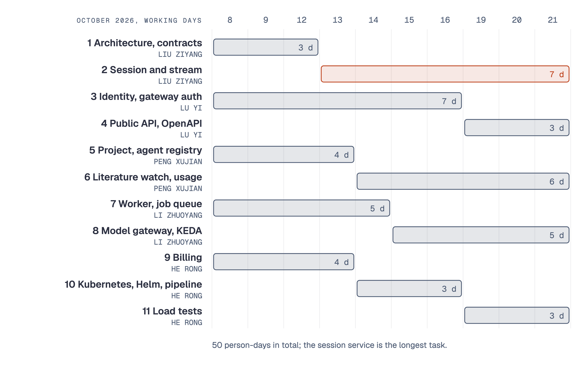
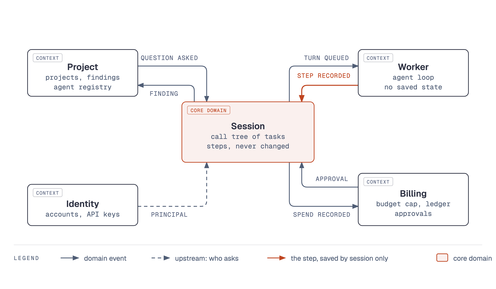
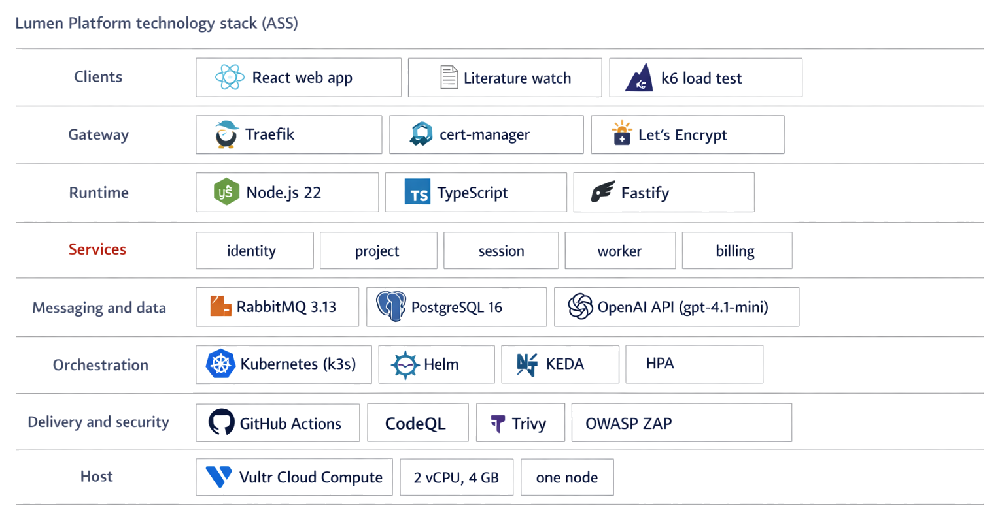
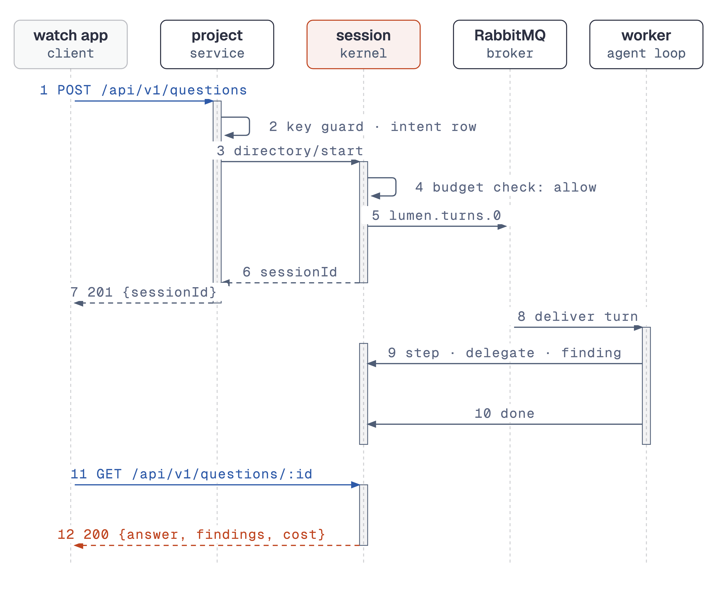

# Project Report for Lumen Platform

Practice Module for Graduate Certificate in Architecting Scalable Systems

Team 15

Members: HE RONG, LI ZHUOYANG, LIU ZIYANG, LU YI, PENG XUJIAN

Public address: https://lumen.139-180-185-51.sslip.io

Code base: https://github.com/ziyangliu-666/lumen-next (branch `ass/platform`)

---

## 1. Introduction

### 1.1 Background

Lumen is an AI for research. You ask one question; several AI agents share
the work; you see every step and its cost.

The report uses these terms, each with one meaning:

| Term | Meaning |
|---|---|
| lead agent | The agent that receives the question, plans the work and writes the answer. |
| reader agent | An agent that the lead agent gives one part of the work, for example one paper to read. |
| task | One agent's part of the work, with its own cost. |
| call tree | The tree of tasks of one question: the lead agent's task at the root, the reader agents' tasks under it. |
| turn | One run of the agent loop for one task. A turn is the unit of work that goes on a queue. The proposal's plan (section 2.1) calls a queued turn a "job". |
| step | One model call or tool call inside a turn, saved with its cost. |
| fan-out | One call of the `delegate` tool, by which an agent opens several child tasks at once. |
| finding | A result that an agent records, for example the title and the main idea of a paper. |
| steer | A message from a person to a running agent. |
| budget cap | The most that an account may spend before a person approves more. |
| approval | The owner's decision to let one step that passes the budget cap go on. |
| module | A part of the original Lumen code with its own routes, tables and interfaces. Each service of the platform is built from one module. |
| session | One question and its call tree. |
| project | The place that holds a user's sessions, findings and files. |

Research teams give work to AI agents. Each of these teams builds the same
parts again. The parts are sign-in, a record of each step and its cost, a
budget cap, a sandbox for commands and a live view of the run. Lumen started as one
Node.js application with five modules: identity, projects, session, steering
and billing. That application is the base product.

This project makes Lumen a platform. The modules run as five services on
Kubernetes, behind one public HTTPS address. Producers publish agents.
Consumers ask questions through the web app or through a public API. The
platform runs each question as a call tree and records each step with its
cost. It streams the run live. A step that would pass the budget cap waits
until the owner approves it. Figure 1 shows the public address and one
answered question on it.

The team submitted the proposal (version 2) on 6 October 2026. The lecturer's
review on the same day asked for "a horizontally scalable cloud-native
microservice-oriented system". The team built the platform from 8 to 21
October. The team presented it on 26 October 2026, with a live demonstration
on the public address. The platform is live at the address on the cover
page.

### 1.2 Business Needs

The table gives the pain points of the users and what a use case gains when
it is built on the platform.

| Pain point | What the platform gives |
|---|---|
| Each team that runs agents builds sign-in, cost control, a step record and a live view again. | The platform builds them once. An app gets them through an API key. |
| An agent author cannot offer a good agent to other teams. | An agent registry. The author publishes the agent once; consumers choose it by name. |
| A team cannot run another team's agent safely. | The platform runs the chosen agent under the consumer's own budget cap and records each step and its cost. |
| Load comes in bursts: one question fans out to several reader agents. | Workers are added when turns wait on the queue, and removed after. |
| A model call costs money, with no limit. | Each step is checked against the account's budget cap; a step that passes it waits for an approval. |

### 1.3 Stakeholders

| Stakeholder | Type | Interest |
|---|---|---|
| Research teams (consumers) | Business | Ask questions, watch the run, keep the findings, control the cost. |
| Agent authors (producers) | Business | Publish an agent once; see how much it is used. |
| App developers (consumers of the API) | Business and IT | Build an app on the API with a key, for example the literature watch. |
| Operator (the team, with staff accounts) | IT | Run the cluster; read usage and spend per account and per agent. |
| Model provider (OpenAI) | External | Supply the model calls. Not built by the team. |
| Hosting provider (AWS, then Vultr) | External | Supply the virtual machine that runs the cluster (section 3.2). |
| NUS-ISS lecturers | Assessor | Assess the architecture, the demonstration and this report. |
| Team 15 members | Delivery | Each member owns one service (section 2.1). |

### 1.4 Project Scope

The scope is the platform side of Lumen. It includes the services, the
messages between them, the deployment, the pipeline, the public API and two
apps on the platform. In a few places the architecture is wider than the
build; section 3.4 lists each place with its resolution.

The work has two phases:

- **Phase 1 (8 October to 16 November 2026).** Five services on k3s, a small
  Kubernetes distribution, on one node. Phase 1 also has the public HTTPS
  address, pod autoscaling, the pipeline, the public API version 1, the agent
  registry and the literature watch. It is built and runs on the public
  address.
- **Phase 2 (after the course).** The roadmap in section 3.4. It adds a second
  session replica and one database per service. When the budget allows, it
  adds a managed cluster with several nodes (section 3.2.1).

#### 1.4.1 Functionality in scope

The table gives each use case of the proposal and its status on 27 October 2026.

| Use case | Actor | Status |
|---|---|---|
| Publish an agent in the registry; the platform lists it. | Producer | Built. An agent is a set of instructions for the lead agent (AD-08). Published through the API and, since 25 October, from the Agents page of the web app. |
| Ask a question with a chosen agent through the public API; read the steps, the answer and the cost. | Consumer | Built and verified on the public host. |
| Create, scope and revoke an API key; a request over the rate limit gets 429. | Consumer | Built and verified on the public host: 429 after 21 requests at once. |
| Approve or refuse a step that would pass the budget cap. | Consumer | Built. Verified across HTTP between the billing and session services in an integration test (section 3.2.4). |
| Read usage: sessions and cost per account and per agent. | Operator, producer | Built and verified on the public host as `GET /api/v1/usage` and the staff pages. Latency per agent is the median time to an answer. |
| Get topic digests: a second app that asks saved questions on a schedule. | Consumer (the literature watch) | Built and verified on the public host, end to end. |

Other functions in scope:

- Sign-up, sign-in and the auth cookie, checked by each service.
- A question runs as a call tree: the lead agent delegates to reader agents.
- The live stream of steps over a WebSocket (`/ws`).
- Autoscaling. The Kubernetes Horizontal Pod Autoscaler (HPA) scales
  identity, project and billing on CPU. KEDA (Kubernetes Event-driven
  Autoscaling) scales the worker on queue length.
- A k6 load test and an autoscaling test on the public host.
- A CI/CD pipeline. It audits the dependencies (SCA), analyses the code
  (SAST), scans the image, scans the live site (DAST) and runs a short load
  test after each deployment (the smoke load).

#### 1.4.2 Functionality out of scope

| Item | Reason or resolution |
|---|---|
| Payments to producers | Proposal: billing measures usage; payout is not built. |
| More than one region | Proposal. |
| Training or fine-tuning models | Proposal. |
| A mobile client | Proposal. |
| Separate `stream` and `model-gateway` services | The stream stays in the session service (AISS-01, AISS-08). |
| One database per service | AD-06, AISS-02. |
| A managed cluster with node autoscaling | Budget; one node instead (AD-09, AISS-03). |
| Agents as remote endpoints, tools or model adapters from producers | AD-08, AISS-09. |
| OpenTelemetry tracing, Prometheus metrics and network policies | AISS-05, AISS-06. |
| A client library for the API | The OpenAPI document at `/api/v1/openapi.json` takes its place. |

---

## 2. Project Conduct

### 2.1 Project Plan

The proposal estimated ten person-days per member, fifty in total, from 8 to
21 October. The table gives the tasks of the proposal and the owner of each
task. Figure 2 is the schedule of the proposal.

| No. | Task | Owner | Estimate (days) |
|---|---|---|---|
| 1 | Architecture: service boundaries, API and event contracts | LIU ZIYANG | 3 |
| 2 | Session service and stream service | LIU ZIYANG | 7 |
| 3 | Identity service; gateway authentication, API keys, rate limits | LU YI | 7 |
| 4 | Public API version 1, OpenAPI document, client library | LU YI | 3 |
| 5 | Project service and agent registry | PENG XUJIAN | 4 |
| 6 | Second app (literature watch); usage analytics | PENG XUJIAN | 6 |
| 7 | Worker service and the job queue | LI ZHUOYANG | 5 |
| 8 | Model gateway; KEDA autoscaling for workers | LI ZHUOYANG | 5 |
| 9 | Billing service | HE RONG | 4 |
| 10 | Kubernetes, Helm charts, pipelines | HE RONG | 3 |
| 11 | Load tests and capacity results | HE RONG | 3 |
| | **Total** | | **50** |

### 2.2 Project Status

On 27 October 2026 the eleven tasks of the plan are done, with the changes
in section 3.4. The platform runs on the public address. The last deployment
is pipeline run 40284716751 of 26 October 2026. Its stages passed, except
the smoke load, which did not run because the workers use the real model.

| Area | Status on 27 October 2026 | Evidence |
|---|---|---|
| Five services, PostgreSQL and RabbitMQ on k3s on one node | Running on the public host | Pipeline run 40284716751 |
| HTTPS with a Let's Encrypt certificate | Running | `https://lumen.139-180-185-51.sslip.io/api/health` answers 200 |
| One question end to end, through the queues, with the live stream | Verified | Section 3.2.4 |
| HPA and KEDA autoscaling | Verified: workers 1 to 4 in demo mode, 1 to 2 with the real model, 1 to 3 on the current host | Section 4.1 |
| Public API version 1, API keys, agent registry, usage, OpenAPI | Verified on the public host | `docs/platform/evidence/2026-10-20-public-api-flow.md` |
| Literature watch | Verified on the public host | Section 4.4 |
| A worker deleted during a question | Verified: the question ended, gracefully and by force | Section 4.2 |
| Pipeline with SCA, SAST, image scan, DAST, smoke load | 17 of 21 deploy runs from 20 to 26 October passed. Two stopped at the image scan gate, one at the format check, one on the first install on a 1 vCPU VM. No failed run changed a running release. | Section 5.3 |
| Approvals across HTTP between billing and session | Verified in an integration test with four scenarios | `docs/platform/evidence/2026-10-21-approval-http.md` |
| Default budget cap of a new account on the public host | USD 0.05 | Commit `ade7f7a`, run 40284716751 |

The open issues are in section 3.4.

### 2.3 Project Metrics

The milestones below come from the git history and the pipeline runs.

| Date (2026) | Milestone | Evidence |
|---|---|---|
| 1 Oct | Proposal version 1 | `01_Proposal-v1_2026-10-01.docx` |
| 6 Oct | Proposal version 2, and the lecturer's review | `03_Proposal-v2_2026-10-06.docx` |
| 8 to 19 Oct | Module work in the base product that the services reuse: API key lifecycle, durable approvals, over-cap approvals | Merged pull requests in the base product |
| 19 Oct | The platform integration branch starts from the base product | Commit `320aa39` |
| 20 Oct | The five services, the Helm chart with HPA and KEDA, the Traefik ingress, the deploy pipeline, the public API and the literature watch | Commits `cbb8372` to `7d575db` |
| 20 Oct | The image scan gate stops a deployment with 5 critical CVEs | Run 39439752963 |
| 20 Oct | First run with every stage passed; load test and worker deletion on the public host | Run 39441445313; `docs/platform/evidence/` |
| 21 Oct | Load test with the real model; approvals across HTTP | `2026-10-21-load-real-model.md`, `2026-10-21-approval-http.md` |
| 25 Oct | The public host moves to a Vultr VM of the same size; first deployment there | Commit `b9aec0c`, run 40162838596 |
| 26 Oct | Default budget cap of USD 0.05 for a new account; deployment | Commit `ade7f7a`, run 40284716751 |
| 26 Oct | Presentation at 11:25, with a live demonstration on the public host | Presentation schedule |
| 16 Nov | Report submission | Briefing |

Effort per member. The team did not keep time sheets. The table gives the
planned effort: ten person-days of eight hours for each member, 400 hours in
total.

| Member | Main work | Effort (hours) |
|---|---|---|
| HE RONG | Billing service, Helm chart, public host, deploy pipeline, DevSecOps stages | 80 |
| LI ZHUOYANG | Worker service, the turn queues, KEDA autoscaling, the agent's instructions on a root turn, worker deletion test | 80 |
| LIU ZIYANG | Architecture and contracts, session service, shared adapters, integration, demonstration script | 80 |
| LU YI | Identity service, Traefik ingress, HTTPS, rate limits, API keys | 80 |
| PENG XUJIAN | Project service, agent registry, public API routes, literature watch, usage, k6 load test | 80 |
| **Total** | | **400** |

---

## 3. Solution Overview

### 3.1 Logical Architecture & Design

The platform is five services. Each service is built from one module of the
base product, with a new entry point (`apps/server/src/services/<name>.ts`).
The five services run from one container image, each with its own command.
Figure 3 shows the tiers, the services, the queues and the data store.

Two kinds of call cross a process boundary:

- **Messages on RabbitMQ.** The session service puts each turn on a durable
  queue. Any worker pod takes it. Steers go on a fanout exchange, which gives
  a copy to each worker pod.
- **Internal HTTP.** The worker reports each step back to the session
  service. The project and worker services reach the running kernel through
  the session directory. The billing service resumes an approved task.

The **kernel** is the part of the session module that runs the call tree. It
opens tasks, rolls up their cost, checks the budget cap and streams each step.
The five services share one PostgreSQL database. A port that only reads or
writes the database stays in-process: a service builds the other module over
the shared database (AD-06, AISS-02).

#### 3.1.1 Key Architectural Decisions

The key architectural decisions taken are as follows:

| Identifier | Description |
|---|---|
| AD-01 | **Service boundaries follow the existing modules.** Decision: five services (identity, project, session, worker, billing), each one an existing module with a new entry point. Alternative: the eight services of the proposal, written new. Trade-off: fewer services than the proposal; the stream and the model gateway are not separate services. Rationale: the modules already have clear ports and tests. Reuse leaves the time for the part that must change: the calls between processes. The base product keeps its tests green, because the module internals do not change. |
| AD-02 | **A turn crosses from session to worker on a durable RabbitMQ queue.** Decision: the kernel takes a `Worker` port. The session service gives it a `QueueWorker`, which publishes the turn and waits for `/internal/turns/:id/done`. Alternatives: a direct HTTP call from session to a worker; the worker loop inside session. Trade-off: one more moving part (the broker) and a second protocol. Rationale: a slow model call never holds a web request. Any worker pod can take any turn. A worker that dies before it acknowledges leaves the turn on the queue for another worker. KEDA can scale on the queue length. The kernel does not change. |
| AD-03 | **One queue per task depth.** Decision: `lumen.turns.0` (lead agents), `lumen.turns.1` (reader agents), `lumen.turns.2` (depth 2 and deeper), each with its own slots per pod (`LUMEN_WORKER_SLOTS`, default 4). Alternative: one queue. Trade-off: three queues to watch and three KEDA triggers. Rationale: a parent turn keeps its worker slot while `delegate` waits for its children. With one queue, waiting parents can take all slots, and the children never start. With one queue per depth, the deepest level never waits, so the queues drain. |
| AD-04 | **The session service is the only writer of the call tree.** Decision: the worker reports each step, delegation, finding and spend through the `WorkerReport` port. In the worker service this port is `RemoteReport`, which calls `/internal/turns/:turnId/<member>` on session. Alternative: the worker writes steps to the database. Trade-off: one HTTP call per step, and `delegate` holds a call open for up to 15 minutes. Rationale: a worker that dies loses nothing, because each step is already saved. The kernel keeps the cost roll-up, the budget checks and the live stream in one place. |
| AD-05 | **Steers go on a fanout exchange.** Decision: `task.steer` from the browser arrives at session over `/ws`. Session publishes it on `lumen.steers`. Each worker pod has an exclusive, auto-delete queue bound to it, and the pod that runs the task applies it. Alternative: a table of which pod runs which task. Trade-off: each pod receives each steer. Rationale: steers are rare and small; no pod needs to know where a task runs. |
| AD-06 | **One shared database, with in-process modules for database-only ports.** Decision: the five services connect to the same PostgreSQL database. A port that only touches the database (for example `requireProject`) is built in-process over it. Alternative: one database per service, with an API call for each read across modules. Trade-off: the services share the schema; one database is a single point of failure. Rationale: one transaction writes a step, its cost and the ledger entry together. The tables are already grouped by module (migration prefixes), so a later split is mechanical (AISS-02). |
| AD-07 | **The public API is a versioned path with API keys and scopes.** Decision: `/api/v1/*`; keys of the form `lmn_<prefix>_<secret>`, stored as a SHA-256 hash; five scopes; a token-bucket rate limit per key (60 a minute, burst 20) that answers 429; an OpenAPI 3.1 document. A key works only on `/api/v1/*`; the web app's routes stay cookie-only. Alternative: the cookie for apps too. Trade-off: two ways to sign in. Rationale: an app needs a credential that it can store, scope and revoke without a password. The key guard refuses a version 1 route that is not in its scope table, so a new route is closed until it is listed. |
| AD-08 | **An agent is a set of instructions for the lead agent, chosen per question.** Decision: a producer publishes a slug, a name, a description and instructions (at most 4,000 characters). `POST /api/v1/questions` writes a question intent row first. The worker claims it on the root turn with `FOR UPDATE SKIP LOCKED` and puts the agent's instructions in front of the question. Alternative: the proposal's registered agent endpoint and manifest. Trade-off: a producer cannot bring its own code or model. Rationale: the producer and consumer roles work end to end with no change to the kernel or the worker loop, and with no untrusted code (AISS-09). |

#### 3.1.2 Tiers and Layers

The solution has four tiers (Figure 3):

1. **Client tier.** The Lumen web app (React, served by the session service),
   the literature watch (Node.js, API key), and any HTTP client of the API.
2. **Edge tier.** Traefik, the Kubernetes ingress controller that ships with
   k3s. It ends TLS, redirects HTTP to HTTPS, applies the rate limit on
   `/api/auth`, and routes by path prefix to the five services. It never
   routes `/internal/*`.
3. **Service tier.** The five services (Fastify on Node.js 22). They talk to
   each other through RabbitMQ and internal HTTP.
4. **Data tier.** PostgreSQL 16 (one shared database), RabbitMQ 3.13 (turn
   queues and the steer exchange), and a persistent volume for project files.

Each service has the same internal layers, the structure of a module:

| Layer | Content | Example |
|---|---|---|
| Entry point | Reads the environment, builds the modules, registers routes, starts the server. | `services/session.ts` |
| HTTP adapter | Fastify routes, validation, the auth resolver, the key guard. | `modules/projects/routes.ts`, `services/platform/keyGuard.ts` |
| Application | The module's service objects and use cases. | `modules/session/kernel.ts`, `modules/billing/approvals.ts` |
| Domain | Types and rules with no I/O. | `core/domain/task.ts`, `core/domain/budget.ts`, `core/domain/money.ts` |
| Ports and adapters | Interfaces between modules, and their local or remote adapters. | `Worker`, `WorkerReport`, `SessionDirectory`; `QueueWorker`, `RemoteReport`, `remoteSessionDirectory` |
| Data access | SQL stores over the shared database. | `modules/session/pgTrace.ts`, `services/platform/registry.ts` |

The ports and adapters layer made the split possible. The kernel depends
only on the `Worker` interface. In the base product the adapter is the
in-process worker. In the platform it is `QueueWorker`. The same is true
for `WorkerReport` (`RemoteReport`) and `SessionDirectory`
(`remoteSessionDirectory`).

#### 3.1.3 Nodes and Subsystems

| Subsystem | Built from | Public routes | Internal routes it serves | Scales on |
|---|---|---|---|---|
| identity | `modules/identity`; `services/platform/apiKeys.ts`, `keyRoutes.ts` | `/api/auth/*`, `/api/me*`, `/api/local/*`, `/api/v1/keys` | none | CPU (HPA, 1 to 3) |
| project | `modules/projects`; `services/platform/registry.ts`, `agentRoutes.ts`, `askRoutes.ts`, `openapi.ts` | `/api/projects*`, `/api/v1/agents`, `POST /api/v1/questions`, `/api/v1/usage`, `/api/v1/openapi.json` | none | CPU (HPA, 1 to 3) |
| session | `modules/session` (the kernel), the `Broker`, `/ws`, the web app, `QueueWorker` | `/api/sessions/*`, `/api/projects/:id/sessions`, `/api/models`, `/ws`, `GET /api/v1/questions/:sessionId`, the web app | `/internal/turns/*`, `/internal/directory/*`, `/internal/approvals/resume`, `/internal/health` | none, 1 replica |
| worker | `modules/steering` (agent loop, sandbox), or the demo worker | `/api/projects/:id/files*`, `/api/projects/:id/upload/*` | none | queue length (KEDA, 1 to 4) |
| billing | `modules/billing` | `/api/wallet/*`, `/api/keys/*`, `/api/billing/*`, `/api/admin/*` | none | CPU (HPA, 1 to 3) |
| PostgreSQL | `postgres:16-alpine` StatefulSet | none | SQL on 5432 | 1 replica |
| RabbitMQ | `rabbitmq:3.13-management` StatefulSet | none | AMQP 5672, management API 15672 | 1 replica |
| literature watch | `apps/watch/watch.mjs`, CronJob `watch` | none (a client) | none | one run a day |

The internal calls, from `docs/platform/contract.md`:

| From | To | Call | Purpose |
|---|---|---|---|
| session | worker | RabbitMQ `lumen.turns.<depth>` | Run one turn of one task. |
| session | worker | RabbitMQ fanout `lumen.steers` | Deliver a steer to the pod that runs the task. |
| worker | session | `POST /internal/turns/:turnId/{step, delegate, finding, spend, stopped, done}` | Report the turn. `delegate` waits up to 15 minutes; the other calls 10 seconds. |
| project, worker | session | `POST /internal/directory/{start, list, stop, context, task-session}` | Reach the running kernel. |
| billing | session | `POST /internal/approvals/resume` | Resume a task after the owner approves. |

Each `/internal/*` route checks the header `x-lumen-internal` against the
secret `LUMEN_INTERNAL_KEY` with a constant-time comparison. A request
without it gets 401.

#### 3.1.4 Platform Design

**Platform roles.** The briefing names the seed, the producers and the
consumers. The **seed** is the core that the apps on the platform use.

| Role | Who | What they do on the platform |
|---|---|---|
| Seed | The run engine: session, worker, billing | A question runs as a call tree of costed, recorded steps under the account's budget cap. |
| Producer | An agent author | Publishes an agent in the registry (`POST /api/v1/agents`). Reads its usage (`GET /api/v1/usage`, `asProducer`). |
| Consumer | A research team, or an app on the API | Asks a question with a chosen agent; reads the answer, the findings and the cost. |
| Operator | The team (staff accounts) | Reads usage per account and per agent (`all` in `/api/v1/usage`, and the admin pages). |

The web app is the first consumer. The literature watch is the second. It
uses only the public API and an API key.

**Domain-driven design.** The team took the nouns of the six use cases (for
example agent, question, step and budget cap). It grouped them into five
bounded contexts. Each context is one module and one service. Figure 4 is the
context map: the session context is the core domain, and the arrows are the
domain events between the contexts.

| Bounded context | Service | Aggregates and entities | Terms |
|---|---|---|---|
| Identity | identity | **Account** (credentials, auth sessions), **ApiKey** | account, role, staff, key, scope |
| Project | project | **Project**, Finding; **Agent**, QuestionIntent (the registry) | project, question, finding, agent, slug, publish, withdraw |
| Session (core domain) | session | **Session** with its Task tree, Step (value) | session, task, call tree, step, turn, delegate, at rest |
| Worker | worker | none: the agent loop keeps no state of its own | reader agent, tool, sandbox, steer |
| Billing | billing | **Wallet**, LedgerEntry, **Approval** | budget cap, spend, ledger, approval, check point |

Rules that each aggregate keeps:

- **Session and its Task tree.** A task has one parent and a depth. The kernel
  limits the depth of the tree. A task's total cost is its own cost plus the
  cost of its children; the kernel does the roll-up. Only the kernel changes
  a task's status.
- **Wallet and LedgerEntry.** Money is `numeric(12,6)`. The database
  computes each total with SUM in SQL, with no JavaScript arithmetic.
- **Approval.** One approval belongs to one attempt of one operation
  (`unique (account_id, attempt_id)`). A grant is consumed once. An old
  approval never authorises a different turn.
- **ApiKey.** The key itself is never stored. A revoked key never works again.
- **Agent.** An agent is withdrawn, never deleted, so its usage stays.

Domain events. The names are the event types in `packages/contracts`, or the
state change that carries the event:

| Event | Raised by | Consumed by |
|---|---|---|
| `step.appended` (step recorded) | Session kernel | The browser over `/ws`; the API answer |
| `finding.recorded` | Session kernel, through the project port | Project (findings table); the browser |
| `task.cost` (spend recorded) | Session kernel, through the billing port | Billing (ledger entry); the browser |
| `task.status` = `waiting` (approval needed) | Session kernel, after the budget guard escalates | Billing (approval row); the browser |
| approval granted | Billing (`resume_pending = true`, an outbox row) | Session (`/internal/approvals/resume`) |
| turn queued, turn done | Session (`lumen.turns.*`), worker (`/done`) | Worker; the kernel |
| agent published, agent withdrawn | Project (registry) | Consumers (`GET /api/v1/agents`) |

The contexts talk only through ports. Two examples:

- The kernel asks a `BudgetGuard` before it spends. Billing implements it as
  a chain: the account may spend; the charge fits the budget cap; else ask
  for an approval. Neither module imports the other.
- The worker loop knows only the `WorkerReport` port. It never writes the
  call tree.

**How the platform interacts with producers and consumers.** The steps below
are the calls on the public API, version 1. Figure 5 shows them on the public
host: a producer's agent in the registry, its usage, and the literature watch
that used it.

1. A producer creates an API key with the `agents:write` scope, or signs in.
2. The producer publishes an agent: `POST /api/v1/agents` with a slug, a
   name, a description and instructions. `apps/watch/publish-agent.mjs`
   publishes `literature-scout` this way.
3. A consumer lists the agents: `GET /api/v1/agents`.
4. The consumer asks: `POST /api/v1/questions {question, agent}`. The answer
   is `201 {sessionId, projectId, agent}`.
5. The platform runs the question. The lead agent gets the agent's
   instructions in front of the question.
6. The consumer reads the result: `GET /api/v1/questions/:sessionId` returns
   the status, the answer, the findings and the cost.
7. The producer and the operator read usage: `GET /api/v1/usage` returns
   sessions, cost and the median time to an answer per agent.

**What a new app saves.** The literature watch is about 210 lines of code in
`watch.mjs` and 36 in `publish-agent.mjs`. It has no database, no model
calls, no sandbox and no billing of its own. The platform gives it sign-in
and keys, the agent runtime, the sandbox, the budget cap and approvals, and
scaling.

### 3.2 Physical Architecture & Design

Figure 6 shows the deployment. The platform runs on one virtual machine (VM)
with k3s, a small Kubernetes distribution. Section 3.2.1 gives the reason
for one node (AD-09).

{wide}

| Part | Value |
|---|---|
| Host since 25 October 2026 | Vultr Cloud Compute `vc2-2c-4gb` in Singapore: 2 vCPU, 4 GB memory, 80 GB SSD, Ubuntu 24.04, plus a 2 GB swap file |
| Host from 20 to 24 October 2026 | AWS EC2 `t3.medium` in `ap-southeast-1` (Singapore): 2 vCPU, 4 GB, 20 GB gp3 disk, an Elastic IP, the same chart |
| Address | `lumen.139-180-185-51.sslip.io`. sslip.io resolves the name to the VM's IP address, so no domain is bought (AD-14). |
| Firewall | Inbound 22, 80 and 443 only. The Kubernetes API (6443), PostgreSQL and RabbitMQ are closed. `kubectl` from a laptop goes through `ssh -L 6443:localhost:6443`. |
| Kubernetes | k3s, one node. k3s ships Traefik, the local-path storage class and metrics-server. The same chart runs on k3d on a laptop. |
| Add-ons | KEDA (worker autoscaling), cert-manager with a Let's Encrypt `ClusterIssuer` (HTTP-01 through Traefik), certificate `lumen-tls` |
| Workloads, namespace `lumen` | Five Deployments (Service port 4000); StatefulSets `postgres-0` (2 Gi volume) and `rabbitmq-0` (1 Gi volume); a 2 Gi `ReadWriteOnce` volume for the workers' project files; three HPAs; one KEDA ScaledObject; an optional CronJob for the literature watch |
| Resources per service pod | Request 50m CPU and 128 MiB; limit 256 MiB. PostgreSQL limit 384 MiB; RabbitMQ limit 512 MiB. |

#### 3.2.1 Key Architectural Decisions

The key architectural decisions taken are as follows:

| Identifier | Description |
|---|---|
| AD-09 | **The platform runs on one node, for budget.** Decision: one VM with 2 vCPU and 4 GB runs k3s and the whole chart. Alternative: Amazon EKS with three worker nodes in three availability zones and the Cluster Autoscaler (the proposal). Reason: budget. One node costs USD 0.65 a day on Vultr, or USD 1.45 a day on EC2. The minimal EKS setup costs USD 7.36 a day, five to eleven times more (Figure 7). Trade-off: one node is one failure domain, there is no node autoscaling, and pods scale only inside 2 vCPU and 4 GB. |
| AD-10 | **The gateway is a Traefik ingress.** Decision: Traefik IngressRoutes route by path prefix, end TLS, redirect HTTP, and rate-limit `/api/auth` (average 10, burst 20). Each service checks the cookie or the API key itself. Alternative: the API gateway service of the proposal. Trade-off: the auth check runs in each service instead of once at the edge; the per-key rate limit is in each pod. Rationale: one less service to build and run; Traefik ships with k3s. |
| AD-11 | **Two autoscalers for two kinds of load.** Decision: HPA on CPU (70%, 1 to 3 replicas) for identity, project and billing. KEDA on the length of the three turn queues (`QueueLength` 5, 1 to 4 replicas, polling every 10 s, scale-down window 60 s) for the worker. Session has one replica with the `Recreate` strategy. Trade-off: session does not scale (AISS-01). Rationale: request load shows in CPU. Agent load shows in the queues before it shows in CPU, because a worker waits on the model most of the time. With `Recreate`, the old kernel stops before the new one starts, so two kernels do not run at the same time. |
| AD-12 | **No image registry.** Decision: the workflow builds `lumen-next:<commit sha>`, copies it to the host with `scp`, and imports it with `k3s ctr images import`. Alternative: GHCR or ECR. Trade-off: the copy is slower than a pull, and only one node can use the image. Rationale: no registry to pay for and no registry credential to keep. It fits one node (AD-09). |
| AD-13 | **Secrets are generated inside the cluster.** Decision: the chart generates the database password, the RabbitMQ password and `LUMEN_INTERNAL_KEY` on the first install (`randAlphaNum`). It keeps them on upgrade (`lookup`) and on uninstall (`resource-policy: keep`). The only GitHub secrets are the SSH key, the host and the model key. Alternative: keep the secrets in GitHub. Trade-off: a lost cluster loses the secrets, and the data with them. Rationale: the core secrets never leave the cluster and never appear in a log. |
| AD-14 | **A public HTTPS address on sslip.io with Let's Encrypt.** Decision: the host name is built from the VM's IP address. Alternative: buy a domain and use a managed DNS service. Trade-off: the name changes when the IP address changes, as it did when the host moved on 25 October. Rationale: a real certificate and a stable name at no cost, so the lecturer can open the platform during and after the presentation. |

**AD-09 in detail: one node for budget.**

*The cost.* Figure 7 and the table compare the list prices in the Singapore
region. The prices come from the AWS Price List API for `ap-southeast-1`,
the Amazon EKS pricing page and the Vultr plans API, all read on 27 October
2026.

| Setup | Parts and list prices (USD) | USD a day | USD for 20 Oct to 16 Nov (28 days) |
|---|---|---|---|
| One Vultr `vc2-2c-4gb` (since 25 Oct) | VM 0.027 an hour, at most 20 a month; IPv4 and 80 GB disk included | 0.65 | 18 |
| One EC2 `t3.medium` (20 to 24 Oct) | instance 0.0528 an hour; public IPv4 0.005 an hour; 20 GB gp3 at 0.096 a GB-month | 1.45 | 41 |
| EKS minimum with three nodes | control plane 0.10 an hour; 3 × `t3.medium`; 3 public IPv4 addresses; one Network Load Balancer 0.0252 an hour; 3 × 20 GB gp3 | 7.36 | 206 |

For the project period the platform costs about USD 22 at list price: five
days on EC2 and 23 days on Vultr. The same period on the minimal EKS setup
costs about USD 206. The EKS figure leaves out the load balancer's usage
units, NAT gateways, EFS and a managed database, so the real gap is larger.
The model calls are a separate cost: the public host uses `gpt-4.1-mini`, and
a new account has a budget cap of USD 0.05.

*What one node gives up.*

- **One failure domain.** If the VM stops, the platform stops. There is no
  second node to take the pods (AISS-03).
- **No node autoscaling.** The Cluster Autoscaler needs a node group. The
  capacity is fixed at 2 vCPU and 4 GB; on EC2 the node reported 3.7 GiB of
  memory to Kubernetes.
- **Pods scale inside the node.** At full scale-out there are 3 identity,
  3 project, 3 billing, 4 worker and 1 session pod. Their memory limits add up
  to 4.4 GiB: 14 × 256 MiB, plus 384 MiB for PostgreSQL and 512 MiB for
  RabbitMQ. The requests are lower (50m CPU and 128 MiB a pod), so the
  scheduler places the pods. The 2 GB swap file takes the peaks.
- **One node is also the floor.** The first install on a 1 vCPU, 2 GB VM
  failed (run 40161155236). The node swapped, the one CPU stayed at 100%, and
  the k3s API timed out. 2 vCPU and 4 GB is the smallest size that holds the
  chart.
- **Node-local storage.** The volumes use local-path, and the workers' file
  volume is `ReadWriteOnce`. Both work only on one node.

*What still scales on one node, measured.*

| Date and host | Load | What scaled | Source |
|---|---|---|---|
| 20 Oct, EC2 | k6, 1 to 10 virtual users, demo worker | Workers 1 to 4 by KEDA, back to 1; identity 1 to 3 by HPA; node memory 2.0 of 3.7 GiB after the run | Section 4.1 |
| 21 Oct, EC2 | k6, real model `gpt-4.1-nano` | Workers 1 to 2 by KEDA, back to 1 | `2026-10-21-load-real-model.md` |
| 25 Oct, Vultr | 15 questions at once, real model `gpt-4.1-mini` | Workers 1 to 3 by KEDA | Figure 14 (c) |

*The growth path.* The design does not change; only the values and three
backing services do.

1. Install the same Helm chart on EKS with a managed node group of three
   nodes in three availability zones. Add the Cluster Autoscaler, which adds
   a node when pods stay `Pending`.
2. Push the image to Amazon ECR; each node pulls it from there. This replaces
   the copy over SSH (AD-12).
3. Move the project files to EFS (`ReadWriteMany`) or S3, PostgreSQL to
   Amazon RDS Multi-AZ, and RabbitMQ to Amazon MQ or a three-node cluster.
4. Add a values file for EKS: storage classes, image repository and the
   ingress load balancer. The templates, the HPAs and the KEDA ScaledObject
   stay as they are.

The team takes this path in two cases. The first is when a sponsor funds the
hosting. The second is when the load passes what 2 vCPU and 4 GB hold; pods
that stay `Pending` show this.

#### 3.2.2 Technology and Services

Figure 8 shows the stack by layer; the table after it gives the use and the trade-off of each part.

| Technology | Use | Trade-off and rationale |
|---|---|---|
| Node.js 22, TypeScript, Fastify | The five services | The stack of the base product, so the modules are reused as they are. |
| React | The web app, served by the session service | One origin, so no CORS. |
| PostgreSQL 16 | All persistent data | Transactions, `FOR UPDATE SKIP LOCKED` for queues of rows, `numeric` for money. One shared database (AD-06). |
| node-pg-migrate | Schema migrations at startup | Takes an advisory lock, so pods that start together migrate one after another. Platform tables start at 090, so they never collide with the base product. |
| RabbitMQ 3.13 | Turn queues and the steer fanout | Durable queues, acknowledgements, prefetch per channel, and a management API that KEDA reads. |
| k3s | Kubernetes on one node | Small footprint; ships Traefik, local-path storage and metrics-server (AD-09). |
| Traefik | Ingress, TLS end, HTTP redirect, rate limit | Ships with k3s (AD-10). |
| cert-manager, Let's Encrypt | TLS certificate | Free; renews on its own. |
| KEDA | Worker autoscaling on queue length | Scales on the queue length, which rises before CPU does (AD-11). |
| Helm | One chart for k3d and the public host | A values file for each environment (`values.yaml`, `public/values.yaml`). |
| Vultr Cloud Compute (AWS EC2 until 24 October) | The host | Lowest price for 2 vCPU and 4 GB (AD-09). |
| GitHub Actions | CI/CD | Free for a public repository; secrets for SSH. |
| k6 | Load test | Scripted in JavaScript; profiles `full`, `short` and `smoke`. |
| CodeQL, npm audit, Trivy, OWASP ZAP | SAST, SCA, image scan, DAST | Free; run in the pipeline. |
| OpenAI API | Model calls in steering mode | External. The deployed model is `gpt-4.1-mini`, set by name in the workflow. The demo worker needs no model, so load tests cost nothing. |

#### 3.2.3 Persistence Design

All persistent data is in one PostgreSQL 16 database on a 2 Gi local-path
volume. Each module owns its tables; the table name or the migration prefix
shows the owner (for example `012_billing_approvals.sql`). Figure 9 shows the
main tables and their relations.

Transactions and concurrency:

- **Money** is `numeric(12,6)`. The database computes each total with SUM.
- **The approval decision** runs in one transaction with `SELECT ... FOR
  UPDATE`, so a grant is consumed once.
- **The approval delivery** is an outbox. A granted row gets
  `resume_pending = true`. The deliver loop claims rows with `FOR UPDATE SKIP
  LOCKED` and a 30-second lease. Two billing pods never deliver the same row,
  and a pod that crashes releases its rows after 30 seconds.
- **The question intent** is claimed by the worker with `FOR UPDATE SKIP
  LOCKED`, so two root turns never take the same intent.
- **A waiting task** keeps its blocked operation in `tasks.pending` (JSONB).
  A restart of the session pod does not lose an approval in flight.
- **Turns in flight** are in RabbitMQ, not in the database. A worker
  acknowledges a turn only after `/done` succeeds.

Logical data model (main tables):

| Table | Owner | Key columns | Kept for |
|---|---|---|---|
| `accounts` | identity | id, email, display_name, role | Life of the account |
| `credentials`, `auth_sessions`, `identity_oauth_attempts`, `identity_mail_*` | identity | account_id | Session lifetime (7 days by default), or until used |
| `platform_api_keys` | identity | account_id, prefix, key_hash, scopes, revoked_at | Until revoked; then kept for audit |
| `projects` | project | account_id, title, mode | Life of the account |
| `findings` | project | session_id, task_id, title, text | Life of the project |
| `platform_agents` | project (registry) | owner_account_id, slug, instructions, withdrawn_at | Withdrawn, never deleted |
| `platform_question_intents` | project (registry) | account_id, agent_id, question, session_id | Kept, for usage |
| `sessions` | session | project_id, account_id | Life of the project |
| `tasks` | session | session_id, parent_id, agent, depth, status, own_cost, pending | Life of the session |
| `steps` | session | task_id, index, kind, text, detail | Life of the session |
| `billing_wallets` | billing | account_id, cap | Life of the account |
| `ledger_entries` | billing | account_id, task_id, amount, reason | Kept, for the ledger |
| `billing_approvals` | billing | account_id, task_id, attempt_id, status, resume_pending | Kept, for audit |
| `billing_topups`, `billing_secrets` | billing | account_id | Top-up history; secrets until removed |

Data groups:

**Identity and access data**

- Data format: relational records. Password hashes are text in the format
  `scrypt$v1$<salt>$<digest>`. Auth sessions are rows keyed by a random token
  that the browser keeps in an HTTP-only cookie (`lumen_session`).
- Proposed storage technology: PostgreSQL. Sign-in needs transactions and
  unique constraints (one email per account).
- Security requirements and controls: passwords hashed with scrypt (N=2^15,
  r=8, p=3, 16-byte salt); a constant-time compare; a dummy hash when no
  account exists, so the response time does not show which emails exist; a
  Traefik rate limit on `/api/auth`; an Origin check on writes. Account
  deletion erases the account's secrets in the same transaction.
- Trade-off consideration: a managed identity provider (for example Amazon
  Cognito) would remove this code. The module already existed and has tests,
  so the team kept it.

**API keys**

- Data format: relational records: prefix, SHA-256 hex hash of the whole key,
  scopes as `text[]`, timestamps.
- Proposed storage technology: PostgreSQL, in the identity context.
- Security requirements and controls: the key is shown once and never stored,
  so a leaked table does not hand out working keys. A key has 190 random bits,
  so a plain SHA-256 is enough and a slow hash is not necessary. Scopes per
  route; a key works only on `/api/v1/*`; 429 over the rate; 401 when revoked;
  `last_used_at` is written at most once a minute.
- Trade-off consideration: a JWT needs no lookup, but it cannot be revoked at
  once. A lookup per request is cheap at this scale.

**Agent registry and question intents**

- Data format: relational records. Instructions are text, at most 4,000
  characters.
- Proposed storage technology: PostgreSQL. The slug is unique; the intent's
  `session_id` is unique.
- Security requirements and controls: only the owner sees the instructions
  and may withdraw the agent. A withdrawn agent cannot be chosen.
- Trade-off consideration: the intent row is written before the session
  exists, because the root turn can reach a worker before `POST
  /api/projects` returns. A matching rule (same account, same question text,
  last 60 seconds) covers that race. A change in the kernel would be simpler;
  the team kept the kernel unchanged instead.

**Call tree (sessions, tasks, steps) and findings**

- Data format: relational records. A step's `detail` and a task's `pending`
  are JSONB. The live stream sends the same records as JSON events.
- Proposed storage technology: PostgreSQL. The call tree needs order
  (`tasks.seq`), parent links and SQL roll-ups.
- Security requirements and controls: only the owner or staff may read a
  session or open its stream. An unknown session and another person's session
  both answer 404, so an id tells an attacker nothing. Steps never hold a
  credential.
- Trade-off consideration: a document store would keep one session as one
  document. The roll-up of cost over the tree and the usage queries are SQL,
  so a relational store fits better.

**Billing data (wallets, ledger, approvals, top-ups, saved model keys)**

- Data format: relational records; money as `numeric(12,6)`.
- Proposed storage technology: PostgreSQL, for transactions and exact
  decimals.
- Security requirements and controls: the payer is always the account that
  opened the session, never a value from the browser. An approval decision
  needs the owner's cookie and the correct Origin. Saved model keys are
  encrypted with AES-256-GCM, with a key from the environment. Admin routes
  are for staff only.
- Trade-off consideration: the budget check does not reserve the money, so
  work that runs at the same time can pass the budget cap a little (AISS-10).

**Messages (turns and steers)**

- Data format: JSON messages `{turnId, task, input}` and
  `{command, principal}`.
- Proposed storage technology: RabbitMQ. Turns are on durable queues, as
  persistent messages with publisher confirms. Steers are on a per-pod queue
  that is deleted with the pod.
- Security requirements and controls: RabbitMQ has no route from outside the
  cluster. Its password is generated in the cluster. The management page is
  reached only through the SSH tunnel.
- Trade-off consideration: delivery is at least once. A redelivered turn runs
  again from its start (AISS-04).

**Project files**

- Data format: files that agents write (code, data, notes) under
  `/data/projects/<project>`.
- Proposed storage technology: a 2 Gi `ReadWriteOnce` local-path volume that
  the worker pods mount. This works only while the pods are on one node.
- Security requirements and controls: the files routes check that the
  principal may touch the project. Agent commands run in a sandbox only when
  a compute provider is set; the public host sets none.
- Trade-off consideration: on more than one node this needs a shared file
  system (EFS) or object storage (S3), as in the growth path of AD-09.

**Configuration and secrets**

- Data format: Kubernetes ConfigMap `lumen-config`; Secrets `lumen-core` and
  `lumen-extra`.
- Proposed storage technology: the Kubernetes API (the k3s datastore).
- Security requirements and controls: generated in the cluster (AD-13); never
  in the repository. The model key reaches the host on SSH standard input at
  deploy time.
- Trade-off consideration: no external secret manager (for example AWS
  Secrets Manager). For one node and one environment, Kubernetes Secrets
  hold the secrets.

#### 3.2.4 Detailed Design

Use case A shows the platform roles and the message path. Use case B shows
the budget cap and a call that crosses three services.

**Use case A: ask a question with a chosen agent through the API**

Precondition: a producer published the agent `literature-scout`. The consumer
has an API key with the scopes `questions:write` and `questions:read`.
Figure 10 shows the sequence. The numbers in the list match the numbers in the
figure.

1. The client sends `POST /api/v1/questions {question, agent:
   "literature-scout"}` with `Authorization: Bearer lmn_...`.
2. In the project service, `withApiKeys` (`apiKeys.ts`) resolves the key to a
   `Principal`. `registerKeyGuard` (`keyGuard.ts`) checks the path, the key,
   the rate (`RateLimiter.take`, a token bucket) and the scope
   (`ROUTE_SCOPES`). `registerAskRoutes` (`askRoutes.ts`) finds the agent
   (`AgentStore.bySlug`) and writes an intent row (`IntentStore.insert`).
   Then it creates the project with the same request as the web app.
3. The projects module calls `SessionDirectory.start`. In the project service
   this is `remoteSessionDirectory`, which calls
   `POST /internal/directory/start` on session.
4. In session, the kernel opens the session and the root task (depth 0). It
   asks the `BudgetGuard` at the check point `turn`. Billing's `BudgetChain`
   answers allow.
5. The kernel calls `Worker.run`. The worker is `QueueWorker`. It keeps the
   kernel's `WorkerReport` in a map under a new `turnId`, and publishes
   `{turnId, task, input}` on `lumen.turns.0`.
6. and 7. Session returns the session id; project sets the intent's session
   id (`IntentStore.attach`) and answers `201 {sessionId, projectId, agent}`.
8. A worker pod takes the message (prefetch = `LUMEN_WORKER_SLOTS`).
   `rootTurnInput` (`rootTurn.ts`) sees depth 0, claims the intent
   (`IntentStore.claim`, `FOR UPDATE SKIP LOCKED`) and puts the agent's
   instructions in front of the question (`agentInput`).
9. The worker loop runs with a `RemoteReport`. Each `appendStep`, `delegate`,
   `recordFinding` and `addSpend` is a `POST /internal/turns/:turnId/<member>`
   to session (`turnRoutes.ts`). The kernel writes the step, rolls up the
   cost, and publishes `step.appended`; the `/ws` socket sends it to the
   browser. `delegate` opens three child tasks (depth 1); each is a new turn
   on `lumen.turns.1`, and any worker pod can take it. This fan-out makes the
   workers scale.
10. When the children are at rest, `delegate` returns, the lead agent writes
    its reply, and the worker calls `done` and acknowledges the message.
11. and 12. The client reads `GET /api/v1/questions/:sessionId` (session
    service, `answerRoutes.ts`): the status, the answer, the findings, the
    agent and the cost.

Verified on the public host on 20 October 2026
(`docs/platform/evidence/2026-10-20-public-api-flow.md`): one API key
published an agent, asked a question with it, and read the answer. The
question ended after 4.9 s with a cost of USD 0.01. The worker's input began
with `Instructions from the agent "Literature Scout"`, so the chosen agent
reached the worker through the intent row. The same key got 403 on a web
route (`GET /api/projects`).

Failure handling in this use case:

- A worker pod dies before it acknowledges: RabbitMQ gives the turn to
  another worker (section 4.2).
- `/done` answers 404 (session restarted and stopped the task): the worker
  acknowledges and drops the turn, so it does not loop.
- The agent lookup fails: the turn runs with the plain question.
- The client passes its rate: 429 with `Retry-After`. The literature watch
  waits and asks again.

**Use case B: a fan-out over the budget cap waits for the owner's approval**

Figure 11 shows the sequence. Figure 12 shows the same use case in the web app.

1. The lead agent's worker calls `delegate` (`POST
   /internal/turns/:id/delegate`).
2. The kernel asks the guard once for the whole fan-out, at the check point
   `fan-out`, with a new attempt id. The guard is billing's `BudgetChain`,
   built in-process in the session service: `AccountHandler` (may the account
   spend?), `MonthlyCapHandler` (does the estimate fit the budget cap?), and
   `ApprovalHandler` (if not, write a pending row in `billing_approvals` and
   answer `escalate`). The kernel keeps the blocked operation in
   `tasks.pending` and sets the task to `waiting`.
3. The browser gets `task.status` = `waiting` on `/ws`.
4. and 5. `delegate` throws `WaitingForApproval`. The worker ends the turn
   with `/done {ok: false, waiting: true}` and acknowledges it. No worker slot
   is held while the person decides.
6. The owner opens the Wallet page and grants:
   `POST /api/wallet/approvals/:id/grant` in the billing service. The route
   checks the cookie, the Origin and that the account may spend.
7. and 8. `Approvals.decide` sets the row to `consumed` and
   `resume_pending = true` in one transaction.
9. The billing deliver loop claims the row (30-second lease, `FOR UPDATE SKIP
   LOCKED`) and calls `POST /internal/approvals/resume` on session.
10. `Kernel.requestResume` finds the task by the approval id and checks the
    owner. It asks the guard again with the same attempt id. The consumed
    approval matches, so the guard answers allow.
11. The kernel opens the children and runs them as turns on `lumen.turns.1`.
12. Session answers 200. The deliver loop sets `resume_pending = false`. A
    404 from session (for example on a second delivery) is final, so the loop
    also clears the row.

Design points:

- When the guard throws an error, the kernel treats the check as failed and
  does not run the work.
- The approval survives a restart of any pod. It is in `billing_approvals`
  and `tasks.pending`, not in memory.
- One approval covers one operation. The attempt id ties them.
- An integration test starts billing and session as separate HTTP listeners
  over one migrated database
  (`docs/platform/evidence/2026-10-21-approval-http.md`). It passes four
  scenarios: grant and resume once; reject; a wrong internal key or another
  account; a session that answers 503 until the lease expires.

### 3.3 Other Architectural Decisions

The key architectural decisions taken are as follows:

| Identifier | Description |
|---|---|
| AD-15 | **One platform image, one command per service.** Decision: `deploy/k8s/Dockerfile` builds one image for all five services; each Deployment starts `node apps/server/dist/services/<name>.js`. The platform image differs from the base product's image in two ways. It has no Docker engine and no sandbox packages, because the workers run with `LUMEN_COMPUTE_PROVIDER=none`. It also installs the Debian security updates at build time. Both changes came from the image scan (section 5.3). Trade-off: each service carries the code of all five, and a change in one module redeploys all five. Rationale: the pipeline builds, scans and copies one image. The services cannot drift to different versions of the shared code. |
| AD-16 | **A demo worker for load tests.** Decision: `LUMEN_WORKER=demo` runs `demoWorker`, which fans out to three reader agents and waits `LUMEN_DEMO_PACE_MS` (1500 ms) per step, with no model call. Trade-off: the load test does not measure the model's latency. Rationale: the test costs no money and is repeatable, and the queue grows enough to make KEDA scale. The pipeline's smoke load runs only when the effective worker mode is `demo`. |
| AD-17 | **A lost RabbitMQ connection ends the process.** Decision: on `close`, the service exits and Kubernetes restarts the pod. Alternative: a reconnect loop. Rationale: a turn that was not acknowledged goes back on its queue, so the exit loses no work. A reconnect loop could hold a half-open channel. |
| AD-18 | **A worker shuts down gracefully.** Decision: on SIGTERM the worker stops taking turns, finishes the turns in hand, then closes the broker and the database. `terminationGracePeriodSeconds` is 120. Rationale: in the common case, a scale-in by KEDA does not cut a turn in the middle. |
| AD-19 | **Each service runs the migrations under an advisory lock.** Decision: each service runs node-pg-migrate at startup; platform migrations numbered from 090 with `checkOrder: false`. Trade-off: startup waits for the lock. Rationale: no separate migration job; pods that start together migrate one after another. |
| AD-20 | **Rate limits at two levels.** Decision: Traefik limits `/api/auth` (average 10, burst 20) against password guessing. The key guard limits each API key (60 a minute, burst 20) in each pod. Trade-off: the per-key limit is per pod (AISS-07). Rationale: no shared store (for example Redis) to add. |
| AD-21 | **The default budget cap of a new account comes from configuration.** Decision: `BILLING_DEFAULT_CAP` sets the budget cap of a new account; the chart sets USD 0.05 on the public host; staff raise it per account. Alternative: the fixed USD 1 in SQL. Trade-off: a new user meets the approval flow after a few questions. Rationale: a public sign-up cannot run up the model bill. |

### 3.4 Architectural Limitation

The key outstanding architectural issues in the solution are as follows:

| Identifier | Issue and impact | Description | Resolution | Owner | Status |
|---|---|---|---|---|---|
| AISS-01 | `session` has one replica. It is a single point of failure for running questions, and it does not scale out. | The kernel keeps running tasks, the pending turns (`QueueWorker`) and the `/ws` sockets in memory. A second replica would not see them. A restart stops the open tasks (`kernel.restore`). | Move the live stream to its own `stream` service (as in the proposal) and the task state to the database. Then run several session replicas. Phase 2. | LIU ZIYANG | Open |
| AISS-02 | One shared database, not one per service (proposal). The services share the schema, and the database is a single point of failure. | The modules still read across tables in-process (for example `requireProject`). | Step 1: one schema and one database user per service. Step 2: replace the in-process reads across modules with internal calls or events. Step 3: one database per service, on a managed service (Amazon RDS). Phase 2. | HE RONG | Open |
| AISS-03 | One node, not EKS (proposal). One failure domain; no node autoscaling; pods scale only inside 2 vCPU and 4 GB. | The platform runs on one node for budget; section 3.2.1 (AD-09) gives the cost, the trade-off and the growth path. | The same chart on EKS with three nodes and the Cluster Autoscaler; ECR, EFS or S3, RDS. Phase 2, when the hosting is funded. | HE RONG | Open, by decision |
| AISS-04 | A redelivered turn runs again from its start. Steps appear twice, and a model call can be paid twice. | Delivery is at least once. If a worker dies after some steps but before the acknowledgement, another worker runs the whole turn again. On the public host, a question still ended after a hard kill. It cost USD 0.08 with 8 findings; an undisturbed question cost USD 0.03 with 3 findings. | Make turns idempotent: an idempotency key per step, or resume from the recorded steps. | LI ZHUOYANG | Open |
| AISS-05 | No network policies (proposal); one shared internal key. A pod in the cluster that has the key can call any `/internal/*` route. | The ingress never routes `/internal/*`, and the key is checked in constant time. | Network policies that allow only the calls in section 3.1.3; one key per caller, or mutual TLS through a service mesh. | LU YI | Open |
| AISS-06 | No tracing or metrics stack (proposal: OpenTelemetry, Prometheus). A slow question is hard to diagnose across services. | The services write structured logs with the session, task and turn ids. | OpenTelemetry with one trace id per question across the queue and the internal calls; Prometheus and Grafana for queue length, latency and errors. | LIU ZIYANG | Open |
| AISS-07 | The per-key rate limit is per pod. With N project pods, the true limit is up to N times higher. | The token buckets are in memory in each pod (AD-20). | A shared limiter in Redis, or a per-key limit at the Traefik edge. | LU YI | Open |
| AISS-08 | No separate `stream` and `model-gateway` services (proposal). | The stream is inside session (AISS-01). Model calls go from the worker to the provider through the existing model module, which prices each call. | Split them as in the proposal when session gets more than one replica. | LI ZHUOYANG | Open |
| AISS-09 | An agent is instructions only. A producer cannot publish an endpoint, a tool or a model adapter (proposal). | Chosen to show the producer role with no untrusted code (AD-08). | A manifest with tools from an allow-list; then remote agent endpoints behind the same `Worker` port, with a sandbox and a timeout. | PENG XUJIAN | Open |
| AISS-10 | The budget check does not reserve the money. Work that runs at the same time can pass the budget cap a little. | `MonthlyCapHandler` checks the estimate against the budget cap but does not hold it. | Reserve the estimate in the ledger at the check point, and settle it when the step is recorded. | HE RONG | Open |
| AISS-11 | The public API, the API keys and the registry were not on the public host at first. | On 20 October 2026, before the API code was merged, `GET /api/v1/openapi.json` returned 404. | Merged and deployed by run 39441445313; verified on the public host: keys, registry, asking with an agent, usage, OpenAPI (200), 429 after 21 requests, and the literature watch end to end. | LU YI, PENG XUJIAN | Closed |
| AISS-12 | The load test is small. The proposal's targets (200 concurrent sessions, 1,000 open streams) were not tested. | The recorded test used 10 virtual users on one node. One node cannot hold the target load (AD-09). | Run the `full` profile (30 virtual users), then a larger test on EKS with node autoscaling. | PENG XUJIAN | Open |
| AISS-13 | The Traefik rate limit can count all users as one client. | The k3s ServiceLB can replace the client IP, so all users could share the `/api/auth` limit. | `externalTrafficPolicy: Local` on the Traefik service, or a `sourceCriterion` on the middleware. | LU YI | Open |

---

## 4. Quality Attributes

### 4.1 Performance

Design choices for performance:

- **No web request waits for a model.** A question returns `201` as soon as
  the session exists. The work runs on the queues (AD-02).
- **The fan-out runs in parallel.** The three reader agents of one question
  are three turns on `lumen.turns.1`. They run at the same time, on different
  slots or pods.
- **Each pod has a bounded number of turns.** A pod takes at most
  `LUMEN_WORKER_SLOTS` (4) turns per depth (RabbitMQ prefetch per channel).
- **Static assets are cached.** `/assets/*` has
  `Cache-Control: public, max-age=31536000, immutable`.
- **Load balancing.** Kubernetes Services balance HTTP across replicas.
  RabbitMQ balances turns across worker pods.
- **Scaling on queue length.** KEDA adds workers when turns wait (AD-11),
  inside the one node (AD-09).

Measured result. On 20 October 2026 the team ran k6 against the public HTTPS
address (one EC2 `t3.medium`, k3s). The workers were in demo mode
(`LUMEN_DEMO_PACE_MS=1500`, no model calls). Profile `short`: 1 to 10
virtual users over 30 s, hold 1 min, down over 20 s. Each virtual user signs
in, asks a question, and polls until the root task is at rest. Figure 13
shows the turns in the queues and the worker pods over the run.

| Measure | Result |
|---|---|
| Questions asked | 135 |
| Questions at rest | 135 |
| Waiting over the budget cap | 0 |
| Timed out | 0 |
| Time to rest, median | 6.1 s |
| Time to rest, p95 | 9.3 s |
| Time to rest, max | 10.9 s |
| HTTP requests | 1,040 |
| HTTP requests failed | 0.00 % (threshold: under 1 %) |
| HTTP request duration, median | 20.8 ms |
| HTTP request duration, p95 | 340.7 ms |
| HTTP request duration, max | 1,561 ms |

The numbers come from `docs/platform/evidence/2026-10-20-k6-short-summary.json`.
What the result shows:

- KEDA added the second worker about 12 s after the queues first held more
  than the target. It reached the maximum of 4 pods about 38 s later.
- With one pod, the unacknowledged count stayed at 4 per queue, so all
  slots were full. With four pods it rose to 16 on `lumen.turns.1`, so each
  new pod took work.
- `lumen.turns.2` stayed empty, because reader agents (depth 1) do not
  delegate.
- After the run the identity HPA showed 3 replicas. The node used 2.0 GiB of
  3.7 GiB memory. RabbitMQ used the most CPU (324m).
- The demo question has several steps at 1.5 s each. So 5 s is about the
  least it can take, and the minimum was 5.1 s. The median of 6.1 s shows
  that the wait in the queue added about 1 s at 10 users.

On 21 October the team ran the same profile with the real model. It gave
131 questions, 130 at rest when the profile ended, and 0% failed HTTP
requests. The median time to rest was 4.1 s and the p95 27.0 s. A worker
waits on the model most of the time, so the queues grew less, and KEDA added
one worker. On the current
host, 15 questions at once took the workers from 1 to 3. Figure 14 shows the
three runs in the terminal.

![Figure 14. Scaling on the public host, in the terminal. (a) k6 with the real model, 21 October 2026 (EC2): 131 questions, 0.00% failed. (b) The KEDA autoscaler of the worker during that run: 1 to 2 replicas and back; repeated rows are left out. (c) 15 questions at once on the Vultr host, 25 October 2026: the ScaledObject, the queue at 15 turns for 5 a worker, and three worker pods; repeated rows are left out. Source: terminal recordings in docs/platform/slides/out and the demonstration recordings.](figures/s-scaling.png)

The proposal's targets (200 concurrent sessions, 1,000 open streams) need
more than one node (AISS-12, AD-09).

### 4.2 Availability

The platform runs on one node, which is one failure domain; section 3.2.1
gives the reason and the path to three nodes. Inside the node, each part
recovers as the table shows.

| Component | Replicas | What happens when it fails |
|---|---|---|
| identity, project, billing | 1 to 3 (HPA) | Kubernetes restarts the pod (liveness probe on `/api/health`). With more than one replica, the Service sends requests to the others. |
| worker | 1 to 4 (KEDA) | A turn that was not acknowledged goes back on its queue, and another worker takes it. On SIGTERM a worker finishes the turns in hand (grace period 120 s). Both paths were tested on the public host. |
| session | 1 (`Recreate`) | Single point of failure (AISS-01). On restart, `kernel.restore` stops the tasks that the last process left open. Running questions end; new questions work when the pod is ready. A worker whose `/done` gets 404 drops the turn. |
| PostgreSQL | 1 (StatefulSet, volume) | Single point of failure (AISS-02). Data survives a pod restart on the volume. |
| RabbitMQ | 1 (StatefulSet, volume) | Durable queues and persistent messages survive a pod restart. Services that lose the connection exit and restart (AD-17). |
| The node | 1 VM | Single point of failure (AISS-03, AD-09). |

Other measures for availability:

- **Probes.** The five services have startup, readiness and liveness probes
  on `/api/health`. An init container waits for PostgreSQL (and for RabbitMQ in
  session and worker), so a fresh install does not crash-loop.
- **Rolling updates.** `helm upgrade --install --wait` waits until the
  Deployments are ready. The workflow then polls the public `/api/health`.
- **Durable approval delivery.** With the outbox row and the lease (section
  3.2.4), a granted approval resumes its task, also after a pod restart.

Worker failure. On 20 October 2026 the team deleted the only worker pod 1 to
2 seconds after a question was asked through `POST /api/v1/questions` (demo
mode, `docs/platform/evidence/2026-10-20-worker-kill.md`). On 25 October the
team repeated the hard kill on the Vultr host with the real model and the
agent `literature-scout`. Figure 15 shows that run.

| Test | What happened | Result |
|---|---|---|
| Graceful delete (`kubectl delete pod`), 20 Oct, 15:05:08 UTC | Kubernetes sent SIGTERM. The pod stopped taking new turns and finished the turns in hand. A new pod started at once. | The question ended at 15:05:09: `ended`, USD 0.03, 3 findings, the same as an undisturbed question. |
| Hard kill (`--grace-period=0 --force`), 20 Oct, 15:05:41 UTC | The turns in hand were not acknowledged. Two seconds later, one turn on depth 0 and two on depth 1 were held by the new pod. | The question ended at 15:05:51 (12.6 s after it started), with USD 0.08 and 8 findings. The redelivered turns ran again from their start (AISS-04). |
| Hard kill with the real model, 25 Oct | The worker pod was force-deleted while the reader agents ran. A new pod took the turns. | The question ended with 3 findings and USD 0.010238. |

No question was lost in any test. A hard kill makes the redelivered turns run
twice, which costs more and records duplicate findings (AISS-04).

### 4.3 Security

Controls that are built:

| Area | Control |
|---|---|
| Transport | HTTPS with a Let's Encrypt certificate. HTTP redirects to HTTPS. `Strict-Transport-Security: max-age=31536000; includeSubDomains`. |
| Network | Firewall: 80 and 443 open, 22 for the deploy key; 6443 closed. The Kubernetes API and the RabbitMQ management page only through an SSH tunnel. PostgreSQL and RabbitMQ have no route from outside the cluster. |
| Edge | Traefik never routes `/internal/*`. Rate limit on `/api/auth` (average 10, burst 20). |
| Service to service | Each `/internal/*` route needs `x-lumen-internal`, compared in constant time; 401 without it. |
| Users | scrypt password hashes; HTTP-only session cookie; Origin check on writes; equal hash work when an account does not exist; OAuth sign-in with GitHub and Google when configured. |
| API keys | SHA-256 hash only; shown once; five scopes; a key works only on `/api/v1/*`; a route that is not in the scope table is refused; 429 per key; 401 when revoked. |
| Authorisation | Only the owner or staff may read a session or open its stream; another person's session answers 404. Admin routes need the staff role. |
| Data | Saved model keys encrypted with AES-256-GCM. Account deletion erases the account's secrets in the same transaction. |
| Spend | A new account on the public host has a budget cap of USD 0.05 (AD-21). A step over the budget cap waits for the owner's approval. |
| Secrets | Core secrets generated in the cluster, never in GitHub or a log (AD-13). The model key goes to the host on SSH standard input. |
| Containers | A platform image with no Docker engine and with the Debian security updates installed at build. Pods run as user 1000, not root. The watch CronJob has a read-only root file system and drops all capabilities. |
| Response headers | `Referrer-Policy`, `Cross-Origin-Opener-Policy` and `Cross-Origin-Resource-Policy`. |
| Pipeline | SCA (`npm audit`), SAST (CodeQL), image scan (Trivy, gate on a CRITICAL with a fix), DAST (OWASP ZAP baseline). The Trivy action is pinned to a commit instead of a tag. The gate stopped two deployments on 20 October (section 5.3). |

Controls in the proposal that are not built:

- network policies (AISS-05);
- a signed token from a gateway: each service checks the credential itself
  (AD-10);
- sandbox containers with no network on the cluster. The chart sets
  `LUMEN_COMPUTE_PROVIDER: none`, so no command container runs on the public
  host.

### 4.4 Extensibility and Maintainability

How the platform is extended:

| Extension | What to do | What changes |
|---|---|---|
| A new agent (producer) | Publish it with `POST /api/v1/agents` or on the Agents page (Figure 5). Consumers can choose it by its slug at once. | No code and no deployment |
| A new app (consumer) | Create an API key with the scopes it needs, read the OpenAPI document at `/api/v1/openapi.json`, and call the API. The literature watch ran end to end on the public host with only the URL and a key (Figure 5 (c)). | Nothing on the platform; the watch is about 210 lines, with no database, model or billing |
| A new API route | Add the route and one row in `ROUTE_SCOPES`. Until the row exists, an API key cannot call the route. | One route and one row |
| A new budget rule | Add a `BudgetHandler` to the `BudgetChain`. A new check point adds one name to `CheckPoint` and one call in the kernel. | One handler class |
| A new service | Write a module with ports, an entry point in `apps/server/src/services/`, one block in the chart and one rule in the IngressRoute. | New code; the image stays one image |
| More capacity | Change `worker.maxReplicas`, `hpa.maxReplicas` or the slots in the values file. On EKS, add nodes (AD-09). | The values file only |

How the platform is maintained:

- **Ports and adapters.** The kernel, the worker loop and the modules did not
  change for the split. The team added only adapters (`QueueWorker`,
  `RemoteReport`, `remoteSessionDirectory`). The base product still runs the
  same modules in one process.
- **Tests.** `npm run verify` runs the format check, lint, typecheck and the
  tests with coverage on each push. In run 40284716751 of 26 October 2026,
  1,198 tests in 131 files passed (5 skipped); line coverage was 97.5%,
  branch coverage 92.34% and function coverage 99.51%. `turn.test.ts` tests
  the whole turn protocol without a network; `approvalResume.test.ts` tests
  the approval across two HTTP listeners.
- **One chart for both environments.** k3d on a laptop and k3s on the public
  host use the same chart with a different values file. The move from EC2 to
  Vultr on 25 October changed one values file and one GitHub secret.
- **Migrations are history.** An applied migration is never edited; a change
  is a new file.
- **Contracts in the repository.** `docs/platform/contract.md` defines the
  calls between services. `docs/platform/public-api.md` defines the API
  routes.

---

## 5. DevOps and Development Lifecycle

### 5.1 Source Control Strategy

Figure 16 shows the repository and its activity.

| Item | Strategy |
|---|---|
| Repository | One public GitHub repository, `ziyangliu-666/lumen-next`: a monorepo with npm workspaces (`apps/server`, `apps/web`, `apps/watch`, `packages/contracts`, `deploy/`, `docs/`, `.github/workflows/`). |
| Branches | `main` holds the base product, which another course module grades. The platform integration branch, `ass/platform`, started from `main` on 19 October 2026. A change to a module goes to `main` first, then `main` is merged into the integration branch. |
| Work on the integration branch | Add files; do not change module internals. New code goes under `apps/server/src/services/`, `deploy/k8s/` and `.github/workflows/platform-*.yml`. Larger changes come as a pull request from a feature branch, for example the approval test across HTTP on 21 October. |
| Rules on `main` | A GitHub ruleset: a pull request with one approving review and a code-owner review; the checks `quality` and `build-web` must pass; no force push; no deletion. |
| Rules on the integration branch | No ruleset. The deploy pipeline is the gate: the deploy job runs only after verify, SCA and SAST pass, and the image scan blocks a vulnerable image. |
| Artefacts | The container image is tagged with the commit SHA (`lumen-next:<sha>`). The pipeline keeps its reports as artefacts: `codeql-sarif`, `trivy-image-report`, `zap-baseline-report` and `k6-smoke-summary`. |
| Developers | Each member commits with a personal GitHub account; the history has commits from all five members. The pipeline deploys with a dedicated SSH key, kept as the GitHub secret `PLATFORM_SSH_KEY`. |
| Language | Everything in the repository is in English. |

### 5.2 Continuous Integration

The pipeline is `.github/workflows/platform-deploy.yml`. Figure 17 shows two
real runs: one that passed and one that the image scan stopped. Figure 18 in
section 5.3 shows the jobs and their order.

Triggers:

- a push to the integration branch;
- a manual run (`workflow_dispatch`) with a choice of worker mode: `auto`,
  `demo` or `steering`.

| Job | What it does | Fails when |
|---|---|---|
| `verify` | `npm run verify`: Prettier check, ESLint, TypeScript typecheck, Vitest with coverage. | Any check fails. |
| `sca` | `npm audit --omit=dev --audit-level=high`. Only production dependencies go into the image. | A high or critical advisory in a production dependency. |
| `sast` | CodeQL for JavaScript and TypeScript. Keeps the SARIF file. | CodeQL fails to run. |

The repository also has `ci.yml` and `security.yml` for the base product.

### 5.3 Continuous Delivery

| Environment | Where | How it is deployed |
|---|---|---|
| Local | k3d on a laptop, `http://lumen.localhost` | `helm upgrade --install` by the developer, with `values.yaml`. |
| Public | k3s on one VM, `https://lumen.139-180-185-51.sslip.io` | The pipeline, on each push to the integration branch. |

There is no separate staging environment. A push to the integration branch is
the approval to deploy, and the pipeline gates are the checks.

Figure 18 shows the jobs. The `deploy` job needs `verify`, `sca` and `sast`.
Its steps:

1. Build the image `lumen-next:<commit sha>` from `deploy/k8s/Dockerfile`.
2. Scan the image with Trivy. One pass reports HIGH and CRITICAL in the job
   summary. A second pass fails the job on a CRITICAL with a fix, so the
   image does not reach the host.
3. `docker save`; copy the image and the chart to the host with `scp`; import
   the image with `k3s ctr images import`.
4. `helm upgrade --install --wait` with `public/values.yaml`, the host name
   and the image tag. The model key goes on SSH standard input.
5. Prune old images on the host.
6. Poll `https://<host>/api/health` until it answers.
7. On failure, print the cluster state.

After the deploy:

| Job | What it does |
|---|---|
| `dast` | OWASP ZAP baseline scan of the public URL. Warnings do not fail the job; a FAIL-level rule does. The report is an artefact. |
| `smoke-load` | k6 `PROFILE=smoke` (2 virtual users for 30 s) with 4 accounts. Runs only when the effective worker mode is `demo`, so a push does not pay for model calls. |
| `summary` | Always runs. Writes the public URL, the image tag and one row per stage. |

Four checks verify a deployment:

- `helm --wait` waits for the readiness probes, and the workflow polls the
  public health check;
- DAST runs against the live address;
- the smoke load runs in demo mode;
- `deploy/k8s/demo.sh` checks the whole flow by hand.

{wide}

The pipeline ran 21 times from 20 to 26 October 2026; 17 runs passed.
Figure 19 shows the list and the Helm history on the host.

| Run | Date | Result | What it shows |
|---|---|---|---|
| 39439752963, 39440170020 | 20 Oct | Failed at the image scan | The gate found 5 critical CVEs: one in `perl-base` with a fix, and others in the `docker.io` package of the base product's image. The image never reached the host. |
| 39441445313 | 20 Oct | Passed, all stages | The fix: a platform image without Docker, with the Debian security updates (commit `44630f7`). Jobs ran 12 min 30 s in total (Figure 18). |
| 39542685448 | 21 Oct | Passed; smoke load skipped | The first deployment with the real model. |
| 40160854228 | 25 Oct | Failed at verify | The format check found two files out of format; nothing deployed. |
| 40161155236 | 25 Oct | Failed at deploy | The first install on a 1 vCPU, 2 GB Vultr VM; the VM was resized to 2 vCPU and 4 GB (AD-09). |
| 40162838596 | 25 Oct | Passed | The first deployment on the Vultr host. |
| 40284716751 | 26 Oct | Passed; smoke load skipped | The default budget cap of USD 0.05; 8 min 31 s. |

Rollback: deploy the previous commit again (push a revert), or run
`helm rollback` through the SSH tunnel.

---

## 6. Other Things to Be Highlighted

### 6.1 Technical findings

| Finding | What happened | What the team did |
|---|---|---|
| Deadlock with one queue | A parent turn keeps its slot while its children run. With one queue, waiting parents can take all slots. Found in design. | One queue per depth (AD-03). |
| The agent choice races the root turn | The root turn can reach a worker before `POST /api/projects` returns. | The intent row is written first; the worker claims it by session id, or by account and question text (AD-08). |
| KEDA's default scale-down | The HPA that KEDA makes waits 300 s before it scales down. | The chart sets 60 s, so the workers leave a minute after the load. |
| KEDA runs in another namespace | KEDA could not reach RabbitMQ by its short name. | The RabbitMQ URL for KEDA uses `rabbitmq.<ns>.svc.cluster.local`. |
| The image scan stopped a deploy | 5 critical CVEs, most in the Docker package of the base product's image. | A platform image without Docker, patched at build (AD-15). |
| Supply chain | Trivy action tags were force-pushed with malicious code earlier in 2026. | The pipeline pins the action to a commit. |
| 1 vCPU and 2 GB is too small | The first install on the smaller Vultr plan swapped and timed out. | 2 vCPU and 4 GB is the floor (AD-09). |
| A model name stopped working | On 24 October the OpenAI API answered 404 for `gpt-4.1-nano`, the pinned model. | The workflow now sets `gpt-4.1-mini` by name. |
| A public sign-up could spend money | The default budget cap was a fixed USD 1. | `BILLING_DEFAULT_CAP`, USD 0.05 on the public host (AD-21). |

### 6.2 The demonstration

The team presented on 26 October 2026 with a live demonstration on the
public host and the real model. The run sheet had five steps:

1. Ask a question in the browser. The lead agent searches arXiv and gives
   three reader agents one paper each. The call tree grows with the cost of
   each task.
2. Publish an agent, ask with it from the literature watch, and read usage.
3. Show KEDA on the live server: the ScaledObject and the worker pods.
4. Delete a worker during a question; the question still ends.
5. Open the last pipeline run on GitHub.

A narrated recording of the same flow on the public host
(`ASS-Team15-Demo-Backup.mp4`, 25 October 2026) was the fallback. Figures 1,
5, 13 and 14 use frames from it. `deploy/k8s/demo.sh` runs a longer
demonstration against the public address and prints each command before it
runs it.

### 6.3 Use of AI tools

The team used Claude, an AI assistant made by Anthropic, to help design the
architecture. Claude also helped to write the code, the tests, the Helm
chart, the pipeline, the diagrams, and the text of this report and the
slides. The team reviewed, ran and corrected this output. The team is
responsible for the content of this report, the code and the presentation.
The proposal made the same declaration.

### 6.4 References

- Repository: https://github.com/ziyangliu-666/lumen-next, branch
  `ass/platform`.
- `docs/platform/contract.md`: the service contract as built.
- `docs/platform/public-api.md`: producers, consumers and the API version 1.
- `docs/platform/evidence/2026-10-20-load-and-scaling.md` and
  `2026-10-20-k6-short-summary.json`: the load test and autoscaling.
- `docs/platform/evidence/2026-10-20-public-api-flow.md`: producers,
  consumers, the API and the literature watch on the public host.
- `docs/platform/evidence/2026-10-20-worker-kill.md`: a worker deleted
  during a question.
- `docs/platform/evidence/2026-10-21-load-real-model.md`: the load test with
  the real model.
- `docs/platform/evidence/2026-10-21-approval-http.md`: approvals across
  HTTP; pull request 148.
- GitHub Actions runs of `platform-deploy.yml`: 39439752963, 39440170020,
  39441445313, 39542685448, 40160854228, 40161155236, 40162838596,
  40284716751.
- `deploy/k8s/`: the Helm chart (`lumen/`), the values for the public host
  (`public/`), the host set-up (`vultr/`, `aws/`), `demo.sh` and the k6 test
  (`load/`).
- `.github/workflows/platform-deploy.yml`: the pipeline.
- `apps/watch/`: the literature watch.
- Prices: AWS Price List API, `ap-southeast-1` (EC2, EBS, VPC, ELB); Amazon
  EKS pricing page; Vultr plans API; all read on 27 October 2026.
